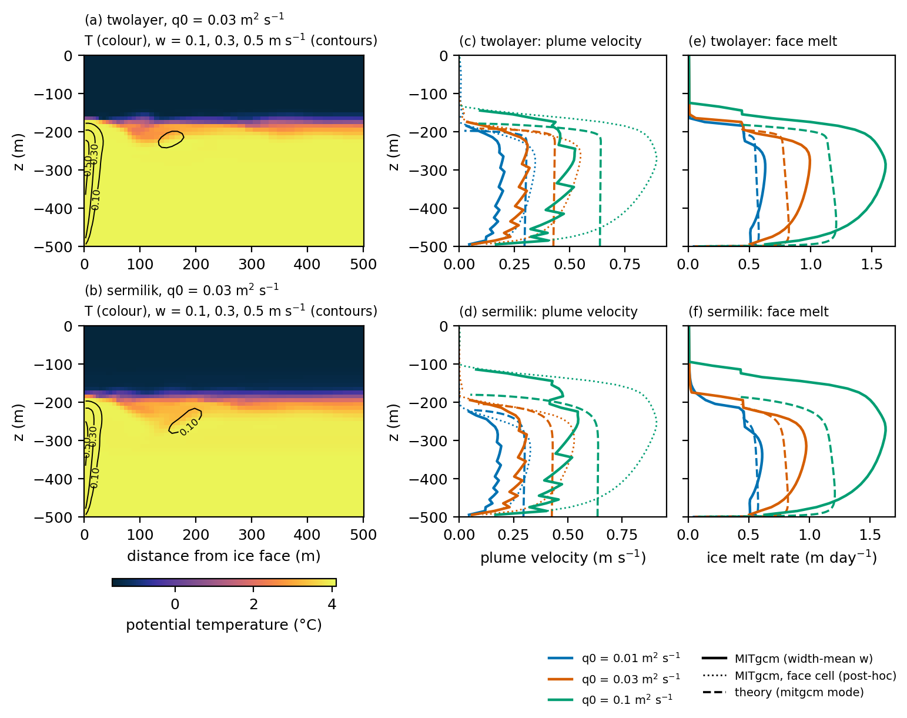
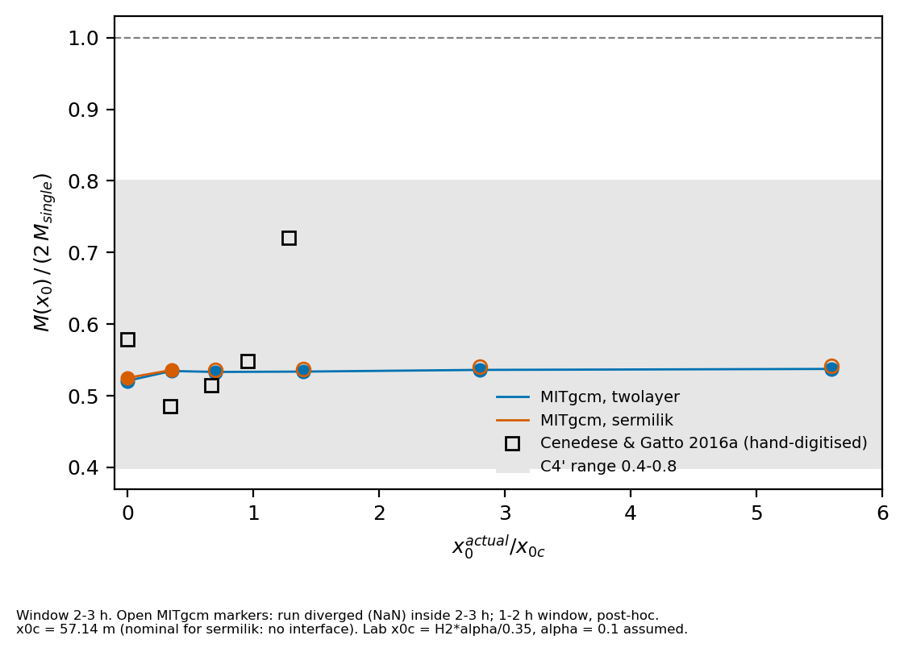
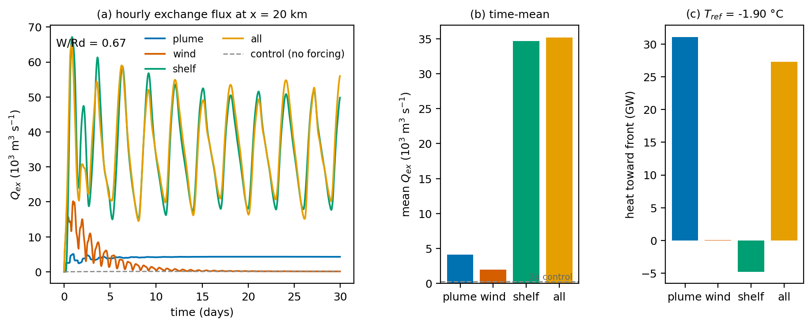

<!-- Rendered by scripts/render_readme.py: edit README.template.md, never README.md. Numbers come from figures/*.json. -->
# Experiment 1 — Subglacial discharge plumes at a tidewater glacier front: validation against plume theory, two-plume interaction, and the partition of fjord forcing

**Esteban Cruz** · idealised MITgcm experiments · PhD application portfolio (2027)

## Abstract

Subglacial discharge plumes control submarine melting at tidewater glaciers, but the theory used to parameterise them assumes an isolated plume in a quiescent ambient. We test that theory and two of its extensions with idealised MITgcm simulations. (a) A two-dimensional line plume against a vertical ice face reproduces the detachment depth of line-plume theory in 5 of 6 cases and the face-mean melt rate in 6 of 6 (model/theory 1.00–1.23), but its mean plume velocity is 0.50–0.61 of the theory's top-hat velocity, and this deficit persists at every resolution tested. (b) In three dimensions, two point plumes separated by x0 were simulated in two-layer and continuous stratification. At 10 m resolution the plume reaches the surface instead of detaching at the depth predicted by half-cone plume theory; a 5 m run detaches within 0.036 H of the theory, which attributes the failure to resolution rather than to missing physics (one stratification, two resolutions). (c) In a 40 km rotating fjord forced by a plume, an along-fjord wind pulse and a shelf pycnocline oscillation, the shelf oscillation dominates the volume exchanged at mid-fjord (8× the plume), while the plume dominates the heat carried toward the glacier. All success criteria were fixed before the runs, failed criteria are reported as failed, and every number below is read from the metrics files in `figures/`.

## 1. Introduction

### 1.1 Tidewater glaciers and ocean melting

Many outlet glaciers of the Greenland Ice Sheet end in the sea at a near-vertical ice cliff, typically several hundred metres deep, at the head of a long, narrow fjord. These are *tidewater glaciers*. Straneo & Cenedese (2015) review how mass loss from the ice sheet quadrupled over the two decades before their review, making Greenland responsible for about a quarter of the rate of sea-level rise at the time, with the widespread retreat and speed-up of marine-terminating glaciers as a major contributor. One proposed trigger is the ocean: warm water in the fjords melts the submerged ice front (*submarine melting*). This undercuts the front, promotes calving and can reduce the resistance that holds the glacier back.

The water that reaches the ice comes from the shelf and is strongly layered. Greenland fjords typically hold cold, fresh **Polar Water** (near −1.5 °C) over warm, salty **Atlantic Water** (3–4 °C) below a few hundred metres (Sciascia et al., 2013; Straneo & Cenedese, 2015). The heat available for melting therefore sits at depth, and how much of it reaches the ice depends on the circulation in the fjord.

### 1.2 Subglacial discharge plumes

In summer, meltwater produced at the surface of the ice sheet drains through crevasses and moulins to the glacier bed. It flows along the bed and leaves the glacier at the base of the ice front, at the *grounding line*, hundreds of metres below the sea surface (Jenkins, 2011; Slater et al., 2016). This is *subglacial discharge*. Because it is fresh, it is much lighter than the surrounding seawater and rises along the ice face as a turbulent **buoyant plume**.

As the plume rises it **entrains** (mixes in) ambient water. The classical entrainment hypothesis of Morton et al. (1956) states that the inflow of ambient water at each height is proportional to the plume's velocity there, with a constant of proportionality α, the *entrainment coefficient*. Three consequences follow:

- The plume grows in volume and slows down as it rises.
- It draws warm Atlantic Water against the ice, and the turbulence it creates in the boundary layer next to the ice raises the rate of heat transfer to the ice (Jenkins, 2011).
- Its buoyancy decreases with height, because the entrained water is denser than the discharge. In a stratified fjord the plume can reach a depth where its density equals that of its surroundings, the **neutral-buoyancy depth**. It then stops being pushed upward, overshoots a little on its momentum, **detaches** from the ice and spreads horizontally into the fjord. Where it detaches sets how much of the ice face it touches.

*Buoyant plume theory* turns these ideas into ordinary differential equations for the plume's width, velocity, temperature and salinity with height, coupled to a melt law at the ice. Its geometry depends on how the discharge leaves the glacier:

- a **line plume** when it emerges as a sheet along a wide stretch of the front (Jenkins, 2011);
- a **point plume** when it emerges from a single channel; against a wall it takes the shape of a half cone (Slater et al., 2016).

Fjord and climate models use the theory, directly or as a parameterisation, to estimate submarine melting (Cowton et al., 2015; Slater et al., 2016).

Real glaciers rarely have a single channel. When two channels are close, their plumes can merge and compete for the same ambient water. In laboratory experiments, Cenedese & Gatto (2016a) found that two close sources melt less ice than two isolated plumes. Their results come from a two-layer tank, and the numerical study of Kimura et al. (2014) used an unstratified ocean, so how two plumes interact in a continuously stratified fjord remains open.

### 1.3 Fjord circulation and its forcing

The plume also drives the fjord's circulation:

- **Plume-driven exchange.** Its outflow at the neutral-buoyancy depth carries glacially modified water toward the sea, and the ambient water it entrains near the glacier must be replaced by inflow from the shelf. The result is an exchange flow that brings shelf water, including Atlantic Water, toward the ice (Cowton et al., 2015; Carroll et al., 2017).
- **Wind.** Strong along-fjord winds, often katabatic winds blowing down from the ice sheet, drive an exchange that exports glacial fresh water in the upper layer and renews the warm, salty water at depth (Spall et al., 2017).
- **Shelf forcing.** Winds over the shelf raise and lower the shelf pycnocline over periods of days. That vertical motion propagates into the fjord as internal waves and drives a strong exchange known as the *intermediary circulation*, which in some East Greenland fjords dominates variability outside summer (Jackson et al., 2014, 2018; Straneo & Cenedese, 2015).

Rotation shapes all three. The relevant scale is the internal Rossby radius Rd, the distance over which rotation balances the pressure gradients of the layered flow. A fjord narrower than Rd behaves almost as a two-dimensional channel; a wider one develops cross-fjord structure and boundary currents (Carroll et al., 2017; Jackson et al., 2018).

Which forcing controls the delivery of heat to the glacier is still debated. Carroll et al. (2017) found that wind can amplify the plume-driven exchange. In a realistic model of Sermilik Fjord, Sanchez et al. (2024) found that including the plume doubles the summer exchange, which is then primarily plume-driven. Most studies compare forcings by the volume of water exchanged, but the glacier responds to the heat that reaches it, and the two need not agree.


*Figure 0.* The setting and the processes. (a) Sermilik Fjord and Helheim Glacier, SE Greenland (MODIS, 5 Aug 2022), the fjord system whose water masses the Sermilik-like profile follows; the orange bar is the fjord model domain of configuration (c) at the same scale. (b) The Helheim terminus at 30 m resolution (Harmonized Landsat Sentinel-2, 30 Jul 2022): glacier ice flows into the fjord and calves at the ice face, here backed by ice mélange. (c) Schematic of the processes (not to scale): (1) subglacial discharge: surface meltwater collects in streams and lakes, drains through a moulin to the bed, flows through linked cavities and a channel, and leaves through a portal at the grounding line as a fresh jet (inset: the channel stays open where melting by the flowing water balances creep closure of the ice); (2) the buoyant plume rises along the ice and entrains ambient water through turbulent eddies; (3) it carries heat to the ice face and melts it; (4) at its neutral-buoyancy depth it detaches and flows out; (5) warm Atlantic Water flows toward the glacier at depth to replace the entrained water; (6) along-fjord wind and (7) the heaving of the shelf pycnocline drive exchange with the shelf. (d) The plume geometries studied: a line plume fed along the whole ice face (configuration a) and two point plumes x0 apart, whose half cones widen as they rise and merge when x0 < x0c (configuration b). Imagery: NASA Worldview/GIBS; (b) contains modified Copernicus Sentinel data 2022. Drawn with VectorCraft from `figures/src/fig0_schematic.py`.

### 1.4 This experiment

Experiment 1 asks three linked questions with idealised MITgcm simulations, each building on the previous one:

1. **(a) Does a resolved plume agree with plume theory when both use the same melt law?** Model–theory comparisons are often confounded by different melt parameterisations. Here the theory is run with MITgcm's own ice-front melt law, line by line, and compared with a resolved two-dimensional line plume in two stratifications.
2. **(b) How do two neighbouring point plumes interact in a stratified ambient?** Two point plumes are placed at increasing separation along a three-dimensional ice face, in a two-layer and a continuous stratification. The total melt is compared with that of two isolated plumes, extending the laboratory experiments of Cenedese & Gatto (2016a) and the unstratified simulations of Kimura et al. (2014).
3. **(c) In a rotating fjord, how does the plume compare with wind and shelf forcing?** The plume, an along-fjord wind pulse and a shelf pycnocline oscillation are applied separately and together in one idealised fjord. Each is compared both by the volume exchanged with the shelf and by the heat carried toward the glacier.

The experiment is designed as a test of rigour as much as of physics. Success criteria were fixed before running. A failed criterion is followed by convergence or sensitivity tests rather than by tuning. Every model–reference difference is classified as (a) our error, (b) missing physics, (c) a numerical or set-up choice, or (d) an error in the reference.

## 2. Methods

### 2.1 Model and common choices

All runs use MITgcm with a linear equation of state (thermal expansion 3.87 × 10⁻⁵ K⁻¹, haline contraction 7.86 × 10⁻⁴ psu⁻¹, ρ0 = 1027 kg m⁻³) and 64-bit binary I/O. The MITgcm source code is never modified; every change lives in each configuration's `code/` directory. Inputs are generated by `gendata/make_case.py` from `cases.yaml`, and each run directory keeps a `case.json` with the parameters actually used (for example, a source separation after snapping to the grid). The analysis reads those actual values, never the nominal ones.

**Ambient water.** Every configuration starts at rest with horizontally uniform temperature and salinity, using one of two profiles built from the same two water masses (Sciascia et al., 2013, Table 2): cold, fresh Polar Water (PW, −1.5 °C, 32.9 psu) above warm, salty Atlantic Water (AW, 4.0 °C, 34.6 psu).

- **Two-layer:** a sharp interface (tanh transition, 10 m scale) at 200 m depth in (a) and 100 m in (b).
- **Sermilik-like:** a continuous pycnocline (tanh transition, 75 m wide) centred at 200 m in (a) and (c) and 100 m in (b).

In (b) the depth of the interface is chosen so that the AW layer below it is H2 = 200 m thick, the layer thickness used in the interaction criterion of Cenedese & Gatto (2016a).

**Ice face and melting.** In (a) and (b) the western boundary (x = 0) is a vertical ice face, represented with MITgcm's `icefront` package. Melting follows the package's three-equation law (`pkg/icefront/icefront_thermodynamics.F`): the heat-transfer velocity is γT = max(10⁻² √(1.5 × 10⁻³) |w|, 10⁻⁴) m s⁻¹, driven by the vertical velocity |w| of the water cell touching the ice, with γS = 5.05 × 10⁻³ γT. The ice temperature varies linearly from its surface value to 0 °C at the base. Configuration (c) has no ice-face melting; its glacier is represented only by the plume (§2.3).

**Reference theory** (`theory/`). The Jenkins (2011) line plume for (a), the Slater et al. (2016) half-cone point plume against a wall for (b) and (c), and the Morton et al. (1956) entrainment hypothesis with entrainment coefficient α = 0.1. The theory's `mitgcm` mode uses the same melt law, line by line, so that differences between model and theory are not differences in melt parameterisation.

### 2.2 Configurations

| | (a) Line plume, 2-D | (b) Two point plumes, 3-D | (c) Fjord, 3-D |
|---|---|---|---|
| Domain (x × y × z) | 20 km × one cell × 500 m | 1.0 km × 1.2 km × 300 m | 40 km × 6 km × 500 m |
| Grid | dx = 5 m at the face, stretched by 3 % per cell to 200 m; dz = 10 m | dx = dy = dz = 10 m (a 5 m subset, §3.2) | dx = dy = 200 m, dz = 10 m |
| Dynamics | non-hydrostatic, no rotation | non-hydrostatic, no rotation | hydrostatic, f = 1.37 × 10⁻⁴ s⁻¹ |
| Ice face | x = 0, melting | x = 0, melting | x = 0, no melting |
| Lateral walls | — (2-D) | closed, at y = 0 and y = 1.2 km | closed, 5.6 km apart |
| Open boundary | far end (x = 20 km): Orlanski radiation + 10-cell velocity sponge | east edge (x ≈ 1 km): Stevens (1990), interior velocity (§2.4) | fjord mouth (x ≈ 40 km): as (b), plus a 10-cell sponge in which T and S relax to the shelf profile |
| Time step / duration | 3 s / 48 h | 2 s / 3 h | 60 s / 30 days |
| Analysis window | hours 36–48 | hours 2–3 | days 0–30 (amplitude: days 6–30) |

### 2.3 Discharge and forcing

**(a) Line source.** Subglacial discharge enters as fresh water (0 °C, 0 psu) through a mass source (MITgcm `addMass`) in the bottom cell next to the ice. Being a line source, it is given per unit width of ice face: q0 = 0.01, 0.03 and 0.1 m² s⁻¹. These three values crossed with the two profiles give six cases.

**(b) Two point sources.** Each source is a mass source of Q0 = 10 m³ s⁻¹ of fresh water (0 °C, 0 psu) in a single bottom cell next to the ice.

- **Separation x0:** the distance along the ice face, in y, between the centres of the two source cells, i.e. between the two places where discharge leaves the glacier bed.
- **Placement:** the sources sit symmetrically about the centre of the face. x0 is rounded to the nearest multiple of the grid spacing (the value used is stored as `x0_actual`).
- **Cases:** x0 = 0, 20, 40, 80, 160 and 320 m in each stratification. At x0 = 0 both sources fall in the same cell, which then discharges 2Q0.
- **Reference:** a single source of Q0, used as the reference "isolated plume".
- **Critical separation x0c:** Cenedese & Gatto (2016a) predict that two plumes rising through a layer of thickness H2 interact when x0 < x0c = H2 α / 0.35. Here x0c = 57 m (H2 = 200 m, α = 0.1). This is exact for the two-layer profile and nominal for the Sermilik-like one, which has no single interface.

**(c) Fjord forcings.** A 40 km × 5.6 km flat-bottomed fjord, 500 m deep, with the glacier at x = 0 and the shelf at the mouth. Each case adds one forcing to the same initial state:

- **Plume.** At 200 m resolution the plume cannot be resolved, so it is represented by buoyant-plume theory as in Cowton et al. (2015). A half-cone plume with Q0 = 100 m³ s⁻¹ is computed once from the initial profile.
  - Below its neutral-buoyancy depth, every model level loses the volume the plume entrains there (sinks of local water).
  - All the plume water — discharge plus entrained water — is returned in the single cell at the neutral-buoyancy depth (about 181 m), with the plume's temperature and salinity. The outflow T and S are imposed by relaxation in that cell (MITgcm `rbcs`).
  - Sinks and outflow are shared by the six cross-fjord cells at the centre of the ice face. The net volume added is exactly Q0.
- **Wind.** A uniform along-fjord wind stress of 0.2 N m⁻², directed down-fjord (away from the glacier, as a katabatic wind), switched on at t = 0 for 12 hours and then off. The 12-h pulse is close to the inertial period (12.7 h). The run is done in two stages: the second restarts from the first, without the wind file.
- **Shelf.** At the mouth, the imposed temperature and salinity profiles are the Sermilik-like profile with its pycnocline centre moving as z_c(t) = 200 m − 30 m · sin(2πt / 6 days). This mimics the shelf-driven isopycnal heaving studied by Jackson et al. (2018), with their central amplitude and period. The open boundary carries the profile, and the 10-cell sponge relaxes T and S toward it (relaxation time 600 s at the boundary to 6 h at the inner edge).
- **All:** plume, wind and shelf together.
- **Control:** none of the above. It measures the spurious motion produced by the open boundary, the sponge and numerical error.

### 2.4 Open boundary

In (b) and (c), the open boundary carries a prescribed depth-mean outflow equal to the discharge (Q0 per unit boundary area), so that the volume added by the sources leaves the domain. Both configurations initially diverged under MITgcm's default Stevens (1990) condition. In that condition the baroclinic boundary velocity is updated from its own previous value (`pkg/obcs/obcs_calc_stevens.F`), so the velocity sponge relaxes the flow toward a value that the boundary itself keeps reinforcing (`obcs_sponge.F`). This produced a spurious overturning cell. Defining `OBCS_STEVENS_USE_INTERIOR_VELOCITY` in the configuration's `code/` makes the boundary use the adjacent interior velocity instead, and removes the instability. Orlanski radiation, tested first, was unstable in 3-D.

Each run must satisfy three pre-registered boundary criteria:

1. It reaches its end time with finite fields.
2. The maximum speed in the three columns next to the boundary stays below 1.5 times the interior maximum.
3. The domain-mean sea level and the net boundary transport match the imposed discharge.

All 3-D production runs pass. As an independent check of (c), the shelf-forced fjord was rebuilt in pyOCEAN, a separate z*-coordinate model with a Flather/Orlanski/sponge boundary (`crosscheck/pyocean_c/`).

### 2.5 Diagnostics and definitions

| Symbol | Meaning |
|---|---|
| H | water depth (500 m in (a) and (c), 300 m in (b)) |
| z_detach | detachment depth: going up from the depth of maximum plume velocity, the deepest level at which the vertical velocity at the ice face falls below 5 % of its maximum; interpolated between levels. In (b) the velocity is the maximum along the face. |
| M | total melt of the ice face (m³ s⁻¹ of ice), integrated over the whole face and averaged over the analysis window |
| M_single, M(x0) | M for the single-source run and for two sources at separation x0 |
| E | plume-induced melt: M minus M of a run with no discharge (same ambient, same boundary) |
| R_E | interaction ratio E(x0) / (2 E_single). R_E = 1: the two plumes melt as two isolated plumes; R_E < 1: interaction reduces melting. Cenedese & Gatto (2016a) normalise the same way. |
| Q_ex | exchange flux through a cross-fjord section at x = 20 km: Q_ex = ½ ∫ \|u\| dA, from hourly snapshots of u; for a two-layer exchange it equals the transport of one layer |
| Heat toward the front | ρ0 cp ∫ (−u)(T − T_ref) dA through the same section, from MITgcm's own advective heat flux averaged over 3-h intervals (so it includes the u–T correlations within each interval); T_ref = −1.90 °C, the freezing point at 34.6 psu |
| W/Rd | fjord width over the internal Rossby radius Rd = c/f, with c the two-layer wave speed for the initial PW/AW density difference and a 200 m upper layer; W/Rd = 0.67 makes (c) a "narrow" fjord |
| Realised amplitude | amplitude of a 6-day sine fitted to the depth of the 1.25 °C isotherm (midway between PW and AW), averaged across the fjord, over days 6–30 |

### 2.6 Pre-registered criteria

| Criterion | Configuration | Definition |
|---|---|---|
| C2 | (a) | \|z_detach(model) − z_detach(theory)\| ≤ 0.10 H |
| C2′ | (a) | mean plume velocity between the plume base and half the theory's rise height, within 25 % of the theory's (model: mean w over the plume width, the width being where w ≥ 10 % of its maximum at that depth) |
| C2″ | (a) | face-mean melt within a factor of 1.5 of the theory, each side averaged below its own z_detach |
| C4 | (b) | single plume: \|z_detach(model) − z_detach(theory)\| ≤ 0.10 H, window hours 2–3, both stratifications |
| Control rule | (c) | a forcing is interpreted only if its mean Q_ex exceeds 3 times the control's |

Further diagnostics (D1, D2, R_E, the realised amplitude) were defined in writing before they were computed. Anything defined after seeing a result is labelled post hoc. The full record, including every failure and how each was followed up, is in `notes/` (in Spanish).

## 3. Results

### 3.1 (a) The line plume agrees with theory in height and melt, not in velocity



*Figure 1.* Line plume against the ice face (a, b) and its velocity and melt profiles against line-plume theory (c–f). Full caption: `figures/fig1_caption.md`.

- **C2 (detachment depth):** passes in 5 of 6 cases (|Δz|/H = 0.009–0.141). It fails for sermilik_q0.1 (0.141 H).
- **C2″ (melt):** passes in 6 of 6 cases; model/theory = 1.00–1.23.
- **C2′ (velocity):** fails in all cases (0 of 6 pass); model/theory = 0.50–0.61.

A resolution study at dx = 10, 5 and 2.5 m (`notes/pd2_convergence.md`) gives a velocity ratio R_Q = 0.538, 0.563 and 0.573 (Richardson extrapolation 0.58), and the free-slip and vertical-resolution sensitivity runs change it by less than the pre-set threshold. The deficit is therefore not a resolution artefact (class c ruled out); the post-hoc diagnostics in the Figure 1 caption point to the difference between a resolved near-wall jet and the theory's top-hat profile.

### 3.2 (b) Two plumes: the detachment failure is resolution

**C4 fails at the production resolution.** At dx = 10 m the single plume rises to -1.9 m (two-layer) and -1.5 m (Sermilik), while half-cone theory detaches at -66.1 m and -57.5 m (|Δz|/H = 0.214 and 0.187).

**Diagnosis.** Two pre-registered diagnostics followed:

- *D1 (entrainment):* the upward volume flux next to the face is larger, not smaller, than the theory's in the lower half of the column. Most of that excess is a face-wide upwelling of 1–3 cm s⁻¹ below the interface, which also exists without any discharge: it is the convective boundary layer of ambient melting by the warm lower layer. Under-entrainment does not explain C4.
- *D2 (resolution):* the same single plume at dx = dy = dz = 5 m detaches at -55.7 m against -66.4 m in theory (|Δz|/H = 0.036, against 0.214 at 10 m; change -0.179). By the pre-registered rule (a drop larger than 0.05) the C4 failure is attributed to resolution (class c). C4 remains failed at the production resolution.

**Two-plume interaction.** Ambient melting of the whole face is 0.93 (two-layer) and 0.91 (Sermilik) of the single-plume total, so the plume signal is measured as the excess over a no-discharge background run, R_E = E(x0) / (2 E_single) (signal-to-noise 568 and 165).



| x0 (m) | 0 | 20 | 40 | 80 | 160 | 320 |
|---|---|---|---|---|---|---|
| R_E, two-layer, 10 m | 0.76 | 0.95 | 0.92 | 0.93 | 0.95 | 0.98 |
| R_E, Sermilik, 10 m | 0.78 | 0.91 | 0.89 | 0.91 | 0.95 | 0.99 |
| R_E, two-layer, 5 m | [pending] | [pending] | — | [pending] | — | — |

At 10 m, separated plumes melt almost as two independent plumes (R_E = 0.92–0.98), and only the merged source (x0 = 0) drops to 0.76. Because the 10 m plumes are under-resolved, this result is only interpreted together with the 5 m subset.

### 3.3 (c) Shelf forcing moves the most water; the plume delivers the heat



*Figure 3.* (a) Hourly exchange flux Q_ex = ½∫|u| dA at x = 20 km for the four forced cases and the control; (b) its 30-day mean, with the 3× control level dashed; (c) mean heat transport toward the glacier (T_ref = −1.90 °C). W/Rd = 0.67.

| Case | Mean Q_ex (m³ s⁻¹) | Max Q_ex (m³ s⁻¹) | × control | Heat toward the front (GW) |
|---|---|---|---|---|
| control | 94 | — | 1 | ≈ 0 |
| plume | 4,128 | 5,101 | 44 | 31.1 |
| wind | 1,994 | 20,167 | 21 | 0.0 |
| shelf | 34,631 | 67,153 | 370 | -4.8 |
| all | 35,156 | 64,936 | 375 | 27.3 |

- Every forcing exceeds 3× the control, so all are interpreted. The temperature and salinity bounds (C5′) hold in all four cases.
- The shelf oscillation reaches the glacier undiminished: its realised amplitude is 33.4 m at mid-fjord and 34.4 m 5 km from the ice (1.11 and 1.15 of the 30 m imposed at the mouth).
- It drives 8 times the plume's exchange, but almost no net heat toward the front over five full periods (-4.8 GW, against 31.1 GW for the plume). Q_ex counts reversible back-and-forth flow as exchange.
- With all forcings together the heat transport (27.3 GW) is close to the sum of the separate cases (26.3 GW).
- The wind is a 12-hour pulse; its 30-day mean dilutes a response that peaks on day 1, so it is not ranked against the continuous forcings.

**Cross-check in pyOCEAN.** The same shelf forcing runs stably for 30 days in pyOCEAN (boundary/interior velocity ≤ 0.51), with a realised amplitude of 29.6 m and a lag of 0.45 d (MITgcm: 33.4 m, 0.14 d). One pre-registered criterion failed: with 100 m³ s⁻¹ of runoff, the outflow averaged over days 20–30 was 97.48 m³ s⁻¹ (-2.5 %, tolerance ±2 %). The window spans 1.67 forcing periods; over the full 30 days the outflow is within 2 %. This diagnosis was made after the fact and does not change the verdict.

## 4. Discussion

### 4.1 What the three experiments show together

The comparisons in (a) and (b) say that plume theory predicts *where* a plume detaches and *how much* it melts when the model resolves it, but not the shape of its velocity profile: the resolved plume is a narrow near-wall jet, not a top-hat. In three dimensions this only holds at a resolution of about 5 m; at 10 m the point plume overshoots the interface. Any fjord model that resolves plumes at coarser grid spacing, or calibrates a parameterisation against such a model, inherits that bias.

The two-plume results at 10 m show weaker interaction than the laboratory (R_E = 0.92–0.98 for separated sources, against about 0.5 in Cenedese & Gatto, 2016a). With x0c spanning only about six cells, that difference cannot yet be separated from resolution; the 5 m subset is designed to do so.

Experiment (c) adds a caution about metrics. The exchange flux ½∫|u| dA ranks shelf forcing highest by an order of magnitude, yet the shelf delivers almost no net heat to the front. Which forcing "matters most" depends on whether the question is renewal of fjord water or heat for melting.

### 4.2 Relation to previous work

- **Cenedese & Gatto (2016a):** they found that close plumes melt about half as much as two independent plumes, in a two-layer laboratory tank. Experiment (b) uses the same normalisation and adds continuous stratification and a no-discharge background; at 10 m it does not reproduce the reduction, a discrepancy left open pending the 5 m runs.
- **Kimura et al. (2014):** they simulated two plumes in an unstratified ambient and found that close plumes give a higher peak but a lower face-mean melt. Experiment (b) adds stratification and shows that, in it, the detachment height is resolution-sensitive.
- **Jackson et al. (2018):** they studied shelf forcing without a plume and noted that boundary-imposed forcing is a simplification. Experiment (c) uses that simplification deliberately and measures the amplitude actually realised inside the fjord.
- **Carroll et al. (2017) and Sanchez et al. (2024):** they showed that wind amplifies plume-driven exchange and that the plume roughly doubles summer exchange in Sermilik. These are not claimed here as findings. Experiment (c) separates the forcings in a single idealised fjord and adds the heat delivered to the front.
- **Cowton et al. (2015):** experiment (c) uses their source/sink plume parameterisation, so its plume is only as good as the theory tested in (a) and (b).

### 4.3 Limitations

- (a) is two-dimensional: no along-face spreading or rotation.
- (b) is resolution-limited at 10 m (§3.2); only one stratification was run at 5 m, and two resolutions do not prove convergence. The 5 m source has a 4× higher inflow velocity than the 10 m source.
- (c) parameterises the plume and imposes the shelf forcing at the open boundary. The wind pulse (12 h) is close to the inertial period (12.7 h). The heat transport of cases with a net transport depends on T_ref (class c).
- The open boundary was fixed with a compile-time option, not tuned; it still runs 10–40 % faster than the interior in (c) (class c, declared).
- No tides, sea ice, icebergs or sills; flat bottom; linear equation of state.

## 5. Conclusions

1. With the same melt law, a resolved 2-D line plume matches line-plume theory in detachment depth and face-mean melt, but carries 0.50–0.61 of the theory's mean velocity, a deficit that does not shrink with resolution.
2. A 3-D point plume at 10 m resolution fails to detach at the theoretical depth; at 5 m it detaches within 0.036 H. The failure is numerical; in this set-up a resolved point plume needs a grid spacing of 5 m or finer (convergence not yet demonstrated).
3. Ambient melting of the whole face is about 0.93 of the total in these short runs, so plume-induced melting must be measured against a no-discharge background.
4. In an idealised rotating fjord, shelf forcing dominates the volume exchanged while the plume dominates the heat delivered to the front; in this diagnostic the forcings add nearly linearly in heat.
5. The default MITgcm Stevens open boundary is unstable for these set-ups; the interior-velocity option fixes it, as supported by an independent pyOCEAN run.

## Reproducing

```bash
bash exp1_fjord_plumes/reproduce.sh --quick   # regenerate every figure and this README from existing output
bash exp1_fjord_plumes/reproduce.sh           # full: generate inputs, build, run all campaigns, figures
```

Paths, the Python environment and compute limits are in the repository `RUNNING.md`. Figure 0 is drawn with the VectorCraft command-line tool (v0.22.0, https://github.com/storytold/vectorcraft): `python figures/src/fig0_schematic.py --cli /path/to/vectorcraft-cli`. Run output is not stored in the repository.

## References

- Carroll, D., et al. (2015). Modeling turbulent subglacial meltwater plumes. *J. Phys. Oceanogr.* https://doi.org/10.1175/JPO-D-15-0033.1
- Carroll, D., et al. (2017). Subglacial discharge-driven renewal of tidewater glacier fjords. *J. Geophys. Res. Oceans.* https://doi.org/10.1002/2017JC012962
- Cenedese, C., & Gatto, V. M. (2016a). Impact of two plumes' interaction on submarine melting of tidewater glaciers. *J. Phys. Oceanogr.* https://doi.org/10.1175/JPO-D-15-0171.1
- Cowton, T., et al. (2015). Modeling the impact of glacial runoff on fjord circulation and submarine melt rate. *J. Geophys. Res. Oceans.* https://doi.org/10.1002/2014JC010324
- Jackson, R. H., et al. (2018). The dynamics of shelf forcing in Greenlandic fjords. *J. Phys. Oceanogr.* https://doi.org/10.1175/JPO-D-18-0057.1
- Jenkins, A. (2011). Convection-driven melting near the grounding lines of ice shelves and tidewater glaciers. *J. Phys. Oceanogr.* https://doi.org/10.1175/JPO-D-11-03.1
- Kimura, S., et al. (2014). The effect of meltwater plumes on the melting of a vertical glacier face. *J. Phys. Oceanogr.* https://doi.org/10.1175/JPO-D-13-0219.1
- Morton, B. R., Taylor, G., & Turner, J. S. (1956). Turbulent gravitational convection from maintained and instantaneous sources. *Proc. R. Soc. A.* https://doi.org/10.1098/rspa.1956.0011
- Sanchez, R., et al. (2024). Relative roles of plume and coastal forcing on exchange flow variability of a glacial fjord. *J. Geophys. Res. Oceans.* https://doi.org/10.1029/2023JC020492
- Sciascia, R., et al. (2013). Seasonal variability of submarine melt rate and circulation in an East Greenland fjord. *J. Geophys. Res. Oceans.* https://doi.org/10.1002/jgrc.20142
- Slater, D. A., et al. (2016). Scalings for submarine melting at tidewater glaciers from buoyant plume theory. *J. Phys. Oceanogr.* https://doi.org/10.1175/JPO-D-15-0132.1
- Jackson, R. H., et al. (2014). Externally forced fluctuations in ocean temperature at Greenland glaciers in non-summer months. *Nat. Geosci.* https://doi.org/10.1038/NGEO2186
- Spall, M. A., et al. (2017). Katabatic wind-driven exchange in fjords. *J. Geophys. Res. Oceans.* https://doi.org/10.1002/2017JC013026
- Stevens, D. P. (1990). On open boundary conditions for three dimensional primitive equation ocean circulation models. *Geophys. Astrophys. Fluid Dyn.* [DOI to verify]
- Straneo, F., & Cenedese, C. (2015). The dynamics of Greenland's glacial fjords and their role in climate. *Annu. Rev. Mar. Sci.* https://doi.org/10.1146/annurev-marine-010213-135133
- Xu, Y., et al. (2012). Numerical experiments on subaqueous melting of Greenland tidewater glaciers in response to ocean warming and enhanced subglacial discharge. *Ann. Glaciol.* https://doi.org/10.3189/2012AoG60A139
