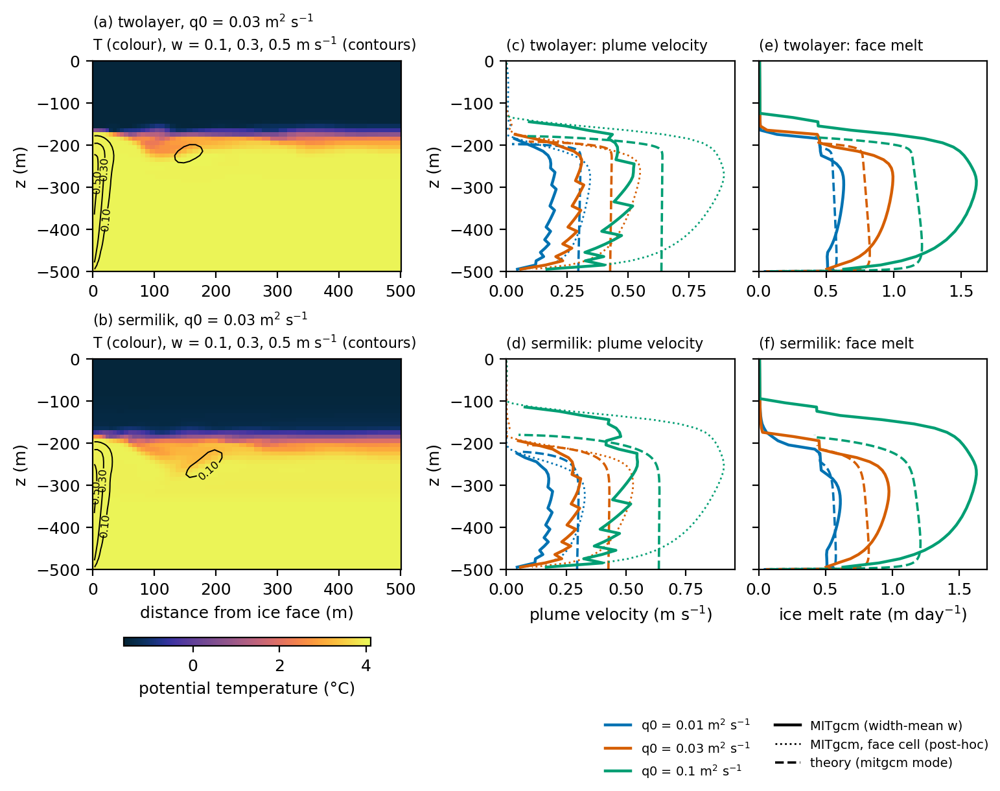
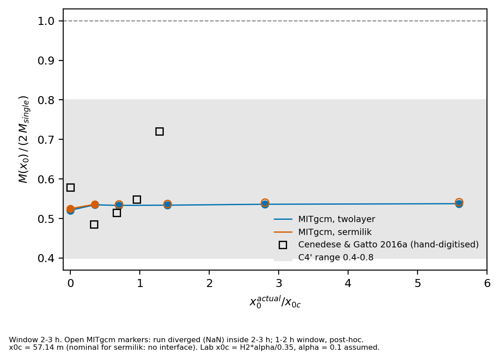
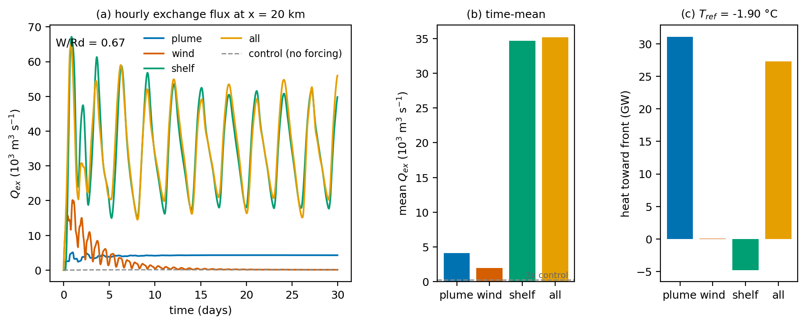

<!-- Rendered by scripts/render_readme.py: edit README.template.md, never README.md. Numbers come from figures/*.json. -->
# Experiment 1 — Subglacial discharge plumes at a tidewater glacier front: validation against plume theory, two-plume interaction, and the partition of fjord forcing

**Esteban Cruz** · idealised MITgcm experiments · PhD application portfolio (2027)

## Abstract

Subglacial discharge plumes control submarine melting at tidewater glaciers, but the theory used to parameterise them assumes an isolated plume in a quiescent ambient. We test that theory and two of its extensions with idealised MITgcm simulations. (a) A two-dimensional line plume against a vertical ice face reproduces the detachment depth of line-plume theory in {{a_C2_npass}} of {{a_ncases}} cases and the face-mean melt rate in {{a_C2pp_npass}} of {{a_ncases}} (model/theory {{a_C2pp_ratio_range}}), but its mean plume velocity is {{a_C2p_ratio_range}} of the theory's top-hat velocity, and this deficit persists at every resolution tested. (b) In three dimensions, two point plumes separated by x0 were simulated in two-layer and continuous stratification. At 10 m resolution the plume reaches the surface instead of detaching at the depth predicted by half-cone plume theory; a 5 m run detaches within {{b_D2_dx5_diff}} H of the theory, which attributes the failure to resolution rather than to missing physics (one stratification, two resolutions). (c) In a 40 km rotating fjord forced by a plume, an along-fjord wind pulse and a shelf pycnocline oscillation, the shelf oscillation dominates the volume exchanged at mid-fjord ({{c_shelf_over_plume_Qex}}× the plume), while the plume dominates the heat carried toward the glacier. All success criteria were fixed before the runs, failed criteria are reported as failed, and every number below is read from the metrics files in `figures/`.

## 1. Introduction

Ocean-driven melting at the fronts of tidewater glaciers is set by the buoyant plumes that form where subglacial meltwater leaves the glacier bed (Straneo & Cenedese, 2015). Buoyant plume theory (Morton et al., 1956; Jenkins, 2011; Slater et al., 2016) predicts how far a plume rises, how much ambient water it entrains, and therefore how much heat reaches the ice. Ocean models of glacial fjords either resolve the plume (Xu et al., 2012; Sciascia et al., 2013; Kimura et al., 2014) or replace it with a theory-based source and sink (Cowton et al., 2015; Carroll et al., 2017). Either way, the result depends on how well the theory and the model agree, and on which external forcing dominates the fjord.

Three questions motivate this experiment:

1. **Does a resolved MITgcm plume agree with plume theory when both use the same melt law?** Model–theory comparisons are often confounded by different melt parameterisations. Here the theory is run with MITgcm's own ice-front thermodynamics (`pkg/icefront`), line by line.
2. **How do two neighbouring plumes interact in a stratified fjord?** Cenedese & Gatto (2016a) found in the laboratory that two sources close together melt about half as much as two independent plumes. Kimura et al. (2014) simulated two plumes, but in an unstratified ambient. Experiment (b) extends these to two-layer and continuous stratification in three dimensions.
3. **How does the exchange driven by a plume compare with wind- and shelf-driven exchange?** Carroll et al. (2017) showed that wind amplifies plume-driven exchange, Jackson et al. (2018) studied shelf forcing without a plume, and Sanchez et al. (2024) compared plume and coastal forcing in a realistic Sermilik Fjord. Experiment (c) separates the three forcings in one idealised fjord and compares the volume exchanged with the heat delivered to the front.

The experiment is designed as a test of rigour as much as of physics: criteria were pre-registered, a failed criterion is followed by convergence or sensitivity tests rather than by tuning, and every model–reference difference is classified as (a) our error, (b) missing physics, (c) a numerical or set-up choice, or (d) an error in the reference.

## 2. Methods

### 2.1 Model and common choices

All runs use MITgcm (checkpoint in `scripts/build_mitgcm.sh`) with a linear equation of state (tAlpha = 3.87e-5 K⁻¹, sBeta = 7.86e-4 psu⁻¹), 64-bit I/O and the `icefront` package for the melt at a vertical ice face. The MITgcm source is never modified; all changes are in each configuration's `code/` directory. Inputs are generated by `gendata/make_case.py` from `cases.yaml`, which records the actual parameters of every run in `case.json` (for example, a source separation snapped to the grid).

Two ambient profiles are used throughout: a **two-layer** profile (polar water over Atlantic water, tanh interface 10 m thick) and a **Sermilik-like** continuous profile (Sciascia et al., 2013, Table 2). The reference theory (`theory/`) contains the Jenkins (2011) line plume, the Slater et al. (2016) half-cone point plume and the three-equation melt law; its `mitgcm` mode reproduces `pkg/icefront/icefront_thermodynamics.F`.

### 2.2 Configurations

| | (a) Line plume, 2-D | (b) Two point plumes, 3-D | (c) Fjord, 3-D |
|---|---|---|---|
| Domain | 20 km × 500 m, one cell in y | 1.0 km × 1.2 km × 300 m | 40 km × 6 km × 500 m |
| Resolution | dx = 5 m at the face, stretched to 200 m; dz = 10 m | dx = dy = dz = 10 m (5 m subset, §3.2) | dx = dy = 200 m, dz = 10 m |
| Dynamics | non-hydrostatic, f = 0 | non-hydrostatic, f = 0 | hydrostatic, f = 1.37e-4 s⁻¹ |
| Discharge | line source q0 = 0.01, 0.03, 0.1 m² s⁻¹ | Q0 = 10 m³ s⁻¹ per source; x0 = 0–320 m | parameterised plume, Q0 = 100 m³ s⁻¹ (source/sink, Cowton et al., 2015) |
| Forcing | — | — | plume; wind 0.2 N m⁻² for 12 h; shelf pycnocline ±30 m, 6-day period (Jackson et al., 2018); all three; no-forcing control |
| Duration | 48 h | 3 h | 30 days |
| Open boundary | far end | east edge, Stevens (1990) with interior velocity | fjord mouth, as (b), plus sponge |

In (b), x0 = 0 is a single source of 2Q0, and a single source of Q0 is the reference for M(x0)/(2 M_single), following the normalisation of Cenedese & Gatto (2016a). The critical separation x0c = H2 α / 0.35 = 57 m (their criterion, H2 = 200 m, α = 0.1).

### 2.3 Open boundary

Both 3-D configurations initially diverged under MITgcm's default Stevens (1990) open boundary: the boundary velocity relaxes towards its own previous value, so the sponge reinforces rather than damps a spurious overturning cell (`pkg/obcs/obcs_calc_stevens.F`, `obcs_sponge.F`). Setting `OBCS_STEVENS_USE_INTERIOR_VELOCITY` in the configuration's `code/` fixes it. Each run must satisfy three pre-registered boundary criteria: it reaches its end time with finite fields; the boundary velocity stays below 1.5 times the interior maximum; and the domain-mean sea level and net boundary transport match the imposed discharge. All 3-D production runs pass.

As an independent check of (c), the shelf-forced fjord was rebuilt in pyOCEAN, a separate z*-coordinate model with a Flather/Orlanski/sponge boundary (`crosscheck/pyocean_c/`).

### 2.4 Pre-registered criteria

| Criterion | Configuration | Definition |
|---|---|---|
| C2 | (a) | detachment depth within 0.10 H of the theory |
| C2′ | (a) | lower-half mean plume velocity within 25 % of the theory |
| C2″ | (a) | face-mean melt within a factor of 1.5 of the theory |
| C4 | (b) | detachment depth of the single plume within 0.10 H of half-cone theory, 2–3 h window, both stratifications |
| Control | (c) | a forcing is interpreted only if its mean exchange exceeds 3× that of the no-forcing control |

Further diagnostics (D1, D2, the plume-excess ratio R_E, the realised shelf amplitude) were defined in writing before they were computed; anything defined after seeing a result is labelled post hoc. The full record, including the failures, is in `notes/` (Spanish).

## 3. Results

### 3.1 (a) The line plume agrees with theory in height and melt, not in velocity



*Figure 1.* Line plume against the ice face (a, b) and its velocity and melt profiles against line-plume theory (c–f). Full caption: `figures/fig1_caption.md`.

- **C2 (detachment depth):** passes in {{a_C2_npass}} of {{a_ncases}} cases (|Δz|/H = {{a_C2_diff_range}}). It fails for {{a_C2_fail_cases}} ({{a_C2_fail_diff}} H).
- **C2″ (melt):** passes in {{a_C2pp_npass}} of {{a_ncases}} cases; model/theory = {{a_C2pp_ratio_range}}.
- **C2′ (velocity):** fails in all cases ({{a_C2p_npass}} of {{a_ncases}} pass); model/theory = {{a_C2p_ratio_range}}.

A resolution study at dx = 10, 5 and 2.5 m (`notes/pd2_convergence.md`) gives a velocity ratio R_Q = {{a_RQ_10}}, {{a_RQ_5}} and {{a_RQ_2p5}} (Richardson extrapolation {{a_RQ_ext}}), and the free-slip and vertical-resolution sensitivity runs change it by less than the pre-set threshold. The deficit is therefore not a resolution artefact (class c ruled out); the post-hoc diagnostics in the Figure 1 caption point to the difference between a resolved near-wall jet and the theory's top-hat profile.

### 3.2 (b) Two plumes: the detachment failure is resolution

**C4 fails at the production resolution.** At dx = 10 m the single plume rises to {{b_C4_twolayer_model}} m (two-layer) and {{b_C4_sermilik_model}} m (Sermilik), while half-cone theory detaches at {{b_C4_twolayer_theory}} m and {{b_C4_sermilik_theory}} m (|Δz|/H = {{b_C4_twolayer_diff}} and {{b_C4_sermilik_diff}}).

**Diagnosis.** Two pre-registered diagnostics followed:

- *D1 (entrainment):* the upward volume flux next to the face is larger, not smaller, than the theory's in the lower half of the column. Most of that excess is a face-wide upwelling of 1–3 cm s⁻¹ below the interface, which also exists without any discharge: it is the convective boundary layer of ambient melting by the warm lower layer. Under-entrainment does not explain C4.
- *D2 (resolution):* the same single plume at dx = dy = dz = 5 m detaches at {{b_D2_dx5_model}} m against {{b_D2_dx5_theory}} m in theory (|Δz|/H = {{b_D2_dx5_diff}}, against {{b_D2_dx10_diff}} at 10 m; change {{b_D2_delta}}). By the pre-registered rule (a drop larger than 0.05) the C4 failure is attributed to resolution (class c). C4 remains failed at the production resolution.

**Two-plume interaction.** Ambient melting of the whole face is {{b_bg_frac_twolayer}} (two-layer) and {{b_bg_frac_sermilik}} (Sermilik) of the single-plume total, so the plume signal is measured as the excess over a no-discharge background run, R_E = E(x0) / (2 E_single) (signal-to-noise {{b_eps_ratio_twolayer}} and {{b_eps_ratio_sermilik}}).



| x0 (m) | 0 | 20 | 40 | 80 | 160 | 320 |
|---|---|---|---|---|---|---|
| R_E, two-layer, 10 m | {{b_RE_twolayer_0}} | {{b_RE_twolayer_20}} | {{b_RE_twolayer_40}} | {{b_RE_twolayer_80}} | {{b_RE_twolayer_160}} | {{b_RE_twolayer_320}} |
| R_E, Sermilik, 10 m | {{b_RE_sermilik_0}} | {{b_RE_sermilik_20}} | {{b_RE_sermilik_40}} | {{b_RE_sermilik_80}} | {{b_RE_sermilik_160}} | {{b_RE_sermilik_320}} |
| R_E, two-layer, 5 m | {{b5_RE_0}} | {{b5_RE_20}} | — | {{b5_RE_80}} | — | — |

At 10 m, separated plumes melt almost as two independent plumes (R_E = {{b_RE_twolayer_sep_range}}), and only the merged source (x0 = 0) drops to {{b_RE_twolayer_0}}. Because the 10 m plumes are under-resolved, this result is only interpreted together with the 5 m subset.

### 3.3 (c) Shelf forcing moves the most water; the plume delivers the heat



*Figure 3.* (a) Hourly exchange flux Q_ex = ½∫|u| dA at x = 20 km for the four forced cases and the control; (b) its 30-day mean, with the 3× control level dashed; (c) mean heat transport toward the glacier (T_ref = −1.90 °C). W/Rd = {{c_W_over_Rd}}.

| Case | Mean Q_ex (m³ s⁻¹) | Max Q_ex (m³ s⁻¹) | × control | Heat toward the front (GW) |
|---|---|---|---|---|
| control | {{c_ctrl_Qex}} | — | 1 | ≈ 0 |
| plume | {{c_plume_Qex}} | {{c_plume_Qexmax}} | {{c_plume_xctrl}} | {{c_plume_heat}} |
| wind | {{c_wind_Qex}} | {{c_wind_Qexmax}} | {{c_wind_xctrl}} | {{c_wind_heat}} |
| shelf | {{c_shelf_Qex}} | {{c_shelf_Qexmax}} | {{c_shelf_xctrl}} | {{c_shelf_heat}} |
| all | {{c_all_Qex}} | {{c_all_Qexmax}} | {{c_all_xctrl}} | {{c_all_heat}} |

- Every forcing exceeds 3× the control, so all are interpreted. The temperature and salinity bounds (C5′) hold in {{c_C5p_all}}.
- The shelf oscillation reaches the glacier undiminished: its realised amplitude is {{c_amp_shelf_20}} m at mid-fjord and {{c_amp_shelf_5}} m 5 km from the ice ({{c_ampr_shelf_20}} and {{c_ampr_shelf_5}} of the 30 m imposed at the mouth).
- It drives {{c_shelf_over_plume_Qex}} times the plume's exchange, but almost no net heat toward the front over five full periods ({{c_shelf_heat}} GW, against {{c_plume_heat}} GW for the plume). Q_ex counts reversible back-and-forth flow as exchange.
- With all forcings together the heat transport ({{c_all_heat}} GW) is close to the sum of the separate cases ({{c_heat_sum_parts}} GW).
- The wind is a 12-hour pulse; its 30-day mean dilutes a response that peaks on day 1, so it is not ranked against the continuous forcings.

**Cross-check in pyOCEAN.** The same shelf forcing runs stably for 30 days in pyOCEAN (boundary/interior velocity ≤ {{py_pyo_shelf_c3}}), with a realised amplitude of {{py_pyo_shelf_amp}} m and a lag of {{py_pyo_shelf_lag}} d (MITgcm: {{c_amp_shelf_20}} m, {{c_lag_shelf_20}} d). One pre-registered criterion failed: with 100 m³ s⁻¹ of runoff, the outflow averaged over days 20–30 was {{py_runoff_Qout}} m³ s⁻¹ ({{py_runoff_rel}} %, tolerance ±2 %). The window spans 1.67 forcing periods; over the full 30 days the outflow is within 2 %. This diagnosis was made after the fact and does not change the verdict.

## 4. Discussion

### 4.1 What the three experiments show together

The comparisons in (a) and (b) say that plume theory predicts *where* a plume detaches and *how much* it melts when the model resolves it, but not the shape of its velocity profile: the resolved plume is a narrow near-wall jet, not a top-hat. In three dimensions this only holds at a resolution of about 5 m; at 10 m the point plume overshoots the interface. Any fjord model that resolves plumes at coarser grid spacing, or calibrates a parameterisation against such a model, inherits that bias.

The two-plume results at 10 m show weaker interaction than the laboratory (R_E = {{b_RE_twolayer_sep_range}} for separated sources, against about 0.5 in Cenedese & Gatto, 2016a). With x0c spanning only about six cells, that difference cannot yet be separated from resolution; the 5 m subset is designed to do so.

Experiment (c) adds a caution about metrics. The exchange flux ½∫|u| dA ranks shelf forcing highest by an order of magnitude, yet the shelf delivers almost no net heat to the front. Which forcing "matters most" depends on whether the question is renewal of fjord water or heat for melting.

### 4.2 Relation to previous work

- **Cenedese & Gatto (2016a):** they found that close plumes melt about half as much as two independent plumes, in a two-layer laboratory tank. Experiment (b) uses the same normalisation and adds continuous stratification and a no-discharge background; at 10 m it does not reproduce the reduction, a discrepancy left open pending the 5 m runs.
- **Kimura et al. (2014):** they simulated two plumes in an unstratified ambient and found that close plumes give a higher peak but a lower face-mean melt. Experiment (b) adds stratification and shows that, in it, the detachment height is resolution-sensitive.
- **Jackson et al. (2018):** they studied shelf forcing without a plume and noted that boundary-imposed forcing is a simplification. Experiment (c) uses that simplification deliberately and measures the amplitude actually realised inside the fjord.
- **Carroll et al. (2017) and Sanchez et al. (2024):** they showed that wind amplifies plume-driven exchange and that the plume roughly doubles summer exchange in Sermilik. These are not claimed here as findings. Experiment (c) separates the forcings in a single idealised fjord and adds the heat delivered to the front.
- **Cowton et al. (2015):** experiment (c) uses their source/sink plume parameterisation, so its plume is only as good as the theory tested in (a) and (b).

### 4.3 Limitations

- (a) is two-dimensional: no along-face spreading or rotation.
- (b) is resolution-limited at 10 m (§3.2); only one stratification was run at 5 m, and two resolutions do not prove convergence. The 5 m source has a 4× higher inflow velocity than the 10 m source.
- (c) parameterises the plume and imposes the shelf forcing at the open boundary. The wind pulse (12 h) is close to the inertial period (12.7 h). The heat transport of cases with a net transport depends on T_ref (class c).
- The open boundary was fixed with a compile-time option, not tuned; it still runs 10–40 % faster than the interior in (c) (class c, declared).
- No tides, sea ice, icebergs or sills; flat bottom; linear equation of state.

## 5. Conclusions

1. With the same melt law, a resolved 2-D line plume matches line-plume theory in detachment depth and face-mean melt, but carries {{a_C2p_ratio_range}} of the theory's mean velocity, a deficit that does not shrink with resolution.
2. A 3-D point plume at 10 m resolution fails to detach at the theoretical depth; at 5 m it detaches within {{b_D2_dx5_diff}} H. The failure is numerical; in this set-up a resolved point plume needs a grid spacing of 5 m or finer (convergence not yet demonstrated).
3. Ambient melting of the whole face is about {{b_bg_frac_twolayer}} of the total in these short runs, so plume-induced melting must be measured against a no-discharge background.
4. In an idealised rotating fjord, shelf forcing dominates the volume exchanged while the plume dominates the heat delivered to the front; in this diagnostic the forcings add nearly linearly in heat.
5. The default MITgcm Stevens open boundary is unstable for these set-ups; the interior-velocity option fixes it, as supported by an independent pyOCEAN run.

## Reproducing

```bash
bash exp1_fjord_plumes/reproduce.sh --quick   # regenerate every figure and this README from existing output
bash exp1_fjord_plumes/reproduce.sh           # full: generate inputs, build, run all campaigns, figures
```

Paths, the Python environment and compute limits are in the repository `RUNNING.md`. Run output is not stored in the repository.

## References

- Carroll, D., et al. (2015). Modeling turbulent subglacial meltwater plumes. *J. Phys. Oceanogr.* https://doi.org/10.1175/JPO-D-15-0033.1
- Carroll, D., et al. (2017). Subglacial discharge-driven renewal of tidewater glacier fjords. *J. Geophys. Res. Oceans.* https://doi.org/10.1002/2017JC012962
- Cenedese, C., & Gatto, V. M. (2016a). Impact of two plumes' interaction on submarine melting of tidewater glaciers. *J. Phys. Oceanogr.* https://doi.org/10.1175/JPO-D-15-0171.1
- Cowton, T., et al. (2015). Modeling the impact of glacial runoff on fjord circulation and submarine melt rate. *J. Geophys. Res. Oceans.* https://doi.org/10.1002/2014JC010324
- Jackson, R. H., et al. (2018). The dynamics of shelf forcing in Greenlandic fjords. *J. Phys. Oceanogr.* https://doi.org/10.1175/JPO-D-18-0057.1
- Jenkins, A. (2011). Convection-driven melting near the grounding lines of ice shelves and tidewater glaciers. *J. Phys. Oceanogr.* https://doi.org/10.1175/JPO-D-11-03.1
- Kimura, S., et al. (2014). The effect of meltwater plumes on the melting of a vertical glacier face. *J. Phys. Oceanogr.* https://doi.org/10.1175/JPO-D-13-0219.1
- Morton, B. R., Taylor, G., & Turner, J. S. (1956). Turbulent gravitational convection from maintained and instantaneous sources. *Proc. R. Soc. A.* https://doi.org/10.1098/rspa.1956.0011
- Sanchez, R., et al. (2024). Relative roles of plume and coastal forcing on exchange flow variability of a glacial fjord. *J. Geophys. Res. Oceans.* https://doi.org/10.1029/2023JC020492
- Sciascia, R., et al. (2013). Seasonal variability of submarine melt rate and circulation in an East Greenland fjord. *J. Geophys. Res. Oceans.* https://doi.org/10.1002/jgrc.20142
- Slater, D. A., et al. (2016). Scalings for submarine melting at tidewater glaciers from buoyant plume theory. *J. Phys. Oceanogr.* https://doi.org/10.1175/JPO-D-15-0132.1
- Stevens, D. P. (1990). On open boundary conditions for three dimensional primitive equation ocean circulation models. *Geophys. Astrophys. Fluid Dyn.* [DOI to verify]
- Straneo, F., & Cenedese, C. (2015). The dynamics of Greenland's glacial fjords and their role in climate. *Annu. Rev. Mar. Sci.* https://doi.org/10.1146/annurev-marine-010213-135133
- Xu, Y., et al. (2012). Numerical experiments on subaqueous melting of Greenland tidewater glaciers in response to ocean warming and enhanced subglacial discharge. *Ann. Glaciol.* https://doi.org/10.3189/2012AoG60A139
