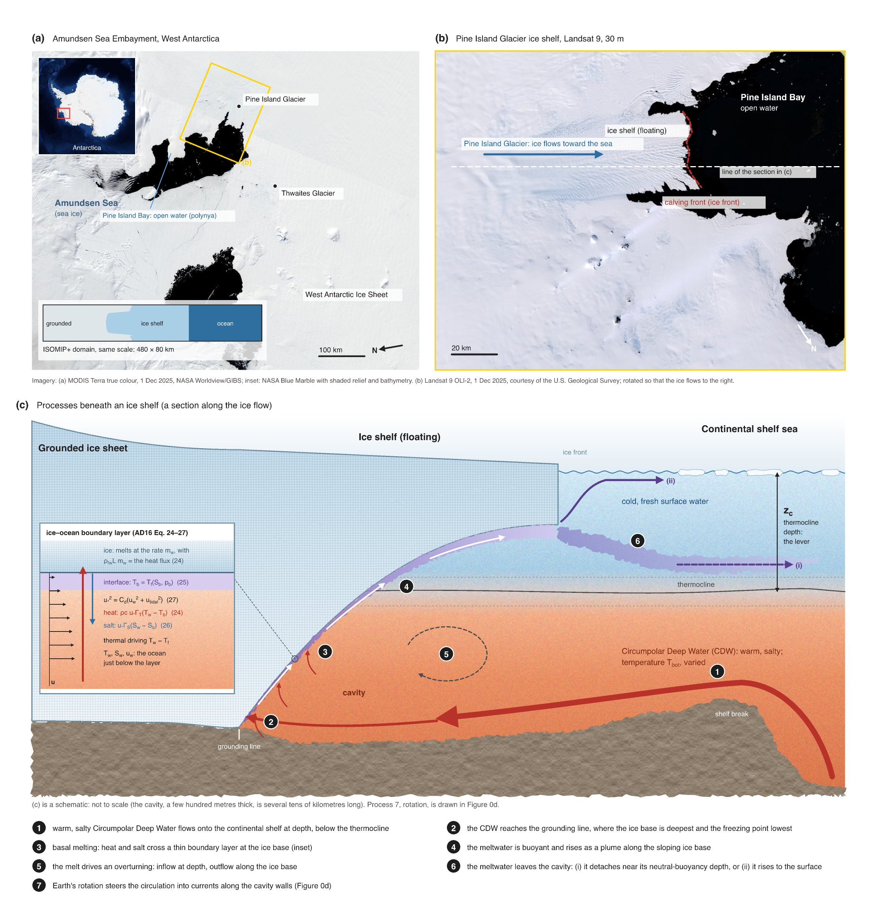
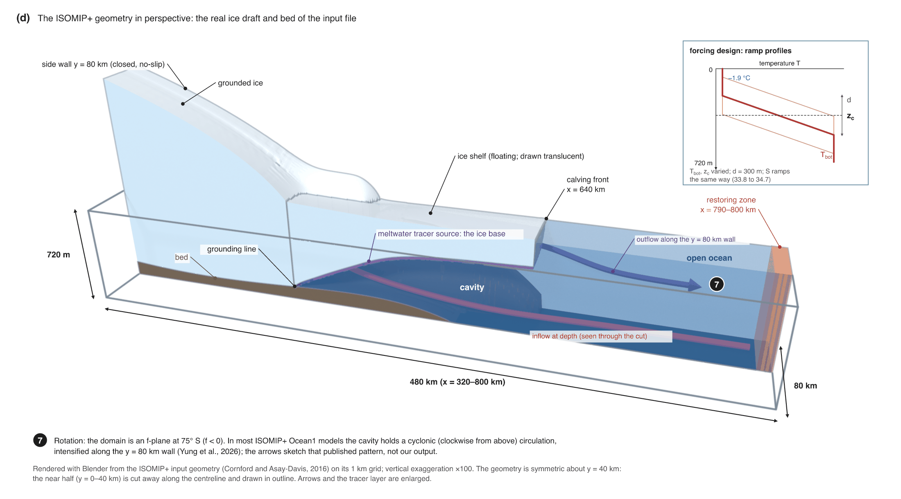
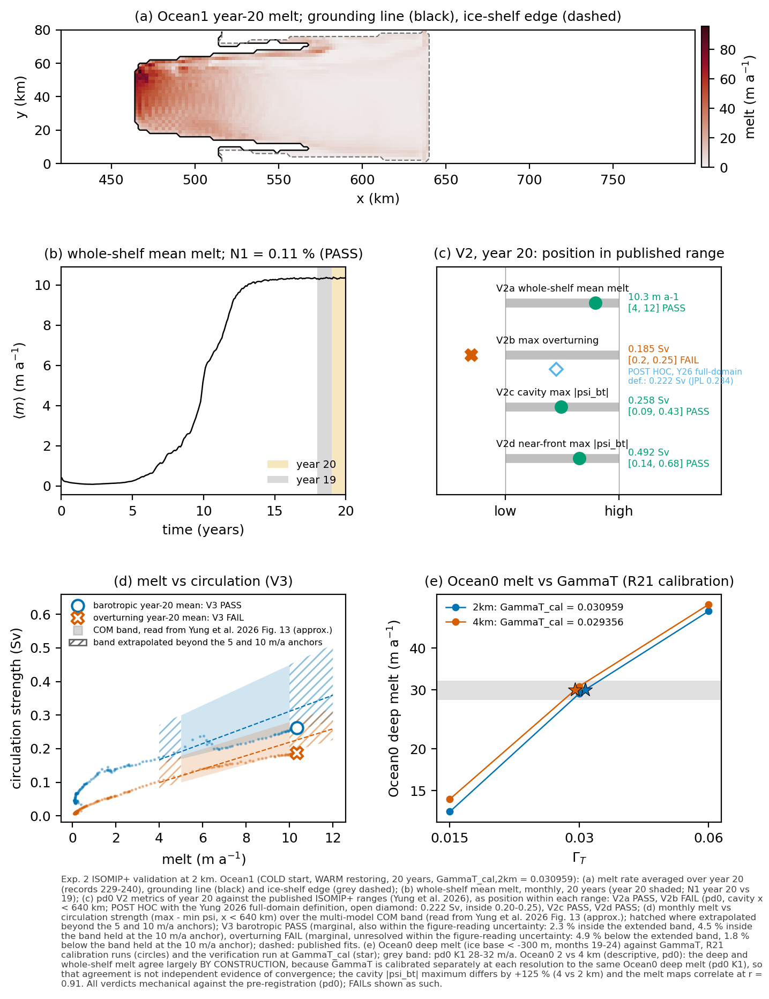
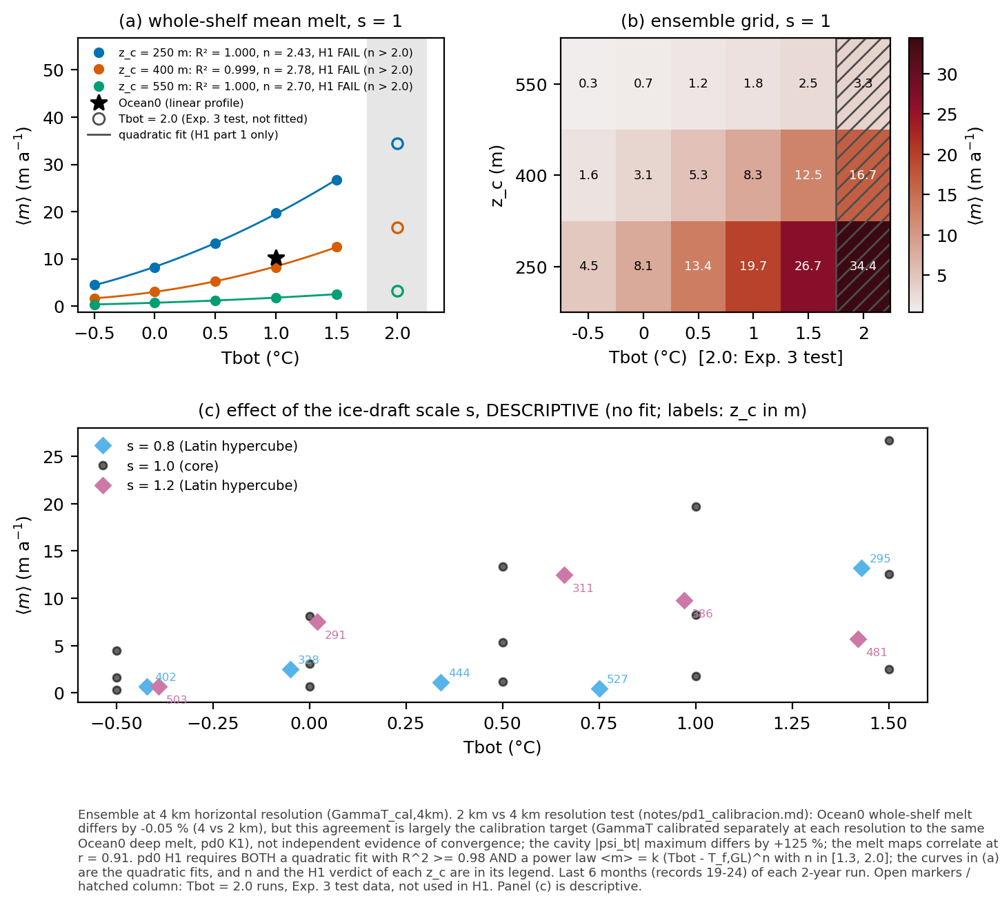
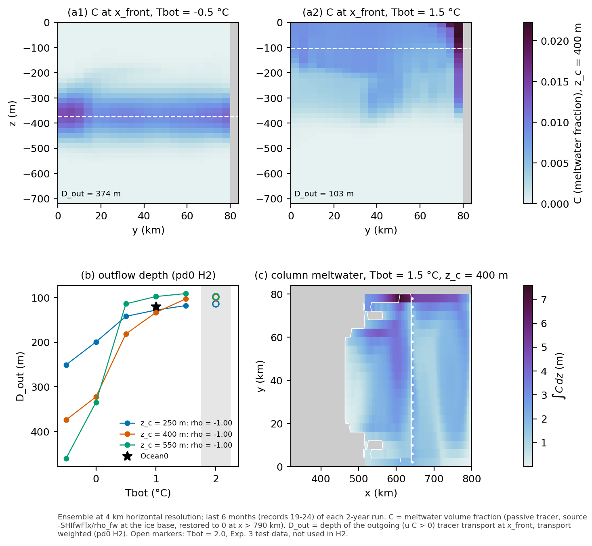

<!-- Rendered by scripts/render_readme.py: edit README.template.md, never README.md. Numbers come from figures/*.json. -->
# Experiment 2 — An ISOMIP+ ice-shelf cavity in MITgcm: how basal melt responds to warm deep water and thermocline depth, and where the meltwater leaves

**Esteban Cruz** · idealised MITgcm experiments · PhD application portfolio (2027)

## Abstract

Warm Circumpolar Deep Water that reaches the cavities beneath Antarctic ice shelves drives most of their basal melting. Two questions follow: how sensitive is the melt rate to the temperature of that water and to the depth of the thermocline above it, and at what depth does the meltwater leave the cavity? We set up the ISOMIP+ ice-shelf cavity (Asay-Davis et al., 2016) in MITgcm, calibrated its heat-transfer coefficient as the protocol prescribes, and checked it against the published ISOMIP+ results (Yung et al., 2026) and against the MITgcm-JPL submission. We then ran a 28-member ensemble at 4 km in which the bottom temperature Tbot, the thermocline depth z_c and the ice-draft depth vary. The 20-year Ocean1 run at 2 km has a year-20 mean melt rate of 10.34 m a⁻¹, inside the published range, and its barotropic circulation is in range too, but its cavity overturning is below the pre-registered range (0.185 Sv against 0.20–0.25 Sv). The pre-registered Holland et al. (2008) form of the melt response fails: the melt is fitted almost perfectly by a quadratic in Tbot (R² ≥ 0.9995), but its power-law exponent is 2.43–2.78, above the pre-registered band [1.3, 2.0], at all three thermocline depths. Post hoc analyses are consistent with the partial exposure of the ice base to warm water playing a role, but the exposure test whose reading rule was written before its runs did not support it as the explanation. The second hypothesis holds: at every thermocline depth the meltwater leaves the cavity at shallower depths as Tbot increases (Spearman ρ = −1.0). An error of ours in the friction-velocity law was found by comparing with MITgcm-JPL output, and every run used for a result was repeated. All success criteria were fixed before the runs, failed criteria are reported as failed, and every number below is read from the metrics files in `figures/`.

## 1. Introduction

### 1.1 Ice shelves and warm deep water

Around Antarctica, the ice sheet flows into the ocean and floats as ice shelves, several hundred metres thick. The ocean circulates in the cavity beneath each shelf and melts its base. Where relatively warm Circumpolar Deep Water (CDW) crosses the continental shelf and reaches the cavity, as in the Amundsen Sea, basal melting is fast and has driven the retreat of West Antarctic glaciers (Jenkins et al., 2018). The CDW lies below a colder, fresher surface layer, separated from it by a thermocline. How much heat reaches the ice therefore depends both on the temperature of the deep water and on the depth of the thermocline relative to the ice base (De Rydt et al., 2014; Jenkins et al., 2018).

### 1.2 How melt responds to ocean temperature

Holland et al. (2008) ran an idealised cavity model across a range of deep-water temperatures. Their area-mean melt rate grew as a quadratic of the thermal forcing, the excess of the ocean temperature over the freezing point. The reason is a feedback: a warmer ocean melts more, the meltwater makes the boundary current under the ice more buoyant and faster, and the faster current transfers heat to the ice more efficiently. In their model the velocity and the temperature difference across the boundary layer both grew linearly with the forcing, but with non-zero intercepts, so their product, the melt, was a quadratic with significant linear and constant terms. Fitted with a single power law instead, their results gave an exponent of 1.61; a strict square law arises only when both factors are proportional to the forcing, as in the theory of MacAyeal (1984) that they discuss (Holland et al., 2008, §4; MacAyeal's paper is cited through theirs, not read by us). Quadratic melt laws in thermal forcing are now widely used to parameterise basal melting in ice-sheet models (Favier et al., 2019; Burgard et al., 2022).

Real cavities are not filled with uniform warm water. When the thermocline lies within the depth range of the ice base, raising or lowering it changes the area of the base exposed to warm water, and the melt response then depends on the geometry of the ice as well as on the water temperature (De Rydt et al., 2014; Hattermann et al., 2014). In this experiment the depth of the thermocline is varied systematically together with the deep-water temperature, to see how it changes the response.

### 1.3 Where the meltwater goes

The meltwater leaves the cavity as part of a buoyant outflow, mixed with the ambient water it entrained on its way up. The depth at which it leaves sets where it spreads in the ocean: near the surface, where it can affect sea-ice formation and surface stratification, or at depth, where it modifies intermediate water masses. This destination of glacial meltwater, and its effect on the wider ocean circulation, is the subject of the ARIES studentship project supervised by P. Sheehan (ARIES DTP, 2026). Experiment 2 gives a first, idealised answer: it measures the depth of the meltwater outflow at the ice front as a function of Tbot and z_c.





*Figure 0.* The setting, the processes and the model geometry. (a) The Amundsen Sea Embayment, West Antarctica (MODIS Terra, 1 Dec 2025). The ISOMIP+ geometry has qualitative similarities to the Pine Island Glacier ice shelf and this region (Asay-Davis et al., 2016, hereafter AD16), where warm Circumpolar Deep Water reaches the ice shelves through deep troughs on the continental shelf (Jenkins et al., 2018). Inset: Antarctica (NASA Blue Marble with bathymetry), the region of (a) in red. The bar at bottom left is the ISOMIP+ model domain at the same scale, drawn from its geometry file: grounded ice, ice shelf and open ocean. (b) The Pine Island Glacier ice shelf at 30 m resolution (Landsat 9, 1 Dec 2025), rotated so that the ice flows to the right, as in (c) and (d); the dashed white line is the line of the section in (c). (c) Schematic of the processes (not to scale): (1) warm, salty CDW flows onto the continental shelf at depth, below a thermocline that separates it from cold, fresh surface water; (2) it reaches the grounding line, where the ice base is deepest and the pressure-dependent freezing point lowest; (3) it melts the ice base: heat and salt cross a thin boundary layer at rates set by the friction velocity u* and the thermal driving T_w − T_f(S, p) (inset: the three-equation melt law of ISOMIP+, AD16 Eq. 24–27); (4) the meltwater is buoyant and rises as a plume along the sloping ice base; (5) the melt drives an overturning, with inflow at depth and outflow along the ice base; (6) the meltwater leaves the cavity, either (i) detaching near its neutral-buoyancy depth or (ii) rising to the surface, the two regimes described by Holland et al. (2008, §4), drawn here as possibilities rather than as a result. The thermocline depth z_c and the deep-water temperature Tbot are the two forcing parameters this experiment varies. (d) The ISOMIP+ geometry in perspective, rendered from the input file (Cornford and Asay-Davis, 2016) with vertical exaggeration ×100 and the near half cut away along the centreline, about which the geometry is symmetric. It shows the grounded ice, the ice shelf (drawn translucent) ending at the calving front at x = 640 km, the cavity, the open ocean to x = 800 km and the restoring zone at 790–800 km. The domain is 480 × 80 km and 720 m deep, with closed side walls, and the meltwater tracer enters at the ice base. (7) Rotation: the domain is an f-plane at 75° S, and in most ISOMIP+ Ocean1 models the cavity holds a cyclonic (clockwise from above) circulation, intensified along the y = 80 km wall (Yung et al., 2026); the arrows sketch that published pattern. The inset of (d) shows the ramp profiles of the ensemble (§2.3). No panel shows model output. Imagery: (a) NASA Worldview/GIBS (MODIS; inset NASA Blue Marble, NASA Earth Observatory); (b) Landsat 9 imagery courtesy of the U.S. Geological Survey, accessed through the Microsoft Planetary Computer. Drawn with VectorCraft from `figures/src/fig0_schematic.py`; (d) rendered with Blender from `figures/src/fig0_geometry_blender.py` and annotated with VectorCraft from `figures/src/fig0_geometry.py`.

### 1.4 ISOMIP+ and the MITgcm entries

The second Ice Shelf–Ocean Model Intercomparison Project (ISOMIP+) defines a common idealised cavity, forcing and output (Asay-Davis et al., 2016). Its results across many models, including three MITgcm configurations, are published (Yung et al., 2026). One of them, MITgcm-JPL (Nakayama and Menemenlis), has its full output openly available (OSF project, doi:10.17605/OSF.IO/QNA89). Running the same protocol gives an external check on our configuration before we change the forcing.

### 1.5 This experiment

Experiment 2 asks two questions, with the validation needed before either can be trusted:

1. **How sensitive is basal melt to the deep-water temperature Tbot and the thermocline depth z_c?** The pre-registered hypothesis H1 was that, at each thermocline depth, the whole-shelf mean melt follows the Holland et al. (2008) form: a quadratic in Tbot, with a power-law exponent between 1.3 and 2.0.
2. **Where does the meltwater leave the cavity?** The pre-registered hypothesis H2 was that the meltwater outflow at the ice front becomes shallower as Tbot increases, at each thermocline depth.

The ensemble also provides the training and test data of Experiment 3, a machine-learning emulator of the melt pattern.

As in Experiment 1, every criterion was fixed before the runs. A failed criterion is followed by diagnostics, never by tuning, and every model–reference difference is classified as (a) our error, (b) missing physics, (c) a numerical or set-up choice, or (d) an error in the reference.

## 2. Methods

### 2.1 Model, domain and geometry

All runs use MITgcm, hydrostatic, with the ISOMIP+ configuration of Asay-Davis et al. (2016, hereafter AD16):

- **Domain:** x = 320–800 km (along the flow, from the grounded ice towards the open ocean), y = 0–80 km, 720 m deep, on an f-plane at 75° S. The ice shelf ends at a front near x = 640 km; the open ocean beyond it is restored to the prescribed profile at x = 790–800 km.
- **Grids:** 2 km (240 × 40 columns) for Ocean0 and Ocean1, and 4 km (120 × 20) for the ensemble, which a 2 km ensemble would not have fitted in the compute budget. 36 levels of 20 m, with partial cells (minimum fraction 0.2) at the bed and at the ice base.
- **Geometry (bed and ice draft).** Both come from the official ISOMIP+ geometry file (Cornford and Asay-Davis, 2016; 1 km grid), block-averaged 2 × 2 or 4 × 4 onto the model grid. Taking the bed from the same file as the draft, with the same averaging, keeps the grounding line consistent between them; the file's bed is the interpolated version of the analytic MISMIP+ bed (AD16 Eq. 1–3), which the code keeps only as a documented check. Ice thinner than 100 m is removed (AD16 §3.1.2), a model column is ice shelf only if most of its 1 km sub-cells float, and a column with less than two wet cells (40 m) is made dry, as grounded ice. No wet cell is left disconnected from the open ocean.
- **Walls.** MITgcm's Cartesian domain is periodic by default. A first smoke run showed flow through the y = 0 / 80 km boundary, against AD16's closed walls; the y boundary was closed with a row of land, and the x boundary is closed because the first column is always dry under grounded ice. Every run reported here has closed, no-slip side walls.
- **Equation of state and mixing:** linear (AD16 Eq. 23); horizontal viscosity and diffusivity 6 and 1 m² s⁻¹, vertical 10⁻³ and 5 × 10⁻⁵ m² s⁻¹, enhanced vertical diffusivity (0.1 m² s⁻¹) for static instability (AD16 Table 4). Non-linear free surface.
- **Advection** of temperature, salinity and tracer: the second-order flux-limited scheme (MITgcm scheme 77). Yung et al. (2026) attribute spurious behaviour in the MITgcm entries to the third-order scheme (33).

### 2.2 Basal melt

Melting follows the ISOMIP+ three-equation law with constant transfer coefficients (AD16 Eq. 24–27): the heat and salt fluxes through the boundary layer are γT (Tw − Tb) and γS (Sw − Sb), with γT = ΓT u*, γS = ΓT u* / 35, and the friction velocity

u*² = Cd (u² + u_tidal²),   Cd = 2.5 × 10⁻³,  u_tidal = 0.01 m s⁻¹   (AD16 Eq. 27).

Tw, Sw and u are averaged over one cell thickness below the ice (the Losch, 2008, boundary layer of MITgcm's `shelfice` package), and the ice is insulating. MITgcm has neither this form of γT nor u_tidal, so a minimal copy of `shelfice_thermodynamics.F` in the configuration's `code/` directory adds them; every change is marked and cites its source, and a Python twin (`theory/melt.py`) reproduces it line by line.

**Freshwater.** The melt enters as a virtual salt flux (AD16 Eq. 28–30), not as a volume source: with a real freshwater flux the closed domain would gain about 4 m of sea level per year.

**Meltwater tracer.** A passive tracer C, the volume fraction of meltwater, enters at the ice base at the melt rate, with the same vertical distribution as the salt flux, and is restored to 0 in the open-ocean restoring zone. MITgcm's own tracer surface-forcing route does not act under a virtual flux, so the source is added in `code/`. The tracer budget closes to better than 1 % in every run (criterion N2).

### 2.3 Forcing: Ocean0, Ocean1 and the ramp profiles

- **Ocean0** (AD16 Table 6): temperature and salinity linear in depth, from −1.9 °C and 33.8 at the surface to 1.0 °C and 34.7 at 720 m; the same profile initialises the run and is restored at the open boundary. 2 years.
- **Ocean1** (AD16 Tables 2 and 5): starts from the COLD profile (−1.9 °C everywhere) and is restored to the WARM (Ocean0) profile, so warm water gradually invades the cavity. 20 years, in four 5-year stages restarted from pickups; the 240 monthly records join without gaps at the three stage seams. A separate check (ruling R25) found a 2-month run restarted from a pickup after one month bit-identical to the same run made continuously (every field of the final state, with the production executable).
- **Ensemble ("ramp" family; a declared deviation from the protocol, which has no thermocline).** Cold surface water (−1.9 °C, 33.8) above z_c − d/2, deep water (Tbot, 34.7) below z_c + d/2, and a linear thermocline of thickness d = 300 m between them; salinity follows the same ramp. Ocean0 is the special case z_c = 360 m, d = 720 m (a unit test checks the identity).

| Group | Runs | n |
|---|---|---|
| Reference | Ocean0 at 4 km | 1 |
| Factorial core | Tbot ∈ {−0.5, 0.0, 0.5, 1.0, 1.5} °C × z_c ∈ {250, 400, 550} m, ice draft as given (s = 1) | 15 |
| Ice-draft depth | the floating-ice draft scaled by s = 0.8 and 1.2 (ruling R9: s scales the draft of floating ice only and grounded ice is unchanged; the two-cell minimum column is applied afterwards, so near the grounding line some columns dry and the wet edge of the cavity moves, retreating at s = 1.2), five runs each, (Tbot, z_c) from a Latin hypercube (fixed seed) over the same ranges | 10 |
| Extrapolation | Tbot = 2.0 °C, z_c ∈ {250, 400, 550} m, s = 1: test data for Experiment 3 only, never used in H1 or H2 | 3 |

Every ensemble run lasts 2 years at 4 km with the same calibrated ΓT; no run was extended on its own.

### 2.4 Calibration, time step and runs

- **Calibration (criterion K1; AD16 §3.2.1, Eq. 37).** ΓT is the one free parameter of the protocol. It is chosen, separately at each resolution, so that the Ocean0 melt of the deep part of the ice base (draft below −300 m) averages 30 ± 2 m a⁻¹ over the last 6 months of 2 years. ΓT = 0.015, 0.03 and 0.06 were run, ln(melt) was interpolated against ln ΓT to 30 m a⁻¹, and one verification run was made at the interpolated value. This fixes ΓT_cal = 0.030959 at 2 km (Ocean0, Ocean1) and 0.029356 at 4 km (the ensemble); it is never changed afterwards. **Calibration is not validation:** it forces the Ocean0 deep melt to agree with the protocol, so that agreement cannot count as evidence.
- **Time step (ruling R17).** The largest of a sequence of doublings whose maximum advective and internal-wave CFL number over a 30-day test stays below 0.5: dt = 400 s at 2 km and 800 s at 4 km (the same dt/dx). The 30-day dt-sensitivity test was made before the R21 correction (§2.6) and was not repeated; the CFL numbers were rechecked in every valid run. Over the full runs the largest CFL number is 0.348 (calibration) and 0.233 (Ocean1).
- **Runs.** Every run went through one campaign script that refuses to start while another model run is active, records the executable's checksum, and writes a status file; the analysis refuses any run that is not complete and finite.

### 2.5 Diagnostics and definitions

| Symbol | Meaning |
|---|---|
| m, ⟨m⟩ | melt rate (m a⁻¹ of freshwater, positive = melting); ⟨m⟩ is its area-weighted mean over the whole ice shelf (wet columns under ice) |
| deep melt | ⟨m⟩ over the part of the shelf with ice base below −300 m (AD16 Eq. 37) |
| window | last 6 months (monthly records 19–24) of a 2-year run; year 20 (records 229–240) of Ocean1 |
| ψ(x, z), ψ_bt(x, y) | overturning streamfunction (integrated across y) and barotropic streamfunction, in Sv |
| circulation strength | max − min of ψ or ψ_bt over x < 640 km, monthly (Yung et al., 2026, Fig. 13) |
| T_f,GL | freezing point (AD16 Eq. 25) at salinity 34.7 and the pressure of the deepest wet ice base: −2.334 °C at 4 km |
| x_front | for each y, the first open-ocean column beyond the ice front |
| D_out | depth of the meltwater outflow: the depth of the outgoing tracer transport (u C > 0) through x_front, weighted by that transport (positive downwards, m) |

### 2.6 Our own error, and what it voided (ruling R21)

The first implementation used u*² = Cd·u² + u_tidal² instead of AD16 Eq. 27, u*² = Cd (u² + u_tidal²). The formula had been copied from a text extraction of the paper that lost its parentheses. Under the wrong law, u* could never fall below u_tidal = 0.01 m s⁻¹, twenty times the correct floor. We found the error by comparing our output with the MITgcm-JPL submission: the mean friction velocity under the deep part of the shelf was 0.0109 m s⁻¹ in our (now void) Ocean0 run, against 0.0040 m s⁻¹ in theirs, too large a gap for any configuration difference. We checked the equation on the printed page, corrected the code (with a test that failed before the fix and passes after it), recompiled, and repeated everything from the first calibration run onwards. The earlier runs, and a series of boundary-layer diagnostics made to explain an apparently low ΓT_cal (below the ISOMIP+ range, so V1 failed at first) that turned out to be caused by the error, are kept on disk and in `figures/void_pre_r21/` only as a record, and the analysis code refuses to read them. The only number in this README that comes from them is the 0.0109 m s⁻¹ quoted above, typed from `notes/pd1_config.md` rather than rendered from a metrics file. The error is ours (class a). We report it because it is part of the record, and because the external comparison that exposed it is the kind of check this portfolio is meant to show.

### 2.7 Pre-registered criteria

The criteria are in `notes/pd0_preregistro.md` (in Spanish), committed before any Experiment 2 run. Published values are those printed in Yung et al. (2026) or, where marked, read from its figures (approximate).

| Criterion | Definition | Outcome |
|---|---|---|
| K1 | Ocean0 deep melt 30 ± 2 m a⁻¹, at 2 km and at 4 km | PASS: 30.00 and 30.02 m a⁻¹ (calibration, not validation) |
| V1 | ΓT_cal,2km inside the ISOMIP+ range 0.011–0.2 | PASS: 0.030959 (MITgcm-JPL uses 0.0325) |
| V2a | Ocean1 year-20 whole-shelf mean melt in 4–12 m a⁻¹ | PASS: 10.34 |
| **V2b** | Ocean1 year-20 maximum \|ψ(x, z)\| in the cavity (x < 640 km) in 0.20–0.25 Sv | **FAIL as pre-registered: 0.185 Sv** |
| *V2b, post hoc* | *the same with the definition Yung et al. (2026) actually use: maximum over the whole domain* | *0.222 Sv, inside the range (not a verdict; see §3.1)* |
| V2c | maximum \|ψ_bt\| in the cavity (y > 50 km, x < 640 km) in 0.09–0.43 Sv | PASS: 0.258 |
| V2d | maximum \|ψ_bt\| near the front (630 < x < 650 km) in 0.14–0.68 Sv | PASS: 0.492 |
| V3, barotropic | year-20 mean circulation strength inside the multi-model band of Yung et al. (2026) Fig. 13 at the year-20 mean melt (read from the figure, approx.) | PASS, marginal: 0.261 Sv, 2.3 % inside the band (4.5 % with the band held at its anchor); also within the figure-reading uncertainty |
| **V3, overturning** | the same for the overturning | **FAIL, marginal: 0.186 Sv, 4.9 % below the band; unresolved within the figure-reading uncertainty** |
| N1 | drift of ⟨m⟩ between the last two 6-month windows (Ocean1: last two years) < 3 % | passes in every calibration run and in Ocean1 (0.11 %); **fails in 5 of the 29 ensemble runs** (28 members and the 4 km reference; §3.2) |
| N2 | meltwater-tracer budget closes within 1 % | passes in every run |
| N3 | run complete, finite, not void | passes in every run; no gaps |
| **H1** | per z_c, the 5 core runs: quadratic in Tbot with R² ≥ 0.98 **and** power law ⟨m⟩ = k (Tbot − T_f,GL)ⁿ with n in [1.3, 2.0] | **FAIL at every z_c**: R² passes (0.9998, 0.9995, 1.0000), n does not (2.43, 2.78, 2.70) |
| H2 | per z_c, Spearman ρ(Tbot, D_out) ≤ −0.9 | PASS at every z_c (ρ = −1.0, −1.0, −1.0) |
| Resolution test | Ocean0 at 2 km against 4 km, each with its own ΓT_cal; descriptive, no threshold | §4.4 |

**Clarification made before the ensemble data were seen (ruling R22).** pd0 wrote ⟨m⟩ in H1 without saying over which area. On 2026-11-09, after the ensemble runs had started but before any of their output was read, we fixed it as the whole-shelf mean (the quantity of Holland et al., 2008, and the one N1 already used), with the deep-melt fit reported as secondary, and decided that core runs failing N1 or N2 stay in the fits and are flagged. The addendum was committed at 16:41 CST that day (commit 968410f); the first evaluation of ensemble output (the queue's N1–N3 check, `ensemble_n_check.json`) was written at 22:04 CST. The original text of pd0 is unchanged.

## 3. Results

### 3.1 Calibration and validation against ISOMIP+



*Figure 1.* Validation at 2 km. (a) Ocean1 melt rate averaged over year 20, with the grounding line and the ice-shelf edge; (b) whole-shelf mean melt over 20 years; (c) the V2 metrics against the published ranges (open diamond: the post hoc V2b with the full-domain definition); (d) monthly melt against circulation strength over the multi-model band of Yung et al. (2026) Fig. 13 (read from the figure, approximate; hatched where extrapolated beyond its anchors at 5 and 10 m a⁻¹): the barotropic point lies just inside the band (marginal PASS) and the overturning point just below it (marginal FAIL); (e) the calibration: Ocean0 deep melt against ΓT at 2 and 4 km, with the verification runs (stars) and the K1 band.

**Calibration.** Ocean0 deep melt at ΓT = 0.015, 0.03 and 0.06 is 13.0, 29.2 and 51.5 m a⁻¹ at 2 km (14.2, 30.7, 53.9 at 4 km), so 30 m a⁻¹ is bracketed at both resolutions without extrapolation. The verification runs give 30.00 and 30.02 m a⁻¹. ΓT_cal,2km = 0.030959 lies inside the ISOMIP+ range (V1) and close to MITgcm-JPL's 0.0325.

**Ocean1.** The whole-shelf mean melt of year 20 is 10.34 m a⁻¹ (V2a passes; its deep melt is 30.37 m a⁻¹), the run is in equilibrium (N1 = 0.11 %) and its tracer budget closes to a relative residual of 1.3e-06. The barotropic circulation is inside the published ranges in the cavity (0.258 Sv, V2c) and near the front (0.492 Sv, V2d), and the barotropic circulation strength lies inside the melt–circulation band of Yung et al. (2026), but only just: V3 barotropic is a marginal PASS, 0.261 Sv against a lower edge of 0.255 Sv (2.3 % inside the extended band; 4.5 % inside the band held at its 10 m a⁻¹ values, 0.25 Sv). Like the overturning failure below, this margin is within the uncertainty of reading the band off a figure.

**V2b fails as pre-registered.** The maximum of the overturning streamfunction in the cavity, x < 640 km, is 0.185 Sv, about 7 % below the lower end of the pre-registered range (0.20–0.25 Sv). Re-reading the source after the result showed that the criterion itself was mis-specified: Yung et al. (2026) give 0.20–0.25 Sv as the maximum of the overturning over the whole domain for most models, with peaks either in the cavity or near the northern boundary, and their Fig. 8 shows the whole-domain streamfunction. The restriction x < 640 km belongs to their Fig. 13 (the circulation strength of V3) and was carried into V2b by mistake. That is our error (class a), in the operational definition of the criterion, not in the model. The pre-registered verdict stays FAIL. As a clearly labelled post hoc row, the whole-domain maximum is 0.222 Sv (at x = 766 km, z = −220 m), inside the range; MITgcm-JPL gives 0.234 Sv with the same definition. This does not make the cavity overturning "fine": in the whole domain our overturning is in range, and only the cavity cell is weak.

**V3 overturning fails, marginally.** The year-20 mean overturning strength is 0.186 Sv at a mean melt of 10.34 m a⁻¹. That melt is above the 10 m a⁻¹ anchor of the band read from Yung et al. (2026) Fig. 13. pd0 only says that the band is interpolated between the anchors and is evaluable on 4–12 m a⁻¹; the evaluation extended it linearly beyond the anchor, a choice made at evaluation time. The result is 4.9 % (0.0096 Sv) below its lower edge (0.196 Sv). Holding the band at its 10 m a⁻¹ values instead gives the same verdict, 1.8 % (0.0035 Sv) below 0.19 Sv. Both margins are smaller than the uncertainty of reading the anchors off a figure, so we report a marginal failure that cannot be resolved with the published information and assign it no class. For information, the monthly points of all 20 years follow y = 0.0170 x + 0.0155, r = 0.993 (overturning) and y = 0.0190 x + 0.0689, r = 0.974 (barotropic), against the published multi-model fits y = 0.02 x + 0.019, r = 0.97 and y = 0.024 x + 0.071, r = 0.89.

### 3.2 Melt sensitivity: H1 fails



*Figure 2.* Ensemble at 4 km, last 6 months. (a) Whole-shelf mean melt against Tbot for each thermocline depth, with the quadratic fits (H1 part 1) and, in the legend, the power-law exponent n and the H1 verdict; star: Ocean0 at 4 km; open circles: Tbot = 2.0 (Experiment 3 test runs, not fitted). (b) The same as a grid of Tbot × z_c. (c) The ice-draft-depth runs (s = 0.8, 1.2), descriptive only.

**N1–N3.** All 29 ensemble runs (the reference and the 28 members) complete (N3) and close their tracer budget (N2; largest residual 3.1e-07). 5 runs fail N1, with a drift above 3 % between the last two 6-month windows: Tbot = −0.5 °C, z_c = 250 m, s = 1.0 (3.7 %); Tbot = −0.5 °C, z_c = 550 m, s = 1.0 (6.5 %); Tbot = 1.5 °C, z_c = 550 m, s = 1.0 (3.4 %); Tbot = −0.42 °C, z_c = 402 m, s = 0.8 (8.8 %); Tbot = −0.39 °C, z_c = 503 m, s = 1.2 (4.9 %). They are mostly cold or deep-thermocline runs with small melt rates, where the same absolute drift likely weighs more. As decided in R22, they stay in the fits and are flagged; no run was extended.

**H1.** At each z_c the melt is an almost exact quadratic in Tbot:

| z_c (m) | ⟨m⟩ at Tbot = −0.5 … 1.5 °C (m a⁻¹) | quadratic R² | power-law n | H1 |
|---|---|---|---|---|
| 250 | 4.5, 8.1, 13.4, 19.7, 26.7 | 0.9998 | 2.43 | FAIL |
| 400 | 1.6, 3.1, 5.3, 8.3, 12.5 | 0.9995 | 2.78 | FAIL |
| 550 | 0.3, 0.7, 1.2, 1.8, 2.5 | 1.0000 | 2.70 | FAIL |

The second part fails everywhere: fitted as a power law of Tbot − T_f,GL, the melt grows faster than quadratically (n = 2.43–2.78), outside the pre-registered band [1.3, 2.0]. **H1 fails at all three thermocline depths.** The failure is robust: dropping any one run leaves n between 2.40 and 2.82, and dropping the runs that fail N1 or taking local slopes also leaves it above 2 (`notes/pd2_ensamble.md`). The secondary fit with the deep melt, which is not a criterion, gives n = 1.99, 2.49 and 2.62.

The quadratic and the power law do not contradict each other. A quadratic with free linear and constant terms can fit data whose power-law exponent differs from 2 (§1.2).

### 3.3 Meltwater export: H2 holds



*Figure 3.* Ensemble at 4 km, last 6 months. (a) Meltwater fraction C in the section just outside the ice front, for a cold (Tbot = −0.5 °C) and a warm (1.5 °C) run with z_c = 400 m, with the outflow depth D_out dashed; (b) D_out against Tbot for each z_c (star: Ocean0; open markers: Tbot = 2.0, not in H2); (c) vertically integrated meltwater of the warm run: the export route.

| z_c (m) | D_out at Tbot = −0.5 … 1.5 °C (m) | Spearman ρ | H2 |
|---|---|---|---|
| 250 | 251, 199, 142, 128, 118 | −1.0 | PASS |
| 400 | 374, 322, 181, 133, 103 | −1.0 | PASS |
| 550 | 460, 334, 114, 97, 91 | −1.0 | PASS |

**H2 holds at all three thermocline depths:** the meltwater outflow rises monotonically as the deep water warms. With cold deep water its depth follows the thermocline, deepening with z_c; with warm deep water it is shallow at every z_c, and the three outflow depths nearly converge. The three Tbot = 2.0 runs, which are not part of H2, follow the trend (D_out = 113, 99, 97 m), and Ocean0 at 4 km gives 119 m.

**Animation.** [Meltwater tracer of Ocean0 at 4 km over 24 monthly means](figures/fig3_anim_ocean0_4km_r21.gif): (a) vertically integrated meltwater in plan view, (b) an along-flow section of C through the centre of the cavity. Colour scales are fixed over all frames.

### 3.4 Post hoc analyses of the H1 failure

Everything in this section was defined after H1 had failed. None of it changes the pre-registered verdict, which stays FAIL. The analyses were approved one at a time, and for R24 the prediction and the reading rule were committed before the runs (commit 874205e, 11:00:55 CST, 2026-11-10).

**Forcing at the ice base (R23).** Tbot is the temperature far below the thermocline, not the temperature the ice sees. If that were the reason for n > 2, an exponent fitted against the forcing actually present at the ice base should fall back into the band. We computed, from the inputs alone, the area mean over the ice base of the ramp temperature minus the local freezing point at each column's draft (TF_eff), and fitted ⟨m⟩ = k TF_effⁿ. Within each z_c the exponent moves further from the band, not closer: n = 2.36, 3.44 and 6.49 (z_c = 250, 400, 550 m). At z_c = 550 m the mean forcing at the base barely changes (0.18–0.24 °C) while the melt grows 7.3-fold. Pooling the 15 core runs gives n = 1.55, inside the band, but with a poor collapse (R² = 0.85 in log space), and the pooled slope mixes variation between z_c with variation within z_c, so we do not take it as support. A thermal driving diagnosed from the model's own heat balance collapses the runs almost perfectly (n = 1.45, R² = 0.9995), but it is partly circular, because it is computed from the melt itself.

**Quadratic melt predictors (R24, part 2).** Against the local quadratic predictor of Favier et al. (2019, Eq. 4) and Burgard et al. (2022, Eq. 14), P = ⟨TF_loc |TF_loc|⟩, the melt grows as P^q with q = 1.18, 1.44 and 1.83 within each z_c, where the quadratic family predicts q = 1 (the non-local form is exactly TF_eff² and adds nothing). Pooled over the 15 runs q = 1.02, but that pooled slope mixes variation between and within z_c and is not taken as evidence.

**Exposure test (R24).** The hypothesis: in our core the thermocline leaves only a small part of the ice base in fully warm water, whereas in Holland et al. (2008) the warm water filled everything below 200 m; with the base much more exposed, n should fall into the band. Five extra runs used a Holland-like ramp (cold above 100 m, a linear thermocline from 100 to 200 m, Tbot below), Tbot = −0.5 … 1.5 °C, otherwise identical to the core. The pre-written rule was: "supports" if n is in [1.3, 2.0], "does not support" otherwise. All 5 runs pass N1–N3 (largest N1 0.51 %). Their melt is 8.2, 14.1, 21.5, 30.2, 40.3 m a⁻¹, again an almost exact quadratic (R² = 0.9999995), with **n = 2.16** (leave-one-out range 2.11–2.19). **By the rule, the test does not support the hypothesis.** With the base far more exposed the exponent does fall, from 2.43–2.78 in the core to 2.16, but the whole leave-one-out range stays above 2.0, and the ordering of the core exponents is not strictly monotonic in exposure (z_c = 400 m gives 2.78, z_c = 550 m 2.70). An important caveat on the premise: about half of the ice-base area of the ISOMIP+ geometry lies shallower than 200 m, so no ramp profile short of a uniform one can put the whole base in warm water. The test was one of much greater exposure, not of total exposure. Within the Holland-like runs, the melt does follow the local forcing almost exactly (n = 1.98 against TF_eff, q = 0.99 against the local quadratic predictor), unlike the core runs; that is consistent with partial exposure contributing to n > 2 in the core, but it is an untested post hoc reading and the pre-written rule says "does not support".

**Comparison with MITgcm-JPL (post hoc).** Using the openly available MITgcm-JPL output on the same 2 km grid:

| Quantity | Ocean0, ours | Ocean0, JPL | Ocean1, ours | Ocean1, JPL |
|---|---|---|---|---|
| deep melt (m a⁻¹) | 30.00 | 31.35 | 30.37 | 31.55 |
| whole-shelf melt (m a⁻¹) | 10.19 | 10.33 | 10.34 | 10.46 |
| deep u* (m s⁻¹) | 0.00365 | 0.00397 | 0.00371 | 0.00396 |
| deep thermal driving (°C; definitions differ) | 0.799 | 0.703 | 0.801 | 0.709 |
| max \|ψ(x, z)\|, x < 640 km (Sv) | 0.185 | 0.200 | 0.185 | 0.203 |
| max \|ψ(x, z)\|, whole domain (Sv) | 0.219 | 0.236 | 0.222 | 0.234 |
| max \|ψ_bt\| near the front (Sv) | 0.477 | 0.268 | 0.492 | 0.276 |
| melt-map correlation r | 0.91 | | 0.91 | |

With nearly the same melt, the two models reach it with a different balance: JPL has a somewhat larger friction velocity and a stronger cavity overturning (its cavity maximum falls inside V2b), ours a larger thermal driving. Our thermal driving is inverted from the heat balance and is a γT-weighted mean, theirs a plain mean over a 20 m layer, so that row is an order-of-magnitude comparison only. The configurations differ in advection scheme (33 in JPL, 77 here), convection (convective adjustment against enhanced diffusivity), partial-cell minimum (0.25 against 0.2), the averaging of the boundary layer, and the geometry (§4.4). We did not attribute the differences to any one of them; the series of runs that tested them one at a time was made under the void u* law and is not used.

## 4. Discussion

### 4.1 What the experiment shows

The configuration reproduces the published ISOMIP+ melt and barotropic circulation, and its melt pattern correlates with MITgcm-JPL's at r = 0.91 in Ocean1. Its cavity overturning is weak: V2b fails as pre-registered, V3 overturning fails marginally, and JPL's cavity overturning is 0.203 Sv against our 0.185 Sv. We have not found the cause, and every melt result below should be read with that in mind.

In the ensemble, the melt is an excellent quadratic function of the deep-water temperature at each thermocline depth, but steeper than the pre-registered power-law band: n = 2.43–2.78. The meltwater outflow rises steadily as the deep water warms, so in this geometry warmer CDW produces both more meltwater and shallower export.

### 4.2 Relation to previous work

- **Melt sensitivity.** Exponents above 2 have been published. Yung et al. (2026, Supplement Fig. S1b) fit a power law per model to the ISOMIP+ Ocean2 experiment (a warm-to-cold transition, which they say matches the equilibrium quadratic response better than Ocean1) and report n ≈ 2.0–2.95 for several models: MITgcm-BAS-Coupled 2.95, NEMO-UKESM1is 2.47, MITgcm-JPL 2.24, MPAS-Ocean 2.09, FVCOM 2.08, NEMO-CNRS 2.04, MOM6-LAYER 2.02 and POP2x 2.02 (others are below 2, down to 1.32). Their temperature variable differs from ours (the temperature below 300 m at x = 520 km, shifted by +2.1 °C), and for the Ocean1 transient the exponents average about 1.3 (Fig. S1a). The steady-state study we read, Holland et al. (2008), reports n below 2 with deep water uniform below 200 m. Our exponents are therefore less isolated than a comparison with Holland et al. alone suggests: they fall within the spread of ISOMIP+ Ocean2 models, MITgcm-JPL included, although with a different forcing, temperature variable and experiment. Favier et al. (2019) and Burgard et al. (2022) find quadratic dependencies best among simple parameterisations, and Jenkins et al. (2018) derive a quadratic melt response from a melt–circulation feedback, which in Holland et al. (2008) gives n = 1.61 because of its linear and constant terms (§1.2).
- **Thermocline and exposure.** De Rydt et al. (2014) raised the pycnocline beneath Pine Island Glacier in MITgcm and found a nearly linear melt response, which they explain by the linear growth of the ice-base area exposed to warm water. Their experiment varies the exposed area; ours does not: at fixed z_c the fraction of the base in full-Tbot water does not change with Tbot, so their mechanism does not carry over directly. Hattermann et al. (2014) show that the distribution of ice-shelf area with depth modulates the melt response to ocean forcing. One untested hypothesis for our steep response is that, with the thermocline inside the depth range of the base, warming the deep water strengthens the cavity circulation that carries that water to the deep base, so that the melt grows faster than the mean forcing at the base predicts (R23). We did not diagnose the ensemble circulation, and the pre-written R24 test did not support the related exposure hypothesis, so this remains a hypothesis.
- **ISOMIP+ and MITgcm.** Our Ocean1 melt and barotropic metrics fall inside the multi-model ranges of Yung et al. (2026); our overturning sits at the weak edge, where MITgcm-JPL does not.

### 4.3 What we can and cannot claim

We can claim that, in this configuration at 4 km, the whole-shelf melt responds to Tbot with a power-law exponent above 2 at three thermocline depths, robustly to the choice of runs; that the Holland-like exposure test lowers the exponent to 2.16 without bringing it into the band; and that the meltwater outflow rises monotonically with Tbot.

We cannot claim that partial exposure of the base explains the steep response. The pre-written test of that idea did not support it, the post hoc fits that favour it mix between- and within-thermocline variation, and the geometry does not allow a test with full exposure. We cannot exclude that the super-quadratic response is partly a property of the 4 km grid or of our weak cavity overturning (§4.4). Exponents above 2 are not unprecedented (several ISOMIP+ models, MITgcm-JPL among them, exceed 2 in Ocean2), but they come from a different experiment and temperature variable, so the result still needs an independent check, ideally at 2 km and in a second model, before it is taken as physics.

### 4.4 Limitations

- **The ensemble is at 4 km.** Ocean0 at 4 km and at 2 km differs by −0.05 % in whole-shelf melt and −0.3 % in cavity overturning, but the melt agreement is largely the calibration target (ΓT was tuned at each resolution to the same Ocean0 deep melt), not evidence of convergence. The metrics that were not calibrated differ more: the maximum cavity |ψ_bt| is +125 % at 4 km (0.58 against 0.26 Sv), and the melt maps correlate at r = 0.91. We did not find a precedent for a factor of 2.2 in the cavity barotropic circulation between these resolutions in the literature we reviewed. Plausible causes, none tested: steering by f/H over a coarser draft and bed; the horizontal viscosity of 6 m² s⁻¹, kept the same on both grids rather than rescaled with the grid spacing; and grid-scale noise, which Losch (2008) describes, in his cavity experiments, as typical of C-grid models that do not resolve the Rossby radius (Scott et al., 2023, also note alternating barotropic flow in MITgcm at the ISOMIP+ resolution). No result here uses the ensemble's ψ_bt.
- **Supercooling.** In Ocean1 at the end of year 20, 241 of 164,922 wet cells are below the local freezing point (minimum −0.13 °C; 10 by more than 0.1 °C); all are the top wet cell of their column, none at the side walls. In Ocean0 at 4 km the numbers are 109 of 41,249 (minimum −0.15 °C). This is consistent with a one-cell (Losch, 2008) boundary layer without frazil ice formation (class b/c).
- **A smoke-test criterion failed.** In the 30-day smoke test of the configuration, criterion S3 (temperature and salinity stay within the initial range ± 0.1) failed: meltwater-laden water under the ice was colder and fresher than any initial water. A post hoc check on that smoke run, made under the void u* law, showed that almost all out-of-range cells lie on the mixing line of ambient water with meltwater (the Gade line; Gade, 1979) once the ambient water is allowed to come from deeper levels, which is what a virtual-flux melt source produces. That smoke test was made before R21 and is void; it was not repeated, and S3 was not a criterion of the production runs.
- **Geometry.** Our interpolation of the 1 km geometry differs from MITgcm-JPL's: they have 481 ice-shelf cells that we do not (3170 against 2689; we have none that they lack). They lie on the grounding-line side, where we have dry columns (likely causes, not verified: our two-cell minimum column and majority-floating rule against their linear interpolation), and along the side walls, where we have no ice (class c). This enters every shelf mean.
- **Melt law.** Constant-ΓT melt has no dependence on the stratification of the boundary layer, which can suppress turbulent heat transfer under ice (Rosevear et al., 2022; Yung et al., 2025). The melt–circulation feedbacks discussed in §1.2 and §4.2 run through u* in this law.
- **Other.** Linear equation of state; no tides beyond the constant u_tidal; no sea ice; an idealised geometry with a single cavity; the overturning streamfunction and D_out use static cell thicknesses (an error of order η/H).
- **Experiment 3.** The dataset for the emulator is exported here (below); the emulator itself is the next experiment and nothing about it is claimed here.

## 5. Conclusions

1. The ISOMIP+ configuration, calibrated as the protocol prescribes (ΓT_cal = 0.030959 at 2 km), reproduces the published Ocean1 melt (10.34 m a⁻¹) and barotropic circulation, but its cavity overturning (0.185 Sv) is weaker than most ISOMIP+ models: V2b fails as pre-registered and V3 overturning fails marginally.
2. An error of ours in the friction-velocity law, found through an external comparison with MITgcm-JPL, voided the first calibration; every run used for a result was repeated with the corrected law.
3. In a 4 km ensemble, whole-shelf mean melt is a near-exact quadratic in the deep-water temperature at each thermocline depth, but its power-law exponent (2.43–2.78) is above the pre-registered band: H1 fails.
4. Post hoc, the exponent falls to 2.16 when the ice base is much more exposed to warm water, but by the pre-written rule the test does not support the hypothesis. The cause of the super-quadratic response remains open.
5. The meltwater outflow rises monotonically as the deep water warms, at all three thermocline depths (H2 holds).

## Data for Experiment 3

`analysis/export_exp3.py` writes the ensemble as one file outside the repository (`exp3_dataset.npz`, 1.3 MB): 29 runs (26 training, 3 test: the Tbot = 2.0 runs), 0 excluded for failing N3, 5 flagged by N1. For each run it holds the parameters (Tbot, z_c, s, d), the initial temperature and salinity profiles on the model levels, the last-6-month melt map (NaN on dry cells), the ice draft, and the wet and ice-shelf masks. The schema and checksum (sha256 beginning `3d2eceb18be2`) are in `notes/exp3_dataset.md` and `figures/exp3_dataset.json`.

## Reproducing

```bash
bash exp2_isomip_cavity/reproduce.sh --quick          # every figure, metrics file, the Exp. 3 export and this README, from existing run output
bash exp2_isomip_cavity/reproduce.sh --quick --gifs   # ... plus the animation
bash exp2_isomip_cavity/reproduce.sh                  # full: calibration, verification, production and R24 queues, then --quick
```

Paths, the Python environment and the compute rules are in the repository `RUNNING.md`. The geometry file and the MITgcm-JPL output are external data, described with their DOIs and checksums in `data_external/SOURCES.md`. Figure 0 is drawn with the VectorCraft command-line tool (v0.22.0, https://github.com/storytold/vectorcraft) and Blender (5.2, run headless): `python figures/src/fetch_sat.py` downloads the satellite images (sources, dates and licences are in its header); `python figures/src/fig0_schematic.py --cli /path/to/vectorcraft-cli` draws (a)–(c); `python figures/src/fig0_geometry.py --all --blender /path/to/blender --cli /path/to/vectorcraft-cli` exports the geometry file, renders (d) and labels it. `reproduce.sh` redraws Figure 0 only when `VECTORCRAFT_CLI` (and, for (d), `BLENDER`) is set; otherwise the committed images are kept. Run output is not stored in the repository.

## References

- ARIES DTP (2026). Antarctic glacial meltwater and its importance for ocean circulation and climate. Studentship project description, supervisor P. Sheehan (University of East Anglia). https://aries-dtp.ac.uk/studentships/sheehan/ (a web page, not a paper)
- Asay-Davis, X. S., et al. (2016). Experimental design for three interrelated marine ice sheet and ocean model intercomparison projects: MISMIP v. 3 (MISMIP+), ISOMIP v. 2 (ISOMIP+) and MISOMIP v. 1 (MISOMIP1). *Geosci. Model Dev.*, 9, 2471–2497. https://doi.org/10.5194/gmd-9-2471-2016
- Burgard, C., Jourdain, N. C., Reese, R., Jenkins, A., & Mathiot, P. (2022). An assessment of basal melt parameterisations for Antarctic ice shelves. *The Cryosphere*, 16, 4931–4975. https://doi.org/10.5194/tc-16-4931-2022
- Cornford, S. L., & Asay-Davis, X. S. (2016). ISOMIP+ ice-shelf topography (`Ocean1_input_geom_v1.01.nc`). GFZ Data Services. https://doi.org/10.5880/PIK.2016.002
- De Rydt, J., Holland, P. R., Dutrieux, P., & Jenkins, A. (2014). Geometric and oceanographic controls on melting beneath Pine Island Glacier. *J. Geophys. Res. Oceans*, 119, 2420–2438. https://doi.org/10.1002/2013JC009513
- Favier, L., et al. (2019). Assessment of sub-shelf melting parameterisations using the ocean–ice-sheet coupled model NEMO(v3.6)–Elmer/Ice(v8.3). *Geosci. Model Dev.*, 12, 2255–2283. https://doi.org/10.5194/gmd-12-2255-2019
- Gade, H. G. (1979). Melting of ice in sea water: a primitive model with application to the Antarctic ice shelf and icebergs. *J. Phys. Oceanogr.*, 9, 189–198. https://doi.org/10.1175/1520-0485(1979)009<0189:MOIISW>2.0.CO;2
- Hattermann, T., Smedsrud, L. H., Nøst, O. A., Lilly, J. M., & Galton-Fenzi, B. K. (2014). Eddy-resolving simulations of the Fimbul Ice Shelf cavity circulation: basal melting and exchange with open ocean. *Ocean Modelling*, 82, 28–44. https://doi.org/10.1016/j.ocemod.2014.07.004
- Holland, P. R., Jenkins, A., & Holland, D. M. (2008). The response of ice shelf basal melting to variations in ocean temperature. *J. Climate*, 21, 2558–2572. https://doi.org/10.1175/2007JCLI1909.1
- Jenkins, A., et al. (2018). West Antarctic Ice Sheet retreat in the Amundsen Sea driven by decadal oceanic variability. *Nat. Geosci.*, 11, 733–738. https://doi.org/10.1038/s41561-018-0207-4
- Losch, M. (2008). Modeling ice shelf cavities in a z coordinate ocean general circulation model. *J. Geophys. Res.*, 113, C08043. https://doi.org/10.1029/2007JC004368
- Nakayama, Y., & Menemenlis, D. ISOMIP+ Ocean0–2 COM results of MITgcm-JPL. OSF project ISOMIP+/MISOMIP1 model output. https://doi.org/10.17605/OSF.IO/QNA89
- Rosevear, M. G., Gayen, B., & Galton-Fenzi, B. K. (2022). Regimes and transitions in the basal melting of Antarctic ice shelves. *J. Phys. Oceanogr.* https://doi.org/10.1175/JPO-D-21-0317.1
- Scott, W. I., Kramer, S. C., Holland, P. R., Nicholls, K. W., Siegert, M. J., & Piggott, M. D. (2023). Towards a fully unstructured ocean model for ice shelf cavity environments: model development and verification using the Firedrake finite element framework. *Ocean Modelling*, 182, 102178. https://doi.org/10.1016/j.ocemod.2023.102178
- Yung, C. K., Asay-Davis, X. S., et al. (2026). Results of the second Ice Shelf–Ocean Model Intercomparison Project (ISOMIP+). *The Cryosphere*, 20, 2053–2088 (with Supplement). https://doi.org/10.5194/tc-20-2053-2026
- Yung, C. K., Rosevear, M. G., et al. (2025). Stratified suppression of turbulence in an ice shelf basal melt parameterisation. *The Cryosphere*, 19, 5827. https://doi.org/10.5194/tc-19-5827-2025
