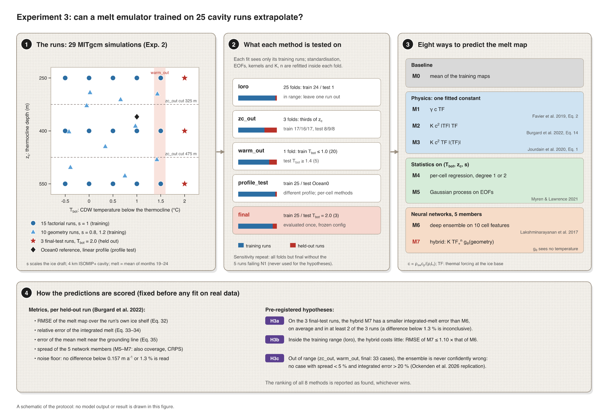
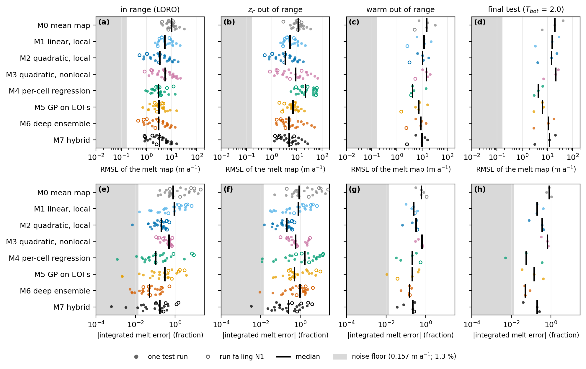
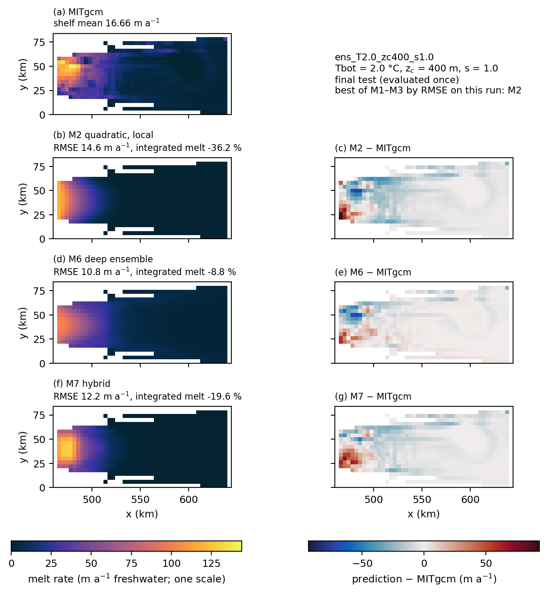
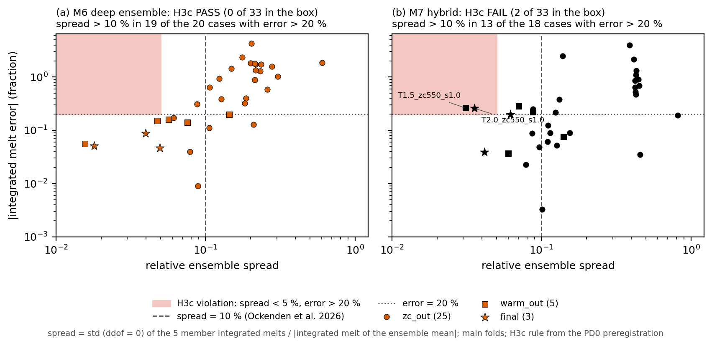
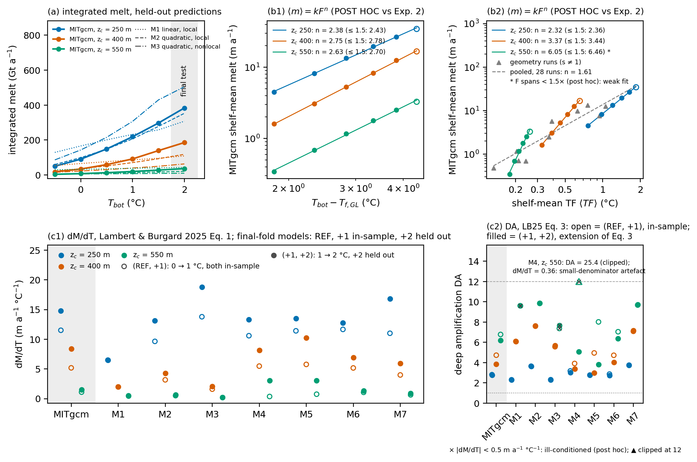

<!-- Rendered by scripts/render_readme.py: edit README.template.md, never README.md. Numbers come from figures/*.json. -->
# Experiment 3 — Emulating ice-shelf basal melt from a small cavity ensemble: simple baselines, neural networks and a physics hybrid, inside and outside the training range

**Esteban Cruz** · idealised MITgcm ensemble and statistical emulators · PhD application portfolio (2027)

## Abstract

Simple methods win. We trained eight methods to predict the basal-melt map of an ice-shelf cavity from the 25 MITgcm runs of Experiment 2 and scored them only on runs they had not seen. By the error of the melt map, a per-cell quadratic regression on the three forcing parameters (M4) is the best method when one run is held out at a time (3.83 m a⁻¹, against 4.27 for a deep ensemble of neural networks), when the warmest training runs are held out (6.08 against 8.11) and on the final test at Tbot = 2.0 °C, warmer than any training run (4.58 against 10.55). When a whole range of thermocline depths is held out, the one-parameter local quadratic parameterisation (M2) is best (5.24 m a⁻¹) and the regression is the worst method (29.95). Two qualifications apply. In the sensitivity repeat without the 5 training runs that fail the drift criterion of Experiment 2, M4 loses its lead inside the range (5.01 m a⁻¹ in `loro`, where M6 is best with 4.29) and for the warmest runs (11.06, where M5 is best with 7.98); and the bootstrap intervals of the means of M4–M7 overlap in every held-out set except `zc_out`. A method without a neural network still has the lowest mean map error in every set of the repeat except `loro`. By the error of the integrated melt, the deep ensemble (M6) is best in three of the four held-out sets (mean |error| 6.2 % on the final test) and M2 in the fourth. The neural networks therefore do not win on the maps, and gain on the integrated melt and near the grounding line. Three hypotheses were registered before any fit on the real data. H3a, that a hybrid of a fitted power law in thermal forcing and a network that sees only the geometry (M7) extrapolates the integrated melt better than the deep ensemble, **fails** (mean |error| 16.4 % against 6.2 %, better in 1 of 3 runs). H3b, that the hybrid costs little inside the training range, **passes** (map error ratio 1.056, threshold 1.10). H3c, a controlled replication of the DeepMelt-GL result that the spread of a network ensemble indicates its reliability (Ockenden et al., 2026), **passes** for the deep ensemble (0 confidently wrong cases out of 33) and **fails** for the hybrid (2). A post hoc diagnosis shows that the hybrid fails badly on the ISOMIP+ Ocean0 profile (+413 % integrated melt), because its geometry network learned a dependence that holds only for the thermocline thickness of the training runs. Every number below is read from the metrics files in `figures/`.

## 1. Introduction

Melting at the base of Antarctic ice shelves is computed in ice-sheet models from the ocean temperature and salinity in front of, or beneath, the shelf, through a parameterisation (Favier et al., 2019; Jourdain et al., 2020; Burgard et al., 2022). The simplest are linear or quadratic in the thermal forcing, the difference between the ocean temperature and the local freezing point. The quadratic form rests on the feedback found by Holland et al. (2008): warmer water melts more, the meltwater speeds up the boundary current under the ice, and the faster current carries heat to the ice more efficiently. ISMIP6 uses a local and a nonlocal version of it (Jourdain et al., 2020). More elaborate parameterisations represent the cavity circulation as boxes (Reese et al., 2018) or plumes (Lazeroms et al., 2018). Calibrated to the same present-day melt, these models disagree widely on how much the melt grows when the deep water warms, so a present-day calibration does not fix the sensitivity (Lambert & Burgard, 2025). The response simulated by cavity models also departs from the simple quadratic law, because the efficiency of the ice–ocean heat transfer depends on the shape of the ice and on the temperature (Little et al., 2009), and a box model gives a quadratic response for small and a linear one for large forcing (Olbers & Hellmer, 2010). Experiment 2 of this portfolio found an ISOMIP+ cavity whose melt is almost exactly quadratic in the deep-water temperature but steeper than the pre-registered power law, and depends strongly on the thermocline depth.

Neural-network emulators of the melt are the alternative. MELTNET, a convolutional network trained on thousands of idealised NEMO cavity simulations, predicts melt maps from geometry and far-field profiles (Rosier et al., 2023). Burgard et al. (2023) trained a per-cell multilayer perceptron on circumpolar NEMO simulations, and found it performed at least as well as the parameterisations, though in much warmer conditions both struggled. DeepMelt-GL (Ockenden et al., 2026) is a per-cell network for the regions of cavities that ocean models do not resolve. It reports two results that this experiment set out to test in a controlled case: neural networks are "particularly sensitive to temperatures and ice-draft slopes outside those used in the training dataset", and "the ensemble spread of the neural networks is a good indicator of the reliability of the emulator", with a provisional threshold for the spread relative to the integrated melt. We replicate that second result here; we do not present it as new.

The training set of an emulator built on a cavity model is small: each run is expensive, and the number of independent forcings, not the number of grid cells, limits generalisation. With few runs, simple baselines often win. A linear pattern-scaling regression beat deep learning in three of four variables of a climate-emulation benchmark, because the networks overfitted internal variability (Lütjens et al., 2025); Gaussian processes on principal components were more accurate and better calibrated than neural networks for computer-model emulation with few runs (Myren & Lawrence, 2021); for the Antarctic sea-level contribution, a recurrent network beat a Gaussian process with many runs, though Gaussian processes remained a good choice for small data sets (Van Katwyk et al., 2023). In an idealised ocean model, physically constrained networks generalised poorly to new regimes (Ross et al., 2023). Deep ensembles estimate the uncertainty of a network simply (Lakshminarayanan et al., 2017), but the evidence that their spread tracks the error outside the training data is thin.

Here we use the 29 runs of Experiment 2, an ISOMIP+ cavity (Asay-Davis et al., 2016) at 4 km in which the deep-water temperature Tbot, the thermocline depth z_c and the ice-draft scale s vary, to compare eight methods (Figure 0): a mean map, three one-parameter parameterisations, two statistical emulators on the forcing parameters, a deep ensemble of neural networks, and a hybrid that multiplies a fitted power law in the local thermal forcing by a network that sees only the geometry. The hybrid is meant to keep the physics of the temperature dependence and leave only the spatial pattern to the network, so that it extrapolates in temperature. Every method is tested on runs it has not seen: inside the training range, outside it in thermocline depth and in temperature, on a different profile shape, and on three runs at Tbot = 2.0 °C evaluated once. The experiment asks which method predicts the melt best with this little data, and when the networks can be trusted outside their training range. Three hypotheses and all thresholds were fixed before any method saw the real data (`notes/pd0_preregistro.md`), and the ranking of the methods was declared a reported result, not a hypothesis, whichever method won.



*Figure 0.* The protocol (no results are drawn). (1) The runs of Experiment 2 in the (Tbot, z_c) plane: the factorial runs with the unscaled draft, the geometry runs with a scaled draft, the final-test runs and the Ocean0 reference. (2) The held-out sets: each fit sees only its training runs. (3) The eight methods with their sources. (4) The metrics and the pre-registered hypotheses. Drawn with VectorCraft from `figures/src/fig0_protocol.py`.

## 2. Methods

### 2.1 Data

The data are the 29 runs of Experiment 2 (`exp2_isomip_cavity/`, dataset sha256 `3d2eceb18be2…`, outside the repository): the ISOMIP+ geometry at 4 km with a ramp profile, cold surface water over deep water at Tbot joined by a thermocline of thickness d = 300 m centred at depth z_c. The target is the melt map in m a⁻¹ of freshwater (positive = melting), the mean over months 19–24. Refreezing cells (negative melt) are kept, never clipped.

- **Training set (25 runs):** the 15 factorial runs (Tbot = −0.5, 0, 0.5, 1, 1.5 °C; z_c = 250, 400, 550 m; unscaled draft) and 10 geometry runs with the ice draft scaled by s = 0.8 and 1.2 and (Tbot, z_c) drawn from a Latin hypercube.
- **Final test (3 runs):** Tbot = 2.0 °C at the three factorial z_c, warmer than any training run.
- **Profile test (`ocean0_4km`):** the ISOMIP+ Ocean0 profile, linear from surface to bottom, which is a ramp with Tbot = 1 °C, z_c = 360 m and d = 720 m. It is never in any training set.
- **N1 runs:** 5 training runs failed the drift criterion N1 of Experiment 2 (Tbot = −0.5 °C, z_c = 250 m, s = 1.0; Tbot = −0.5 °C, z_c = 550 m, s = 1.0; Tbot = 1.5 °C, z_c = 550 m, s = 1.0; Tbot = −0.42 °C, z_c = 402 m, s = 0.8; Tbot = −0.39 °C, z_c = 503 m, s = 1.2). They stay in the training set, are marked in every per-run figure, and a sensitivity repeat drops them (§3.6).

Each method predicts on the union of the shelf masks, but every metric uses only the evaluated run's own shelf mask (the mask changes with s). The grid is uniform, so area weighting is a plain mean over the mask. The thermal forcing is TF = T − T_f(S, p) at the ice base, with the liquidus of Asay-Davis et al. (2016, Table 4) imported from Experiment 2.

### 2.2 The eight methods

Every fitted quantity (standardisation, EOFs, kernel, coefficients, polynomial degree, network weights, the choice of forcing of M7) is refitted inside each fold from its training runs only. c = ρ_sw c_p / (ρ_i L_i) = 0.0133 K⁻¹ with the constants of Favier et al. (2019, Table 2).

- **M0, mean map:** the per-cell mean of the training maps. It is the reference of the skill scores.
- **M1, linear local:** m = γ c TF (Favier et al., 2019, Eq. 2), one coefficient, closed-form least squares over all training shelf cells.
- **M2, quadratic local:** m = K c² |TF| TF, the form of Favier et al. (2019, Eq. 4) and of Burgard et al. (2022, Eq. 14), with the exchange velocity (Favier) or the slope and far-field factors (Burgard) folded into K. One coefficient, fitted as M1.
- **M3, quadratic nonlocal:** m = K c² TF |⟨TF⟩|, with ⟨TF⟩ the shelf-mean thermal forcing (Jourdain et al., 2020, Eq. 1; Favier et al., 2019, Eq. 5). One coefficient. M1–M3 keep the sign of TF.
- **M4, per-cell regression:** at each cell, a polynomial of degree 1 or 2 (10 terms for the quadratic) in the standardised (Tbot, z_c, s), fitted by least squares; the degree is chosen by an inner leave-one-run-out over the fold's training runs (mean rmse_map; a tie goes to the linear).
- **M5, Gaussian process on EOFs** (Myren & Lawrence, 2021, §3.1): the maps are standardised per cell and decomposed by SVD; the smallest number of EOFs with ≥ 99 % of the variance is kept, at most m − 1 for m training runs (7–9 EOFs in the main folds). Each EOF coefficient gets a Gaussian process on (Tbot, z_c, s) with kernel Constant (1e-3–1e3) × ARD RBF (1e-2–1e3) + White (initial 1e-3, bounds [1e-8, 1e-2]), normalised targets and 5 restarts. The white-noise term is a small, bounded nugget: its bounds were a pre-registration decision, set so that it cannot absorb signal given the noise floor (§2.4). Myren & Lawrence's formulation has no nugget; Berdahl et al. (2021, §2.3) also use a small nugget for numerical conditioning. The predictive variance is propagated through the EOFs; the truncation error is not added.
- **M6, deep ensemble** (Lakshminarayanan et al., 2017): 5 multilayer perceptrons (32-64-32, ReLU) with seeds 0–4, each with outputs (μ, σ²), trained with the Gaussian negative log-likelihood, no bagging, and combined as a uniform Gaussian mixture. Inputs: the 10 per-cell features draft, T, S, TF, TF_mean, draft_minus_zc, dist_gl, dist_front, slope, s (draft_minus_zc is the depth of the ice base below the thermocline centre).
- **M7, hybrid:** m = K b(TF)ⁿ g_θ(x_g), where g_θ is a network (32-64-32, ReLU) of the 6 geometric features x_g = (draft, draft_minus_zc, dist_gl, dist_front, slope, s), which contain no temperature. K and n are trained per member, starting from n₀ = 2 and K₀ from the closed-form M2 (or M3) fit. The forcing is either local, b = TF₊ = max(TF, 0), or nonlocal, b = the square root of TF₊ |⟨TF⟩|; the choice is made inside each fold by an inner leave-one-run-out (mean rmse_map; a tie goes to local). The variance is σ² = softplus(h₀(x_g))² + (softplus(h₁(x_g)) · stopgrad(μ))² + 1e-6, so the network still never sees temperature. 5 members, trained like M6.

**Training of M6 and M7.** Adam (learning rate 1e-3), batches of 512 cells, double precision on CPU, deterministic algorithms and one thread, so results are byte-reproducible. Each member holds out 3 validation runs stratified by Tbot (one drawn at random at the highest level, one at the median and one at the lowest, with the member's seed); training stops after 250 epochs without improvement of their mean rmse_map (cap 5000 epochs, reached by 0 of the 120 cross-validation fits). Validation runs enter neither the gradients nor the standardisation.

### 2.3 Held-out sets

| Set | Folds | Training / test runs | What it tests |
|---|---|---|---|
| `loro` | 25 | 24 / one, each training run once | inside the training range |
| `zc_out` | 3 | 17/16/17 / 8/9/8: thirds by z_c (test z_c 250–311 m, 328–444 m, 481–550 m), geometry runs included | thermocline depth out of range |
| `warm_out` | one | Tbot ≤ 1 °C (20) / Tbot ≥ 1.42 °C (5) | warm water out of range |
| `profile_test` | one | 25 / `ocean0_4km`, for M0, M1, M2, M3, M6, M7 only | a different profile shape |
| `final` | one | 25 / the 3 runs at Tbot = 2.0 °C, **evaluated once** | extrapolation in temperature |

M4 and M5 receive only (Tbot, z_c, s) and cannot represent the profile shape of `ocean0_4km`, so they were excluded from `profile_test` before any run. The final test was run once by `run_protocol.py --final`, which refuses to run again if its result or its start marker exists; once an attempt has completed there is no override (only an attempt recorded as crashed may be repeated, from scratch; attempts recorded in `final_test.json`: 1, status complete).

### 2.4 Metrics and the noise floor

Per held-out run (Burgard et al., 2022): rmse_map, the area-weighted RMSE of the melt map over the run's shelf (Eq. 32); the relative error of the integrated melt, (Σ pred − Σ melt)/Σ melt (Eqs. 33–34, for one shelf); and rmse_gl, the absolute difference of the mean melt over the 10 % of shelf cells nearest the grounding line (Eq. 35 for one shelf and one period; its RMS over runs is reported). For M5–M7, coverage of the central predictive intervals and the CRPS are stored in `cv_results.json`; for M6 and M7 the ensemble spread is the standard deviation of the 5 members' integrated melts over the |integrated melt of the ensemble mean| (Ockenden et al., 2026).

There are no duplicate runs, so the noise of a melt map was estimated as the RMS difference between its mean over months 19–24 and over the six months before, for each of the 25 training runs (`analysis/noise_floor.py`). The median is **0.157 m a⁻¹** (range 0.029–0.366); for the integrated melt the median |drift| is **1.3 %**. No difference between methods smaller than these floors is interpreted.

The pre-registration asks for bootstrap intervals over runs but does not fix their settings. We resample the held-out runs of each set with replacement, using the same resampled runs for every method, and report the percentile 95 % interval of each method's mean (`analysis/bootstrap.py`, `figures/bootstrap.json`); no method is refitted. The number of resamples, B = 10000, and the seed, 0, were the analyst's choice, made at analysis time after the results were known. The hypotheses H3a–H3c are defined on the means, as pre-registered, and do not use these intervals.

### 2.5 Pre-registered criteria

| | Hypothesis | Test cases | Pass rule |
|---|---|---|---|
| H3a | The hybrid extrapolates the integrated melt better than the deep ensemble | final test, 3 runs | mean \|integrated error\| of M7 < M6, and M7 better in ≥ 2 of 3 runs; inconclusive if the means differ by less than 1.3 % |
| H3b | The hybrid costs little inside the training range | `loro`, 25 main folds | mean rmse_map of M7 ≤ 1.10 × M6 |
| H3c | The ensemble is never confidently wrong out of range (replication of Ockenden et al., 2026) | `zc_out`, `warm_out` and final test runs, 33 cases, M6 and M7 separately | no case with spread < 5 % and \|integrated error\| > 20 %; the 10 % spread threshold of Ockenden et al. is reported as a confusion table |

The ranking of the eight methods was declared a reported result, and the pre-registration states that if M2, M3, M4 or M5 wins, that is the main result. H3a–H3c use only the main folds, never the N1 sensitivity repeat. Every model–reference difference is classified as (a) our error, (b) missing physics, (c) method choice or (d) an error in the reference, and analyses defined after seeing results are labelled post hoc.

### 2.6 What was seen before the thresholds were fixed

The pre-registration (`notes/pd0_preregistro.md`, "Divulgación") lists everything seen before the thresholds were fixed; the main items are below. All of it comes from the training runs; no method had predicted the Tbot = 2.0 °C runs or `ocean0_4km`.

- **M5 tuning on the training runs.** A reviewer computed an exploratory leave-one-run-out of M5 on the training runs while auditing the Gaussian process, and its in-sample fit was inspected; the nugget bounds were decided after that.
- **Stopping rule of M6/M7.** max_epochs and patience were raised after looking at inner-validation curves on the training runs of the final fold, and the stratified validation rule (R10–R12) came from a reviewer's observations on those runs.
- **The choice of forcing of M7.** On the training runs, the local-versus-nonlocal choice reversed when the stopping rule changed; that is why it is made by a full inner leave-one-run-out (it chose local in 30 of the 30 main folds).
- **In-sample fits and fitted exponents.** The in-sample map errors of the ensemble means of M6 and M7 and of M2 on the training runs, and the exponents n and coefficients K fitted by the M7 members on them, were seen before the thresholds were fixed (values in the pre-registration).
- **Experiment 2 was known.** Its H1 result, a melt response steeper than the pre-registered power law, was known when the hypotheses were written.
- **The MITgcm melt of the final-test runs was public.** The shelf-mean melt of the three Tbot = 2.0 °C runs is in Figure 2a of the Experiment 2 README. No method was fitted or evaluated against it before the final test.
- **Preliminary M7 values during the cross-validation.** Esteban saw preliminary M7 values of finished units while the cross-validation ran, after Amendment 1 had been decided; the protocol was already frozen and nothing was changed.
- **Amendment 1.** The frozen stop rule ended the cross-validation when its wall-clock estimate exceeded 8 h, before any metric had been looked at. Esteban raised the budget to 20 h; methods, folds, hyperparameters and thresholds did not change, and the amendment is recorded in `cv_results.json` and in every unit run under it (9 units written before it were kept, since each unit is an independent, deterministic fit).
- **The final test ran once** (1 attempt, 2026-11-11, 51 min), with the configuration frozen at the pre-registration (`protocol_config.json`, sha256 `56a9ffe5b57f…`).

## 3. Results

The cross-validation fitted 476 units (variant × fold × method) in 11.1 h of wall clock with 5 single-threaded processes (65 CPU hours), giving 892 per-run entries.

### 3.1 Ranking: simple methods win

| Method | loro: rmse_map | loro: \|int. err.\| (%) | zc_out: rmse_map | zc_out: \|int. err.\| (%) | warm_out: rmse_map | warm_out: \|int. err.\| (%) | final: rmse_map | final: \|int. err.\| (%) |
|---|---|---|---|---|---|---|---|---|
| M0 mean map | 10.68 (8.69–13.07) | 345.4 (174.6–550.1) | 12.73 (10.40–15.49) | 438.9 (218.5–707.5) | 15.45 (7.91–24.42) | 68.2 (46.6–91.5) | 22.39 (6.18–41.55) | 82.5 (59.0–108.3) |
| M1 linear local | 7.10 (5.45–8.97) | 139.7 (81.1–207.5) | 7.04 (5.41–8.96) | 138.6 (79.8–209.5) | 11.09 (5.22–17.26) | 24.1 (15.7–32.4) | 15.82 (3.29–28.62) | 26.6 (18.9–41.3) |
| M2 quadratic local | 5.23 (3.59–7.03) | 20.3 (15.3–25.6) | **5.24 (3.61–7.07)** | **20.3 (15.2–25.4)** | 9.85 (5.43–14.38) | 26.6 (15.3–35.6) | 14.25 (4.12–24.00) | 28.9 (8.0–42.5) |
| M3 quadratic nonlocal | 7.71 (5.54–9.97) | 43.7 (36.7–50.5) | 14.20 (8.47–21.16) | 99.6 (66.0–137.4) | 13.62 (8.69–17.98) | 54.3 (39.7–66.4) | 18.46 (6.97–26.89) | 56.7 (31.7–72.5) |
| M4 per-cell regression | **3.83 (2.76–5.15)** | 91.4 (19.0–187.0) | 29.95 (22.33–37.73) | 355.1 (197.3–531.5) | **6.08 (3.76–10.19)** | 23.6 (7.6–41.0) | **4.58 (2.97–6.50)** | 13.7 (0.5–35.0) |
| M5 GP on EOFs | 3.91 (2.87–5.24) | 63.8 (32.2–103.1) | 7.66 (6.19–9.27) | 163.4 (78.3–269.6) | 7.74 (3.93–12.49) | 22.6 (6.1–39.0) | 5.43 (2.88–7.12) | 19.4 (3.4–40.9) |
| M6 deep ensemble | 4.27 (2.98–5.66) | **9.9 (5.9–14.8)** | 9.50 (5.45–14.66) | 108.6 (74.3–148.8) | 8.11 (4.45–11.62) | **14.1 (9.4–17.8)** | 10.55 (2.93–17.93) | **6.2 (4.6–8.8)** |
| M7 hybrid | 4.51 (3.16–6.02) | 25.3 (13.6–40.3) | 7.03 (4.80–9.70) | 66.9 (35.0–107.6) | 9.40 (5.18–13.62) | 17.6 (8.9–26.4) | 12.00 (3.17–20.59) | 16.4 (3.9–25.7) |

*Table 1.* Mean over the held-out runs of rmse_map (m a⁻¹) and of |integrated relative error| (%), main variant; 25, 25, 5 and 3 runs. In parentheses, the percentile 95 % bootstrap interval of the mean over runs (§2.4); with 3 final-test runs those intervals are indicative only. The best mean in each column is in bold. Means of |integrated error| are dominated by a few low-melt runs; the medians are in `hypotheses.json`.



*Figure 1.* Error by method in the four held-out sets, one point per run (open: a run failing N1), the bar is the median. Top: rmse_map; bottom: |integrated relative error|. The grey band is the noise floor.

**By the map error, the per-cell regression M4 is the best method** in `loro` (order M4 < M5 < M6 < M7 < M2 < M1 < M3 < M0; M5 is within the noise floor of it), in `warm_out` (M4 < M5 < M6 < M7 < M2 < M1 < M3 < M0) and on the final test (M4 < M5 < M6 < M7 < M2 < M1 < M3 < M0). Its quadratic in (Tbot, z_c, s) was chosen in 29 of 29 main folds. **When a third of the thermocline depths is held out, the regression fails** (29.95 m a⁻¹, the worst of all methods, including the mean map) and the one-parameter local quadratic M2 is best (M2 < M7 < M1 < M5 < M6 < M0 < M3 < M4). A polynomial in z_c cannot extrapolate across the thermocline, while M2 sees the thermocline through the local temperature at the ice base. The nonlocal quadratic M3, which sees only the shelf-mean forcing, is worse than M2 everywhere. The bootstrap intervals qualify this ranking: in `loro`, `warm_out` and the final test the intervals of the means of M4, M5, M6 and M7 overlap (for example 2.76–5.15 m a⁻¹ for M4 against 2.98–5.66 for M6 in `loro`), so the order among them is not resolved by the resampling of runs; only in `zc_out` does the interval of M2 (3.61–7.07) lie entirely below that of M4 (22.33–37.73). These are intervals of each method's mean, not of the differences between methods.

**By the integrated melt, the deep ensemble M6 is best** in `loro` (order M6 < M2 < M7 < M3 < M5 < M4 < M1 < M0), `warm_out` (M6 < M7 < M5 < M4 < M1 < M2 < M3 < M0) and the final test (M6 < M4 < M7 < M5 < M1 < M2 < M3 < M0), and also by the grounding-line error in these three sets (rms rmse_gl 1.24, 2.04 and 1.33 m a⁻¹). In `zc_out`, M2 is best by all three metrics (order by |integrated error|: M2 < M7 < M3 < M6 < M1 < M5 < M4 < M0). The networks thus get the total right but the pattern less well than a regression on three numbers: on the final test, M6's mean map error is 10.55 m a⁻¹ against 4.58 for M4. The hybrid M7 is not the best method in any held-out set by any of the three metrics.

### 3.2 The final test

| Method | z_c = 250 m | z_c = 400 m | z_c = 550 m |
|---|---|---|---|
| M0 | 41.6 / −80.2 | 19.4 / −59.0 | 6.2 / +108.3 |
| M1 | 28.6 / −19.8 | 15.5 / −41.3 | 3.3 / +18.9 |
| M2 | 24.0 / −8.0 | 14.6 / −36.2 | 4.1 / −42.5 |
| M3 | 26.9 / +31.7 | 21.5 / −65.9 | 7.0 / −72.5 |
| M4 | 6.5 / −5.6 | 4.3 / +0.5 | 3.0 / +35.0 |
| M5 | 6.3 / −3.4 | 7.1 / +13.9 | 2.9 / +40.9 |
| M6 | 17.9 / −4.6 (4.9) | 10.8 / −8.8 (4.0) | 2.9 / −5.1 (1.8) |
| M7 | 20.6 / +3.9 (4.2) | 12.2 / −19.6 (6.2) | 3.2 / −25.7 (3.6) |

*Table 2.* Final test at Tbot = 2.0 °C, evaluated once: rmse_map (m a⁻¹) / signed integrated relative error (%), and for M6 and M7 the ensemble spread (%) in parentheses. Integrated MITgcm melt (m a⁻¹ × cells): 23962, 11593 and 2280.



*Figure 2.* Melt maps of the final-test run at z_c = 400 m (MITgcm shelf mean 16.7 m a⁻¹): MITgcm, the best of M1–M3 on that run (M2), M6 and M7 on one colour scale, and each prediction minus MITgcm. On this run M2 has rmse_map 14.6 m a⁻¹ and integrated error −36 %, M6 10.8 and −9 %, M7 12.2 and −20 %.

On the z_c = 400 m run every method except M4 and M5 underestimates the integrated melt, and M1–M3 underestimate it by more than M6 and M7. This is consistent with a single coefficient, fitted on cooler runs, that cannot follow the steeper-than-quadratic response of Experiment 2 (§3.4), but no test here isolates that cause.

### 3.3 Hypotheses

**H3a fails.** On the final test the mean |integrated error| of the hybrid is 16.4 % against 6.2 % for the deep ensemble, a difference far above the 1.3 % floor, and M7 is better on only 1 of the 3 runs (Tbot = 2.0 °C, z_c = 250 m, s = 1.0). With 3 runs this is an indication, not a conclusion, but it is the opposite of the hypothesis: the fitted power law in TF did not make the extrapolation in temperature better than a network that receives temperature as an input.

**H3b passes.** Inside the training range (`loro`, 25 folds), the mean rmse_map of M7 is 4.51 m a⁻¹ against 4.27 for M6, a ratio of 1.056, below the threshold of 1.10. Both are worse than M4 and M5 (§3.1).

**H3c passes for the deep ensemble and fails for the hybrid.** Over the 33 out-of-range cases, M6 has 0 cases with spread < 5 % and |integrated error| > 20 %. M7 has 2: Tbot = 1.5 °C, z_c = 550 m, s = 1.0 (warm_out, fails N1): spread 3.1 %, |integrated error| 26.2 %; Tbot = 2.0 °C, z_c = 550 m, s = 1.0 (final): spread 3.6 %, |integrated error| 25.7 %. With the 10 % spread threshold of Ockenden et al. (2026), M6 has 1 low-spread, high-error case (Tbot = 0.0 °C, z_c = 400 m, s = 1.0), and M7 has 5.

| | spread > 10 %, error > 20 % | spread > 10 %, error ≤ 20 % | spread ≤ 10 %, error > 20 % | spread ≤ 10 %, error ≤ 20 % |
|---|---|---|---|---|
| M6 | 19 | 3 | 1 | 10 |
| M7 | 13 | 9 | 5 | 6 |

*Table 3.* Spread against |integrated error| over the 33 H3c cases, at the threshold of Ockenden et al. (2026).



*Figure 4.* |Integrated relative error| against the relative ensemble spread for M6 and M7 over the H3c cases; the shaded box is the H3c failure region (spread < 5 %, error > 20 %), the dashed line the 10 % threshold of Ockenden et al. (2026).

For the deep ensemble this replicates the DeepMelt-GL result in a controlled case: large errors out of range came with a large spread. For the hybrid it does not. A plausible reason, not tested here, is that its members share the form of the fitted power law, so they can agree with each other where they are all wrong. Both M7 violations are at z_c = 550 m, where the melt is smallest.

### 3.4 Physics diagnostics



*Figure 3.* (a) Integrated melt against Tbot for each z_c: MITgcm and the held-out predictions of M1–M3 (their `loro` fold, and the final test at Tbot = 2.0 °C). (b1) and (b2) **Post hoc relative to Experiment 2**: power laws of the MITgcm shelf-mean melt against Tbot − T_f at the grounding line and against the shelf-mean TF. (c1) and (c2) Melt sensitivities of Lambert & Burgard (2025, Eqs. 1 and 3) for each method's final-fold model.

**(a)** M1, linear in TF, is too flat at all z_c; M2 follows MITgcm at z_c = 250 m but is too flat at 400 and 550 m; M3 overestimates the melt at 250 m and underestimates it at 400 and 550 m, where the shelf-mean forcing it multiplies by changes little with Tbot (panel b).

**(b) Post hoc relative to Experiment 2.** Experiment 2 pre-registered a power law in Tbot − T_f,GL over Tbot ≤ 1.5 °C; the Tbot = 2.0 °C runs and the shelf-mean TF as forcing are added here after the fact and are descriptive only. Including the final-test runs barely changes the exponent in Tbot − T_f,GL: n = 2.38, 2.75 and 2.63 at z_c = 250, 400 and 550 m (2.43, 2.78 and 2.70 without them). Against the shelf-mean TF the exponent is 2.32, 3.37 and 6.05, but at z_c = 550 m the forcing spans only 0.18–0.26 °C, so that exponent is poorly constrained (a post hoc display flag); pooled over the 28 non-reference runs, n = 1.61 with R² = 0.86 in log space. A single power law in a shelf-mean forcing does not describe this ensemble.

**(c)** The sensitivities of Lambert & Burgard (2025) with REF, +1 and +2 at Tbot = 0.0, 1.0 and 2.0 °C, M the shelf-mean melt, dM/dT over (REF, +1) and (+1, +2), and the deep amplification DA, the ratio of dM/dT over the deepest tenth of the draft to dM/dT over the shelf:

| Model | dM/dT, z_c = 250 m | dM/dT, z_c = 400 m | dM/dT, z_c = 550 m | DA, z_c = 250 m | DA, z_c = 400 m | DA, z_c = 550 m |
|---|---|---|---|---|---|---|
| MITgcm | 11.51 / 14.77 | 5.19 / 8.41 | 1.10 / 1.49 | 2.8 / 2.8 | 4.7 / 3.8 | 6.8 / 6.2 |
| M1 | 6.49 / 6.49 | 1.97 / 1.97 | 0.48 / 0.48 | 2.3 / 2.3 | 6.1 / 6.1 | 9.6 × / 9.6 × |
| M2 | 9.64 / 13.15 | 3.17 / 4.26 | 0.51 / 0.66 | 3.6 / 3.6 | 7.6 / 7.6 | 9.8 / 9.9 |
| M3 | 13.79 / 18.79 | 1.60 / 2.06 | 0.18 / 0.21 | 2.3 / 2.3 | 5.6 / 5.7 | 7.4 × / 7.7 × |
| M4 | 10.60 / 13.29 | 5.48 / 8.17 | 0.36 / 3.05 | 3.2 / 3.0 | 3.9 / 3.4 | 25.4 × / 5.1 |
| M5 | 11.42 / 13.53 | 5.77 / 10.22 | 0.75 / 3.03 | 2.8 / 2.8 | 5.0 / 3.0 | 8.0 / 3.8 |
| M6 | 11.66 / 12.75 | 5.17 / 6.91 | 1.06 / 1.34 | 2.9 / 2.7 | 4.7 / 4.0 | 7.0 / 6.4 |
| M7 | 11.01 / 16.83 | 3.99 / 5.96 | 0.64 / 0.90 | 3.7 / 3.7 | 7.1 / 7.1 | 9.7 / 9.7 |

*Table 4.* dM/dT (m a⁻¹ °C⁻¹) and DA over (REF, +1) / (+1, +2). × marks |dM/dT| < 0.5 m a⁻¹ °C⁻¹, an ill-conditioned ratio.

Three caveats apply. First, REF and +1 are **in-sample** for the final-fold models (they were trained on those runs) and only +2 is held out, so the (REF, +1) values of the flexible methods M4–M7 largely reproduce their training data. Second, DA over (+1, +2) is our extension of Lambert & Burgard (2025, Eq. 3), which defines DA over (REF, +1). Third, the two display thresholds of the figure, |dM/dT| < 0.5 m a⁻¹ °C⁻¹ for an ill-conditioned DA and the axis clip, are post hoc; the M4 value at z_c = 550 m (DA = 25.4 with dM/dT = 0.36 m a⁻¹ °C⁻¹) is a small-denominator point, not a physical amplification. MITgcm's DA over (REF, +1) is 2.8, 4.7 and 6.8 at z_c = 250, 400 and 550 m: the deeper the thermocline, the more the warming concentrates on the deepest ice. The one-coefficient parameterisations M1–M3 overestimate DA at z_c = 400 m.

### 3.5 Post hoc: the profile test

On `ocean0_4km`, the ISOMIP+ Ocean0 profile (d = 720 m) never seen in training, the integrated melt errors are: M0 −33 %, M1 +62 %, M2 **−4.8 %**, M3 +59 %, M6 +53 % (spread 9.3 %) and **M7 +413 %** (rmse_map 53.5 m a⁻¹, spread 25 %). The mean map M0 has the lowest map error (5.2 m a⁻¹). Because the M7 error is so large, we diagnosed it after the fact (`notes/diag_profile_test.md`, `analysis/profile_test_diag.py`, `figures/profile_test_diag.json`). Nothing in the protocol was changed.

- **Not our error (a).** The Ocean0 profile in the dataset equals the ISOMIP+ profile and the ramp with z_c = 360 m and d = 720 m exactly; draft, shelf mask (696 cells), TF and units match the training runs and an independent recomputation; a refit of M7 reproduces the unit's integrated melts exactly.
- **Each input is in range, the combination is not.** For every feature, 0 % of the Ocean0 cells lie outside the training range (TF 0.00 to 2.70 °C against −0.04 to 3.83 °C), so the exponent n is not extrapolated. But 405 of 696 cells (58 %) have a TF larger than any training TF at the same distance from the thermocline centre: with d = 300 m in training, cells well above z_c sit in cold water with TF near zero, while with d = 720 m they are already inside the gradient.
- **The excess comes from g_θ × TF₊ⁿ above the thermocline centre.** In the training runs the melt of the shallow cells is sustained by heat brought up by the plume from below, which a local TF₊ⁿ cannot see, so g_θ learned large values there as a function of draft_minus_zc. On Ocean0 the local TF of those cells is real and large, and the product explodes: in the band 150–250 m above z_c the learned g is 4.2 where 0.14 would reproduce MITgcm. 84 % of the excess integrated melt lies in the cells with an unseen TF; from 50 m above z_c downwards the error per band is −6 to +1 %.
- **K and g are not separately identified.** With g fixed at one, K TF₊ⁿ alone gives +323 %, because K is 16–34 against an M2-equivalent of 6.3; only the product is constrained.

| draft − z_c band (m) | cells | TF, Ocean0 (median, °C) | TF, training (max, °C) | Σ melt, MITgcm | Σ melt, M7 | g_θ learned (median) | g needed (median) |
|---|---|---|---|---|---|---|---|
| [−400, −250) | 45 | 0.20 | 0.18 | 140 | 362 | 8.83 | 3.52 |
| [−250, −150) | 369 | 0.85 | 0.29 | 1164 | 25316 | 4.19 | 0.14 |
| [−150, −50) | 135 | 1.12 | 1.41 | 1255 | 6226 | 1.45 | 0.21 |
| [−50, 50) | 68 | 1.71 | 2.58 | 1657 | 1672 | 0.30 | 0.30 |
| [50, 150) | 53 | 2.16 | 3.79 | 1833 | 1812 | 0.25 | 0.22 |
| [150, 250) | 26 | 2.59 | 3.83 | 1039 | 976 | 0.17 | 0.19 |

*Table 5.* M7 on `ocean0_4km` by band of draft − z_c (negative = above the thermocline centre). Σ in m a⁻¹ × cells. Post hoc.

**Classification:** (c) method choice, with a part of (b) missing physics: the separable form K TF₊ⁿ g_θ(x_g) with a local forcing cannot represent the nonlocal heat supply of the plume, and g_θ absorbs it as a function of position relative to z_c that is valid only for the training profile shape. It is a *conditional* out-of-distribution failure that no check of the marginal ranges detects. M4 and M5 were excluded from `profile_test` because they "cannot represent d = 720 m"; the diagnosis shows that M7, like M4 and M5, effectively inherits d = 300 m, through draft_minus_zc, although it formally receives per-cell inputs. M2 has no learned position-dependent factor: its errors partly cancel in the total (−4.8 %; rmse_map 6.8 m a⁻¹). M6 receives draft_minus_zc too, but also T, S, TF and ⟨TF⟩ as additive inputs, and its error stays at +53 %. The spread of M7 (25 %) is far below its error, the confidently-wrong pattern that H3c looks for, although `profile_test` is not one of the H3c cases. The N1 sensitivity repeat gives M7 +438 % by the same mechanism. A hybrid with a nonlocal forcing, or without draft_minus_zc in x_g, would be a new, post hoc experiment and was not tried.

### 3.6 Sensitivity: without the N1 runs

The repeat without the 5 N1-failing training runs (all folds but `final`; never used for H3a–H3c) changes the ranking by map error inside the range:

| Held-out set | rmse_map, best three | within the noise floor of the best | \|integrated error\|, best three |
|---|---|---|---|
| loro | M6 < M5 < M7 … | M6, M5 | M6 < M2 < M7 … |
| zc_out | M2 < M1 < M6 … | M2 | M2 < M7 < M6 … |
| warm_out | M5 < M6 < M7 … | M5, M6 | M6 < M1 < M7 … |

*Table 6.* Sensitivity repeat (`drop_n1`), main ranking metrics.

Without these runs M4 loses its lead inside the range (mean rmse_map 5.01 m a⁻¹ in `loro`, where M6 becomes best with M5 within the noise floor) and in `warm_out` (11.06, where M5 is best); its `zc_out` error falls (15.28) but M2 stays best there. The lead of M4 therefore rests partly on the coverage of the parameter space that the N1 runs provide, not only on its form. The conclusions by integrated melt (M6 best, M2 best in `zc_out`) do not change.

## 4. Discussion

### 4.1 What the experiment shows

With 25 runs, a regression on three numbers has a lower mean map error than a deep ensemble that sees 10 per-cell features, inside the range and in a modest extrapolation in temperature, as Lütjens et al. (2025) found for climate emulation and Myren & Lawrence (2021) for computer-model emulation. Which method leads is not robust, though: without the N1-failing runs the deep ensemble (M6) leads inside the range and the Gaussian process (M5) for the warmest runs, and the intervals of M4–M7 overlap. The regression has no physics and fails as soon as the thermocline depth leaves its range; there, the physical form of the local quadratic, one coefficient fitted to all cells of all runs, is the most robust. The networks earn their place only on the integrated melt and near the grounding line, and the deep ensemble's spread was a useful warning out of range, as in DeepMelt-GL (Ockenden et al., 2026). The hybrid, built to extrapolate in temperature, did not; its members could agree with each other while wrong, possibly because they share the fitted power law, and its geometry network silently learned the profile shape of the training set (§3.5).

### 4.2 What we cannot claim

The ranking is that of this ensemble: one geometry family, one family of profiles and a single cavity model. In `loro` M4 and M5 differ by less than the noise floor, and the N1 repeat reorders the methods by map error inside the range (§3.6), so "M4 wins" is a statement about these runs, not about per-cell regression in general. The final test has 3 runs, so H3a is an indication, not a conclusion. The profile-test analysis is post hoc and covers one profile.

### 4.3 Limitations

- **Few runs:** 25 training runs, with only 15 on a regular factorial; the cross-validation folds fit every method to fewer.
- **One geometry family:** the ISOMIP+ geometry with the ice draft scaled, so no method is tested on another cavity shape.
- **Three final test runs**, at a single temperature.
- **Resolution:** 4 km, the resolution of the Experiment 2 ensemble; the plume near the ice base is not resolved.
- **N1 runs:** 5 training runs failed the Experiment 2 drift criterion; they are kept and their influence is measured by the sensitivity repeat (§3.6), which changes the ranking inside the range.
- **One far-field profile family:** ramp profiles with d = 300 m in training; the only different shape is Ocean0 (§3.5).
- **Intervals:** the bootstrap intervals (§2.4) resample only the held-out runs, so they do not include the variability of the fits themselves; their settings were chosen at analysis time; and with 5 `warm_out` and 3 final-test runs they are wide and, for the final test, indicative only.

## 5. Conclusions

- Simple methods win on the melt map: the per-cell quadratic regression M4 has the lowest mean map error inside the range, for the warmest held-out runs and on the final test; the local quadratic parameterisation M2 is best when the thermocline depth is held out, where M4 is the worst method. The lead of M4 is fragile: without the 5 N1-failing runs it falls to rank 4 in `loro` (M6 best) and 6 in `warm_out` (M5 best), and its bootstrap interval overlaps those of M5–M7 in every set except `zc_out`.
- The deep ensemble M6 is best on the integrated melt and near the grounding line in three of the four held-out sets, and its spread flagged its large out-of-range errors (H3c passes), replicating the DeepMelt-GL result in a controlled case.
- The physics hybrid M7 does not extrapolate better than the deep ensemble (H3a fails), costs little inside the range (H3b passes), and can be confidently wrong (H3c fails); on a profile shape not seen in training it fails by +413 %, because its geometry network learned the training profile shape.
- For an emulator trained on a small cavity ensemble, a simple statistical baseline and a one-parameter physical baseline must both be beaten, and the spread of an ensemble whose members share a fixed physical form was not a reliable warning here.

## Reproducing

```bash
bash exp3_melt_emulator/reproduce.sh --quick   # hypotheses, figures and README from the committed JSON (+ dataset and maps)
bash exp3_melt_emulator/reproduce.sh           # full: noise floor and --cv again, then --quick (never --final)
```

The protocol runs under the `anemoi` conda environment (PyTorch, scikit-learn) and the analysis under `pyocean`; tests under anemoi run through `scripts/pytest_anemoi.sh`. The frozen configuration is `figures/protocol_config.json`; `scripts/run_protocol.py --cv` verifies it, the dataset sha256 and the folds before fitting, and `--final` refuses to run a second time. The full mode needs the Experiment 2 dataset and run output (`/Volumes/LaCie/portfolio_runs/exp2`) and about 11.1 h of wall clock; it reuses finished cross-validation units, so a refit from scratch needs an empty units directory. Figure 2 and Figure 3 need the final-test maps (`final_maps.npz`, sha256 `20ada7e54cbc…`, outside the repository). See [RUNNING.md](../RUNNING.md).

## References

- Asay-Davis, X. S., et al. (2016). Experimental design for three interrelated marine ice sheet and ocean model intercomparison projects: MISMIP v. 3 (MISMIP+), ISOMIP v. 2 (ISOMIP+) and MISOMIP v. 1 (MISOMIP1). *Geosci. Model Dev.*, 9, 2471–2497. https://doi.org/10.5194/gmd-9-2471-2016
- Berdahl, M., Leguy, G., Lipscomb, W. H., & Urban, N. M. (2021). Statistical emulation of a perturbed basal melt ensemble of an ice sheet model to better quantify Antarctic sea level rise uncertainties. *The Cryosphere*, 15, 2683–2699. https://doi.org/10.5194/tc-15-2683-2021
- Burgard, C., Jourdain, N. C., Reese, R., Jenkins, A., & Mathiot, P. (2022). An assessment of basal melt parameterisations for Antarctic ice shelves. *The Cryosphere*, 16, 4931–4975. https://doi.org/10.5194/tc-16-4931-2022
- Burgard, C., et al. (2023). Emulating present and future simulations of melt rates at the base of Antarctic ice shelves with neural networks. *J. Adv. Model. Earth Syst.*, 15, e2023MS003829. https://doi.org/10.1029/2023MS003829
- Favier, L., et al. (2019). Assessment of sub-shelf melting parameterisations using the ocean–ice-sheet coupled model NEMO(v3.6)–Elmer/Ice(v8.3). *Geosci. Model Dev.*, 12, 2255–2283. https://doi.org/10.5194/gmd-12-2255-2019
- Holland, P. R., Jenkins, A., & Holland, D. M. (2008). The response of ice shelf basal melting to variations in ocean temperature. *J. Climate*, 21, 2558–2572. https://doi.org/10.1175/2007JCLI1909.1
- Jourdain, N. C., et al. (2020). A protocol for calculating basal melt rates in the ISMIP6 Antarctic ice sheet projections. *The Cryosphere*, 14, 3111–3134. https://doi.org/10.5194/tc-14-3111-2020
- Lakshminarayanan, B., Pritzel, A., & Blundell, C. (2017). Simple and scalable predictive uncertainty estimation using deep ensembles. *Advances in Neural Information Processing Systems 30 (NIPS 2017)*. https://doi.org/10.48550/arXiv.1612.01474
- Lambert, E., & Burgard, C. (2025). Brief communication: Sensitivity of Antarctic ice shelf melting to ocean warming across basal melt models. *The Cryosphere*, 19, 2495–2505. https://doi.org/10.5194/tc-19-2495-2025
- Lazeroms, W. M. J., Jenkins, A., Gudmundsson, G. H., & van de Wal, R. S. W. (2018). Modelling present-day basal melt rates for Antarctic ice shelves using a parametrization of buoyant meltwater plumes. *The Cryosphere*, 12, 49–70. https://doi.org/10.5194/tc-12-49-2018
- Little, C. M., Gnanadesikan, A., & Oppenheimer, M. (2009). How ice shelf morphology controls basal melting. *J. Geophys. Res.*, 114, C12007. https://doi.org/10.1029/2008JC005197
- Lütjens, B., Ferrari, R., Watson-Parris, D., & Selin, N. E. (2025). The impact of internal variability on benchmarking deep learning climate emulators. *J. Adv. Model. Earth Syst.*, 17, e2024MS004619. https://doi.org/10.1029/2024MS004619
- Myren, S., & Lawrence, E. (2021). A comparison of Gaussian processes and neural networks for computer model emulation and calibration. *Stat. Anal. Data Min.*, 14, 606–623. https://doi.org/10.1002/sam.11507
- Ockenden, H., et al. (2026). DeepMelt-GL v1: a neural network emulator of sub-shelf melt rates for the unrepresented regions of ice-shelf cavities in ocean models. *Geosci. Model Dev.*, 19, 7979–8002. https://doi.org/10.5194/gmd-19-7979-2026
- Olbers, D., & Hellmer, H. (2010). A box model of circulation and melting in ice shelf caverns. *Ocean Dyn.*, 60, 141–153. https://doi.org/10.1007/s10236-009-0252-z
- Reese, R., Albrecht, T., Mengel, M., Asay-Davis, X., & Winkelmann, R. (2018). Antarctic sub-shelf melt rates via PICO. *The Cryosphere*, 12, 1969–1985. https://doi.org/10.5194/tc-12-1969-2018
- Rosier, S. H. R., Bull, C. Y. S., Woo, W. L., & Gudmundsson, G. H. (2023). Predicting ocean-induced ice-shelf melt rates using deep learning. *The Cryosphere*, 17, 499–518. https://doi.org/10.5194/tc-17-499-2023
- Ross, A., Li, Z., Perezhogin, P., Fernandez-Granda, C., & Zanna, L. (2023). Benchmarking of machine learning ocean subgrid parameterizations in an idealized model. *J. Adv. Model. Earth Syst.*, 15, e2022MS003258. https://doi.org/10.1029/2022MS003258
- Van Katwyk, P., Fox-Kemper, B., Seroussi, H., Nowicki, S., & Bergen, K. J. (2023). A variational LSTM emulator of sea level contribution from the Antarctic Ice Sheet. *J. Adv. Model. Earth Syst.*, 15, e2023MS003899. https://doi.org/10.1029/2023MS003899
