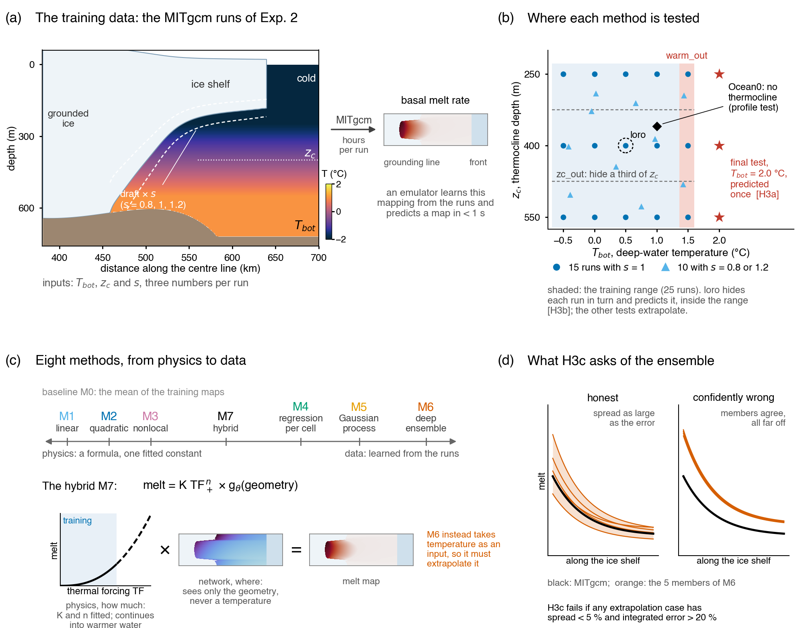
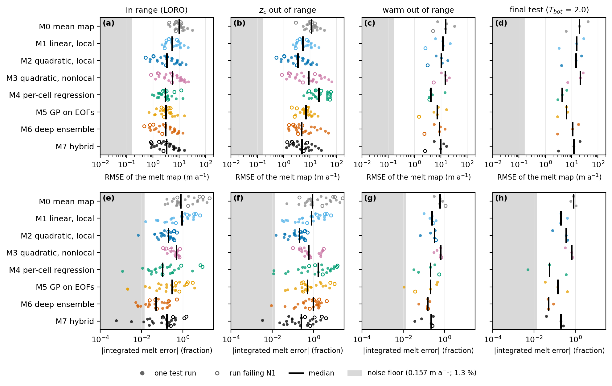
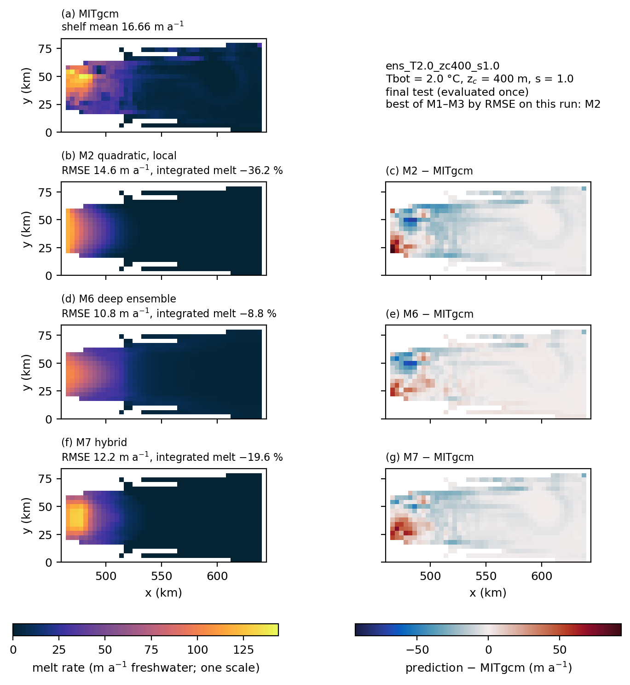
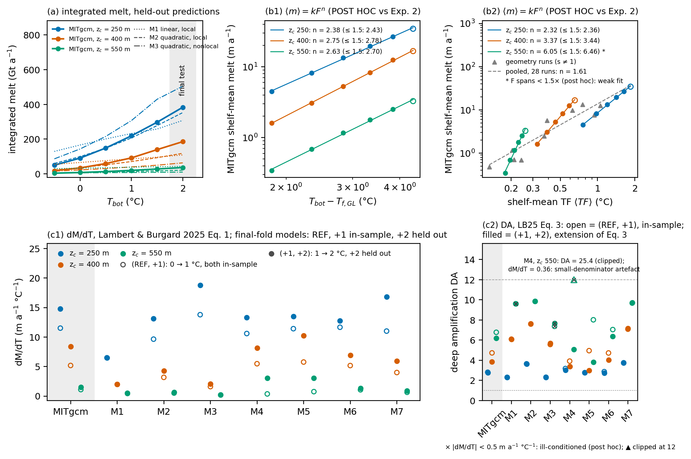
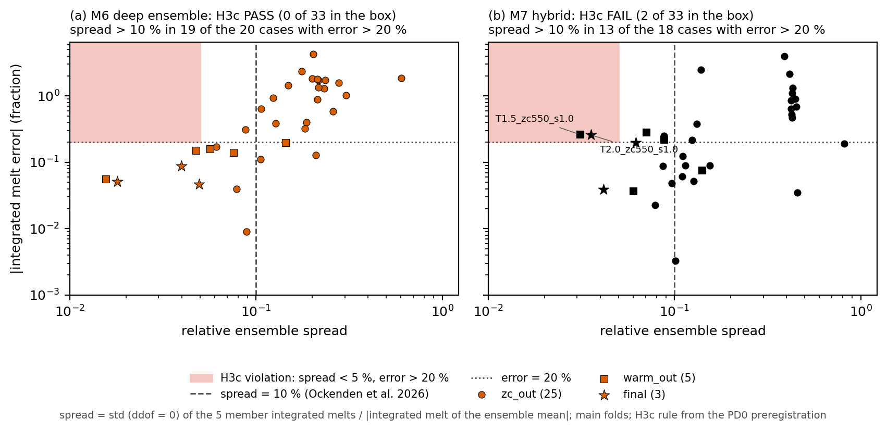

<!-- Rendered by scripts/render_readme.py: edit README.template.md, never README.md. Numbers come from figures/*.json. -->
# Experiment 3 — Emulating ice-shelf basal melt from a small cavity ensemble: simple baselines, neural networks and a physics hybrid, inside and outside the training range

**Esteban Cruz** · idealised MITgcm ensemble and statistical emulators · PhD application portfolio (2027)

## Abstract

With {{n_train}} training runs, a deep ensemble of neural networks predicts the basal-melt map of an ice-shelf cavity better than one-parameter melt parameterisations, except when the thermocline depth is out of range, but not better than a regression or a Gaussian process on the three forcing parameters, and most differences among the better methods are not resolved. We trained eight methods on the MITgcm runs of Experiment 2 and scored them only on runs they had not seen. Inside the training range (one run held out at a time), a per-cell regression on the forcing parameters (M4) has the lowest mean map error ({{rmse_loro_M4}} m a⁻¹), but a paired bootstrap over runs (post hoc) does not separate it from a Gaussian process on EOFs (M5, {{rmse_loro_M5}}), a deep ensemble of neural networks (M6, {{rmse_loro_M6}}), a hybrid of a fitted power law in thermal forcing and a network that sees only the geometry (M7, {{rmse_loro_M7}}) or the local quadratic parameterisation (M2, {{rmse_loro_M2}}), although both networks are resolved better than M2. For the warmest held-out runs, too, the lowest mean (M4) is not resolved from {{lead_rmse_warm_out_others}}. When a range of thermocline depths is held out, M2 is resolved best by all three metrics ({{rmse_zc_out_M2}} m a⁻¹), and M4 is resolved worse even than the mean map ({{rmse_zc_out_M4}}). Inside the range, the deep ensemble has a resolved lead in the error of the integrated melt ({{ire_loro_M6}} %), which becomes a tie with M2 when the {{n_n1}} training runs failing the drift criterion of Experiment 2 are left out. On the final test at Tbot = {{test_Tbot}} °C, warmer than any training run, M4, M5 and M6 have lower map errors ({{rmse_final_M4}}, {{rmse_final_M5}} and {{rmse_final_M6}} m a⁻¹) than the hybrid ({{rmse_final_M7}}) and the parameterisations, an indicative result with only {{n_final_runs}} runs. Three hypotheses were fixed before any method was evaluated on the held-out runs of the protocol and before any prediction of the Tbot = {{test_Tbot}} °C runs or of Ocean0 (what was seen on the training runs is listed in §2.6). H3a, that a hybrid of a fitted power law in thermal forcing and a network that sees only the geometry (M7) extrapolates the integrated melt better than the deep ensemble, **fails** (mean |error| {{H3a_M7}} % against {{H3a_M6}} %, better in {{H3a_nbetter}} of {{H3a_nruns}} runs). H3b, that the hybrid costs little inside the training range, **passes** (map error ratio {{H3b_ratio_obs}}, threshold {{H3b_ratio}}). H3c, a controlled replication of the DeepMelt-GL result that the spread of a network ensemble indicates its reliability (Ockenden et al., 2026), **passes** for the deep ensemble ({{H3c_M6_nviol}} confidently wrong cases out of {{H3c_M6_ncases}}) and **fails** for the hybrid ({{H3c_M7_nviol}}). On the ISOMIP+ Ocean0 profile, which is not an H3c case, the deep ensemble's spread ({{prof_M6_spread}} %) stayed below the {{ock_spread}} % flag of Ockenden et al. (2026) while its integrated error was {{prof_M6_ire}} %. A post hoc diagnosis shows that the hybrid fails badly on that profile ({{prof_M7_ire}} % integrated melt), because its geometry network learned a dependence that holds only for the thermocline thickness of the training runs. Every number below is read from the metrics files in `figures/`.

## 1. Introduction

Melting at the base of Antarctic ice shelves is computed in ice-sheet models from the ocean temperature and salinity in front of, or beneath, the shelf, through a parameterisation (Favier et al., 2019; Jourdain et al., 2020; Burgard et al., 2022). The simplest are linear or quadratic in the thermal forcing, the difference between the ocean temperature and the local freezing point. The quadratic form rests on the feedback found by Holland et al. (2008): warmer water melts more, the meltwater speeds up the boundary current under the ice, and the faster current carries heat to the ice more efficiently. ISMIP6 uses a local and a nonlocal version of it (Jourdain et al., 2020). More elaborate parameterisations represent the cavity circulation as boxes (Reese et al., 2018) or plumes (Lazeroms et al., 2018). Calibrated to the same present-day melt, these models disagree widely on how much the melt grows when the deep water warms, so a present-day calibration does not fix the sensitivity (Lambert & Burgard, 2025). The response simulated by cavity models also departs from the simple quadratic law, because the efficiency of the ice–ocean heat transfer depends on the shape of the ice and on the temperature (Little et al., 2009), and a box model gives a quadratic response for small and a linear one for large forcing (Olbers & Hellmer, 2010). Experiment 2 of this portfolio found an ISOMIP+ cavity whose melt is almost exactly quadratic in the deep-water temperature but steeper than the pre-registered power law, and depends strongly on the thermocline depth.

Neural-network emulators of the melt are the alternative. MELTNET, a convolutional network trained on thousands of idealised NEMO cavity simulations, predicts melt maps from geometry and far-field profiles (Rosier et al., 2023). Burgard et al. (2023) trained a per-cell multilayer perceptron on circumpolar NEMO simulations, and found it performed at least as well as the parameterisations, though in much warmer conditions both struggled. DeepMelt-GL (Ockenden et al., 2026) is a per-cell network for the regions of cavities that ocean models do not resolve. It reports two results that this experiment set out to test in a controlled case: neural networks are "particularly sensitive to temperatures and ice-draft slopes outside those used in the training dataset", and "the ensemble spread of the neural networks is a good indicator of the reliability of the emulator", with a provisional threshold for the spread relative to the integrated melt. We replicate that second result here; we do not present it as new.

The training set of an emulator built on a cavity model is small: each run is expensive, and the number of independent forcings, not the number of grid cells, limits generalisation. With few runs, simple baselines often win. A linear pattern-scaling regression beat deep learning in three of four variables of a climate-emulation benchmark, because the networks overfitted internal variability (Lütjens et al., 2025); Gaussian processes on principal components were more accurate and better calibrated than neural networks for computer-model emulation with few runs (Myren & Lawrence, 2021); for the Antarctic sea-level contribution, a recurrent network beat a Gaussian process with many runs, though Gaussian processes remained a good choice for small data sets (Van Katwyk et al., 2023). In an idealised ocean model, physically constrained networks generalised poorly to new regimes (Ross et al., 2023). Deep ensembles estimate the uncertainty of a network simply (Lakshminarayanan et al., 2017), but the evidence that their spread tracks the error outside the training data is thin.

Here we use the {{n_runs_total}} runs of Experiment 2, an ISOMIP+ cavity (Asay-Davis et al., 2016) at 4 km in which the deep-water temperature Tbot, the thermocline depth z_c and the ice-draft scale s vary, to compare eight methods (Figure 0): a mean map, three one-parameter parameterisations, two statistical emulators on the forcing parameters, a deep ensemble of neural networks, and a hybrid that multiplies a fitted power law in the local thermal forcing by a network that sees only the geometry. The hybrid is meant to keep the physics of the temperature dependence and leave only the spatial pattern to the network, so that it extrapolates in temperature. Every method is tested on runs it has not seen: inside the training range, outside it in thermocline depth and in temperature, on a different profile shape, and on three runs at Tbot = {{test_Tbot}} °C evaluated once. The experiment asks which method predicts the melt best with this little data, and when the networks can be trusted outside their training range. Three hypotheses and all thresholds were fixed before any method was evaluated on the held-out runs and before any prediction of the final-test runs or Ocean0 (`notes/pd0_preregistro.md`; what was seen on the training runs is listed in §2.6), and the ranking of the methods was declared a reported result, not a hypothesis, whichever method won.



*Figure 0.* The protocol; no result of this experiment is drawn. (a) The training data. A section along the centre line of the ISOMIP+ ice shelf (the input geometry of Cornford and Asay-Davis, 2016, vertically exaggerated), with the ocean coloured by one ramp profile of the design. Each run of Experiment 2 is set by three numbers: the deep-water temperature Tbot, the thermocline depth z_c, and the factor s that scales the ice draft (dashed: the draft scaled down and up). MITgcm turns them into a map of the basal melt rate in hours; an emulator learns that mapping from the runs and predicts a map almost at once. (b) Where each method is tested, in the (Tbot, z_c) plane of the design. The shaded box holds the {{n_train}} training runs ({{n_factorial}} with the draft unscaled, {{n_geometry}} with it scaled). loro hides each run in turn and stays inside that range; it is the test of H3b. The other tests extrapolate: zc_out hides a third of the thermocline depths, warm_out the five warmest runs, the profile test predicts Ocean0, whose profile has no thermocline, and the final test predicts three runs at Tbot = {{test_Tbot}} °C, once; it is the test of H3a. (c) The eight methods, ordered from a physical formula with one fitted constant (M1–M3) to learned only from the runs (M6), in the colours of Figures 1–4, and the baseline M0. The hybrid M7 is the product of a power law in the local thermal forcing, which sets how much ice melts and continues into warmer water, and a network that sees only the geometry and sets where it melts; its network is never asked about a temperature outside the training range, while M6 takes temperature as an input. (d) What H3c asks of the deep ensemble: its spread should grow with its error (left), and it fails if any extrapolation case has a small spread and a large error (right). The melt maps, the power law and the ensemble members are an illustration computed from the input geometry and the profile in (a), not output of MITgcm or of any method. Drawn with matplotlib by `figures/src/fig0_protocol.py`.

## 2. Methods

### 2.1 Data

The data are the {{n_runs_total}} runs of Experiment 2 (`exp2_isomip_cavity/`, dataset sha256 `{{dataset_sha12}}…`, outside the repository): the ISOMIP+ geometry at 4 km with a ramp profile, cold surface water over deep water at Tbot joined by a thermocline of thickness d = 300 m centred at depth z_c. The target is the melt map in m a⁻¹ of freshwater (positive = melting), the mean over months {{nf_months}}. Refreezing cells (negative melt) are kept, never clipped.

- **Training set ({{n_train}} runs):** the {{n_factorial}} factorial runs (Tbot = {{fact_Tbot}} °C; z_c = {{fact_zc}} m; unscaled draft) and {{n_geometry}} geometry runs with the ice draft scaled by s = {{s_values}} and (Tbot, z_c) drawn from a Latin hypercube.
- **Final test ({{n_test}} runs):** Tbot = {{test_Tbot}} °C at the three factorial z_c, warmer than any training run.
- **Profile test (`ocean0_4km`):** the ISOMIP+ Ocean0 profile, linear from surface to bottom, which is a ramp with Tbot = {{prof_Tbot}} °C, z_c = {{prof_zc}} m and d = {{prof_d}} m. It is never in any training set.
- **N1 runs:** {{n_n1}} training runs failed the drift criterion N1 of Experiment 2 ({{n1_list}}). They stay in the training set, are marked in every per-run figure, and a sensitivity repeat drops them (§3.6).

Each method predicts on the union of the shelf masks, but every metric uses only the evaluated run's own shelf mask (the mask changes with s). The grid is uniform, so area weighting is a plain mean over the mask. The thermal forcing is TF = T − T_f(S, p) at the ice base, with the liquidus of Asay-Davis et al. (2016, Table 4) imported from Experiment 2.

### 2.2 The eight methods

Every fitted quantity (standardisation, EOFs, kernel, coefficients, polynomial degree, network weights, the choice of forcing of M7) is refitted inside each fold from its training runs only. c = ρ_sw c_p / (ρ_i L_i) = {{c_const}} K⁻¹ with the constants of Favier et al. (2019, Table 2).

- **M0, mean map:** the per-cell mean of the training maps. It is the reference of the skill scores.
- **M1, linear local:** m = γ c TF (Favier et al., 2019, Eq. 2), one coefficient, closed-form least squares over all training shelf cells.
- **M2, quadratic local:** m = K c² |TF| TF, the form of Favier et al. (2019, Eq. 4) and of Burgard et al. (2022, Eq. 14), with the exchange velocity (Favier) or the slope and far-field factors (Burgard) folded into K. One coefficient, fitted as M1.
- **M3, quadratic nonlocal:** m = K c² TF |⟨TF⟩|, with ⟨TF⟩ the shelf-mean thermal forcing (Jourdain et al., 2020, Eq. 1; Favier et al., 2019, Eq. 5). One coefficient. M1–M3 keep the sign of TF.
- **M4, per-cell regression:** at each cell, a polynomial of degree {{M4_degrees}} ({{M4_n_terms}} terms for the quadratic) in the standardised (Tbot, z_c, s), fitted by least squares; the degree is chosen by an inner leave-one-run-out over the fold's training runs (mean rmse_map; a tie goes to the linear).
- **M5, Gaussian process on EOFs** (Myren & Lawrence, 2021, §3.1): the maps are standardised per cell and decomposed by SVD; the smallest number of EOFs with ≥ {{M5_var}} % of the variance is kept, at most {{M5_kcap}} for m training runs ({{M5_k_range}} EOFs in the main folds). Each EOF coefficient gets a Gaussian process on (Tbot, z_c, s) with kernel Constant ({{M5_const_b}}) × ARD RBF ({{M5_rbf_b}}) + White (initial {{M5_white0}}, bounds {{M5_white_b}}), normalised targets and {{M5_restarts}} restarts. The white-noise term is a small, bounded nugget: its bounds were a pre-registration decision, set so that it cannot absorb signal given the noise floor (§2.4). Myren & Lawrence's formulation has no nugget; Berdahl et al. (2021, §2.3) also use a small nugget for numerical conditioning. The predictive variance is propagated through the EOFs; the truncation error is not added.
- **M6, deep ensemble** (Lakshminarayanan et al., 2017): {{nn_members}} multilayer perceptrons ({{nn_hidden}}, ReLU) with seeds {{nn_seeds}}, each with outputs (μ, σ²), trained with the Gaussian negative log-likelihood, no bagging, and combined as a uniform Gaussian mixture. Inputs: the {{M6_n_feat}} per-cell features {{M6_feats}} (draft_minus_zc is the depth of the ice base below the thermocline centre).
- **M7, hybrid:** m = K b(TF)ⁿ g_θ(x_g), where g_θ is a network ({{nn_hidden}}, ReLU) of the {{M7_n_feat}} geometric features x_g = ({{M7_feats}}), which contain no temperature. K and n are trained per member, starting from n₀ = {{M7_n0}} and K₀ from the closed-form M2 (or M3) fit. The forcing is either local, b = TF₊ = max(TF, 0), or nonlocal, b = the square root of TF₊ |⟨TF⟩|; the choice is made inside each fold by an inner leave-one-run-out (mean rmse_map; a tie goes to local). The variance is σ² = softplus(h₀(x_g))² + (softplus(h₁(x_g)) · stopgrad(μ))² + {{nn_var_floor}}, so the network still never sees temperature. {{nn_members}} members, trained like M6.

**Training of M6 and M7.** Adam (learning rate {{nn_lr}}), batches of {{nn_batch}} cells, double precision on CPU, deterministic algorithms and one thread, so results are byte-reproducible. Each member holds out {{nn_val}} validation runs stratified by Tbot (one drawn at random at the highest level, one at the median and one at the lowest, with the member's seed); training stops after {{nn_patience}} epochs without improvement of their mean rmse_map (cap {{nn_max_epochs}} epochs; it was reached by none of the {{nn_members_trained}} member trainings of the {{nn_units}} M6/M7 cross-validation units; the inner fits that choose the forcing of M7 do not record it). Validation runs enter neither the gradients nor the standardisation.

### 2.3 Held-out sets

| Set | Folds | Training / test runs | What it tests |
|---|---|---|---|
| `loro` | {{loro_n}} | {{loro_train}} / one, each training run once | inside the training range |
| `zc_out` | {{zc_out_n}} | {{zc_out_train}} / {{zc_out_test}}: thirds by z_c (test z_c {{zc_out_ranges}}), geometry runs included | thermocline depth out of range |
| `warm_out` | one | Tbot ≤ {{warm_train_max}} °C ({{warm_n_train}}) / Tbot ≥ {{warm_test_min}} °C ({{warm_n_test}}) | warm water out of range |
| `profile_test` | one | {{n_train}} / `ocean0_4km`, for {{profile_methods}} only | a different profile shape |
| `final` | one | {{n_train}} / the {{n_test}} runs at Tbot = {{test_Tbot}} °C, **evaluated once** | extrapolation in temperature |

M4 and M5 receive only (Tbot, z_c, s) and cannot represent the profile shape of `ocean0_4km`, so they were excluded from `profile_test` before any run. The final test was run once by `run_protocol.py --final`, which refuses to run again if its result or its start marker exists; once an attempt has completed there is no override (only an attempt recorded as crashed may be repeated, from scratch; attempts recorded in `final_test.json`: {{final_attempts}}, status {{final_status}}).

### 2.4 Metrics and the noise floor

Per held-out run (Burgard et al., 2022): rmse_map, the area-weighted RMSE of the melt map over the run's shelf (Eq. 32); the relative error of the integrated melt, (Σ pred − Σ melt)/Σ melt (Eqs. 33–34, for one shelf); and rmse_gl, the absolute difference of the mean melt over the {{gl_frac}} % of shelf cells nearest the grounding line (Eq. 35 for one shelf and one period; its RMS over runs is reported). For M5–M7, coverage of the central predictive intervals and the CRPS are stored in `cv_results.json`; for M6 and M7 the ensemble spread is the standard deviation of the {{nn_members}} members' integrated melts over the |integrated melt of the ensemble mean| (Ockenden et al., 2026).

There are no duplicate runs, so the noise of a melt map was estimated as the RMS difference between its mean over months {{nf_months}} and over the six months before, for each of the {{nf_n}} training runs (`analysis/noise_floor.py`). The median is **{{nf_rms}} m a⁻¹** (range {{nf_min}}–{{nf_max}}); for the integrated melt the median |drift| is **{{nf_ire}} %**. No difference between methods smaller than these floors is interpreted.

The pre-registration asks for bootstrap intervals over runs but does not fix their settings, nor how two methods are compared. We resample the held-out runs of each set with replacement, using the same resampled runs for every method, and report the percentile {{boot_level}} % interval of each method's mean (`analysis/bootstrap.py`, `figures/bootstrap.json`); no method is refitted. The number of resamples, B = {{boot_B}}, and the seed, {{boot_seed}}, were the analyst's choice, made at analysis time after the results were known. The hypotheses H3a–H3c are defined on the means, as pre-registered, and do not use these intervals. **Post hoc** (added at the final review), the same resampled runs give the interval of the difference between two methods; a difference counts as resolved only if that interval excludes zero and the mean difference is above the noise floor ({{nf_rms}} m a⁻¹ or {{nf_ire}} %). The methods not resolved from the one with the lowest mean are called the leading methods below.

### 2.5 Pre-registered criteria

| | Hypothesis | Test cases | Pass rule |
|---|---|---|---|
| H3a | The hybrid extrapolates the integrated melt better than the deep ensemble | final test, {{n_test}} runs | mean \|integrated error\| of M7 < M6, and M7 better in ≥ {{H3a_min_better}} of {{n_test}} runs; inconclusive if the means differ by less than {{H3a_floor}} % |
| H3b | The hybrid costs little inside the training range | `loro`, {{H3b_nfolds}} main folds | mean rmse_map of M7 ≤ {{H3b_ratio}} × M6 |
| H3c | The ensemble is never confidently wrong out of range (replication of Ockenden et al., 2026) | `zc_out`, `warm_out` and final test runs, {{H3c_M6_ncases}} cases, M6 and M7 separately | no case with spread < {{H3c_spread}} % and \|integrated error\| > {{H3c_err}} %; the {{ock_spread}} % spread threshold of Ockenden et al. is reported as a confusion table |

The ranking of the eight methods was declared a reported result, and the pre-registration states that if M2, M3, M4 or M5 wins, that is the main result. H3a–H3c use only the main folds, never the N1 sensitivity repeat. Every model–reference difference is classified as (a) our error, (b) missing physics, (c) method choice or (d) an error in the reference, and analyses defined after seeing results are labelled post hoc.

### 2.6 What was seen before the thresholds were fixed

The pre-registration (`notes/pd0_preregistro.md`, "Divulgación") lists everything seen before the thresholds were fixed; the main items are below. All of it comes from the training runs; no method had predicted the Tbot = {{test_Tbot}} °C runs or `ocean0_4km`.

- **M5 tuning on the training runs.** A reviewer computed an exploratory leave-one-run-out of M5 on the training runs while auditing the Gaussian process, and its in-sample fit was inspected; the nugget bounds were decided after that.
- **Stopping rule of M6/M7.** max_epochs and patience were raised after looking at inner-validation curves on the training runs of the final fold, and the stratified validation rule (R10–R12) came from a reviewer's observations on those runs.
- **The choice of forcing of M7.** On the training runs, the local-versus-nonlocal choice reversed when the stopping rule changed; that is why it is made by a full inner leave-one-run-out (it chose local in {{M7_main_local}} of the {{M7_main_units}} main folds).
- **In-sample fits and fitted exponents.** The in-sample map errors of the ensemble means of M6 and M7 and of M2 on the training runs, and the exponents n and coefficients K fitted by the M7 members on them, were seen before the thresholds were fixed (values in the pre-registration).
- **Experiment 2 was known.** Its H1 result, a melt response steeper than the pre-registered power law, was known when the hypotheses were written.
- **The MITgcm melt of the final-test runs was public.** The shelf-mean melt of the three Tbot = {{test_Tbot}} °C runs is in Figure 2a of the Experiment 2 README. No method was fitted or evaluated against it before the final test.
- **Preliminary M7 values during the cross-validation.** Esteban saw preliminary M7 values of finished units while the cross-validation ran, after Amendment 1 had been decided; the protocol was already frozen and nothing was changed.
- **Inner selection errors printed once.** During the timing check of the cross-validation, before Esteban's instruction that no metric be shown, the inner-validation errors of the choice of forcing of M7 (training runs only) were printed for five units; only the choice (local) was relayed.
- **Amendment 1.** The frozen stop rule ended the cross-validation when its wall-clock estimate exceeded {{am_frozen_h}} h, before any metric had been looked at. Esteban raised the budget to {{am_new_h}} h; methods, folds, hyperparameters and thresholds did not change, and the amendment is recorded in `cv_results.json` and in every unit run under it ({{cv_resumed}} units written before it were kept, since each unit is an independent, deterministic fit).
- **The final test ran once** ({{final_attempts}} attempt, {{final_created}}, {{final_wall_min}} min), with the configuration frozen at the pre-registration (`protocol_config.json`, sha256 `{{config_sha12}}…`).

## 3. Results

The cross-validation fitted {{cv_units}} units (variant × fold × method) with {{cv_workers}} single-threaded processes: {{cv_resumed}} in a first session stopped by the frozen wall-clock rule and the rest in {{cv_wall_h}} h of wall clock after Amendment 1 ({{cv_cpu_h}} CPU hours in all), giving {{cv_entries}} per-run entries.

### 3.1 Ranking: few differences are resolved

| Method | loro: rmse_map | loro: \|int. err.\| (%) | zc_out: rmse_map | zc_out: \|int. err.\| (%) | warm_out: rmse_map | warm_out: \|int. err.\| (%) | final: rmse_map | final: \|int. err.\| (%) |
|---|---|---|---|---|---|---|---|---|
| M0 mean map | {{rmse_loro_M0}} ({{rmse_ci_loro_M0}}) | {{ire_loro_M0}} ({{ire_ci_loro_M0}}) | {{rmse_zc_out_M0}} ({{rmse_ci_zc_out_M0}}) | {{ire_zc_out_M0}} ({{ire_ci_zc_out_M0}}) | {{rmse_warm_out_M0}} ({{rmse_ci_warm_out_M0}}) | {{ire_warm_out_M0}} ({{ire_ci_warm_out_M0}}) | {{rmse_final_M0}} ({{rmse_ci_final_M0}}) | {{ire_final_M0}} ({{ire_ci_final_M0}}) |
| M1 linear local | {{rmse_loro_M1}} ({{rmse_ci_loro_M1}}) | {{ire_loro_M1}} ({{ire_ci_loro_M1}}) | {{rmse_zc_out_M1}} ({{rmse_ci_zc_out_M1}}) | {{ire_zc_out_M1}} ({{ire_ci_zc_out_M1}}) | {{rmse_warm_out_M1}} ({{rmse_ci_warm_out_M1}}) | {{ire_warm_out_M1}} ({{ire_ci_warm_out_M1}}) | {{rmse_final_M1}} ({{rmse_ci_final_M1}}) | {{ire_final_M1}} ({{ire_ci_final_M1}}) |
| M2 quadratic local | {{rmse_loro_M2}} ({{rmse_ci_loro_M2}}) | {{ire_loro_M2}} ({{ire_ci_loro_M2}}) | **{{rmse_zc_out_M2}} ({{rmse_ci_zc_out_M2}})** | **{{ire_zc_out_M2}} ({{ire_ci_zc_out_M2}})** | {{rmse_warm_out_M2}} ({{rmse_ci_warm_out_M2}}) | {{ire_warm_out_M2}} ({{ire_ci_warm_out_M2}}) | {{rmse_final_M2}} ({{rmse_ci_final_M2}}) | {{ire_final_M2}} ({{ire_ci_final_M2}}) |
| M3 quadratic nonlocal | {{rmse_loro_M3}} ({{rmse_ci_loro_M3}}) | {{ire_loro_M3}} ({{ire_ci_loro_M3}}) | {{rmse_zc_out_M3}} ({{rmse_ci_zc_out_M3}}) | {{ire_zc_out_M3}} ({{ire_ci_zc_out_M3}}) | {{rmse_warm_out_M3}} ({{rmse_ci_warm_out_M3}}) | {{ire_warm_out_M3}} ({{ire_ci_warm_out_M3}}) | {{rmse_final_M3}} ({{rmse_ci_final_M3}}) | {{ire_final_M3}} ({{ire_ci_final_M3}}) |
| M4 per-cell regression | **{{rmse_loro_M4}} ({{rmse_ci_loro_M4}})** | {{ire_loro_M4}} ({{ire_ci_loro_M4}}) | {{rmse_zc_out_M4}} ({{rmse_ci_zc_out_M4}}) | {{ire_zc_out_M4}} ({{ire_ci_zc_out_M4}}) | **{{rmse_warm_out_M4}} ({{rmse_ci_warm_out_M4}})** | {{ire_warm_out_M4}} ({{ire_ci_warm_out_M4}}) | **{{rmse_final_M4}} ({{rmse_ci_final_M4}})** | {{ire_final_M4}} ({{ire_ci_final_M4}}) |
| M5 GP on EOFs | {{rmse_loro_M5}} ({{rmse_ci_loro_M5}}) | {{ire_loro_M5}} ({{ire_ci_loro_M5}}) | {{rmse_zc_out_M5}} ({{rmse_ci_zc_out_M5}}) | {{ire_zc_out_M5}} ({{ire_ci_zc_out_M5}}) | {{rmse_warm_out_M5}} ({{rmse_ci_warm_out_M5}}) | {{ire_warm_out_M5}} ({{ire_ci_warm_out_M5}}) | {{rmse_final_M5}} ({{rmse_ci_final_M5}}) | {{ire_final_M5}} ({{ire_ci_final_M5}}) |
| M6 deep ensemble | {{rmse_loro_M6}} ({{rmse_ci_loro_M6}}) | **{{ire_loro_M6}} ({{ire_ci_loro_M6}})** | {{rmse_zc_out_M6}} ({{rmse_ci_zc_out_M6}}) | {{ire_zc_out_M6}} ({{ire_ci_zc_out_M6}}) | {{rmse_warm_out_M6}} ({{rmse_ci_warm_out_M6}}) | **{{ire_warm_out_M6}} ({{ire_ci_warm_out_M6}})** | {{rmse_final_M6}} ({{rmse_ci_final_M6}}) | **{{ire_final_M6}} ({{ire_ci_final_M6}})** |
| M7 hybrid | {{rmse_loro_M7}} ({{rmse_ci_loro_M7}}) | {{ire_loro_M7}} ({{ire_ci_loro_M7}}) | {{rmse_zc_out_M7}} ({{rmse_ci_zc_out_M7}}) | {{ire_zc_out_M7}} ({{ire_ci_zc_out_M7}}) | {{rmse_warm_out_M7}} ({{rmse_ci_warm_out_M7}}) | {{ire_warm_out_M7}} ({{ire_ci_warm_out_M7}}) | {{rmse_final_M7}} ({{rmse_ci_final_M7}}) | {{ire_final_M7}} ({{ire_ci_final_M7}}) |

*Table 1.* Mean over the held-out runs of rmse_map (m a⁻¹) and of |integrated relative error| (%), main variant; {{n_loro_runs}}, {{n_zc_out_runs}}, {{n_warm_out_runs}} and {{n_final_runs}} runs. In parentheses, the percentile {{boot_level}} % bootstrap interval of the mean over runs (§2.4); with {{n_final_runs}} final-test runs those intervals are indicative only. The best mean in each column is in bold. Means of |integrated error| are dominated by a few low-melt runs; the medians are in `hypotheses.json`.



*Figure 1.* Error by method in the four held-out sets, one point per run (open: a run failing N1), the bar is the median. Top: rmse_map; bottom: |integrated relative error|. The grey band is the noise floor.

**By the map error, the lowest mean inside the training range is not resolved.** In `loro` M4 has the lowest mean (order {{order_rmse_loro}}), but M2, M5, M6 and M7 are not resolved from it (leading methods {{lead_rmse_loro}}; for example M6 − M4 is {{loro_M6_M4_ci}} m a⁻¹, post hoc). Among M4–M7 the only resolved difference is that M7 is worse than M6; both networks are resolved better than M1–M3. In `warm_out` the leading methods are {{lead_rmse_warm_out}}, and M6 is resolved better than M1–M3. On the final test the leading methods are {{lead_rmse_final}}: each is resolved better than M1–M3 and than the hybrid, and M5 also better than M6 (indicative, {{n_final_runs}} runs). In no set of the main variant is a network resolved better than the Gaussian process M5. The quadratic of M4 in (Tbot, z_c, s) was chosen in {{M4_main_quad}} of {{M4_main_units}} main folds.

**When a range of thermocline depths is held out, the differences are resolved.** M2 is the only leading method by all three metrics (map order {{order_rmse_zc_out}}), and the regression M4 is resolved worse even than the mean map ({{rmse_zc_out_M4}} m a⁻¹). A polynomial in z_c cannot extrapolate across the thermocline, while M2 sees the thermocline through the local temperature at the ice base. The nonlocal quadratic M3, which sees only the shelf-mean forcing, has a higher mean error than M2 in every set.

**By the integrated melt, the deep ensemble M6 has the lowest mean** in `loro` (order {{order_ire_loro}}), `warm_out` ({{order_ire_warm_out}}) and the final test ({{order_ire_final}}), but its lead is resolved only in `loro`; in `warm_out` and on the final test the leading methods are {{lead_ire_warm_out}} (`warm_out`) and {{lead_ire_final}} (final test). By the grounding-line error the leading methods are {{lead_gl_loro}} in `loro`. In `zc_out` the order by |integrated error| is {{order_ire_zc_out}}. The hybrid M7 never has the lowest mean in any held-out set by any of the three metrics, and inside the range its map error is resolved above that of M6 (difference {{loro_M7_M6_diff}} m a⁻¹, interval {{loro_M7_M6_ci}}), although by less than the H3b margin.

The marginal intervals in Table 1 overlap for M4–M7 in `loro`, `warm_out` and the final test (for example {{rmse_ci_loro_M4}} m a⁻¹ for M4 against {{rmse_ci_loro_M6}} for M6 in `loro`); in `zc_out` the interval of M2 ({{rmse_ci_zc_out_M2}}) lies entirely below that of M4 ({{rmse_ci_zc_out_M4}}).

{{table_skill}}

*Table 2.* Skill against the mean map M0 (pre-registered; 1 − error/error of M0, mean over runs): rmse_map / |integrated relative error|. Negative = worse than the mean map.

### 3.2 The final test

{{table_final}}

*Table 3.* Final test at Tbot = {{test_Tbot}} °C, evaluated once: rmse_map (m a⁻¹) / signed integrated relative error (%), and for M6 and M7 the ensemble spread (%) in parentheses. Integrated MITgcm melt (m a⁻¹ × cells): {{final_true_250}}, {{final_true_400}} and {{final_true_550}}.



*Figure 2.* Melt maps of the final-test run at z_c = {{f2_zc}} m (MITgcm shelf mean {{f2_mean}} m a⁻¹): MITgcm, the best of M1–M3 on that run ({{f2_best}}), M6 and M7 on one colour scale, and each prediction minus MITgcm. On this run {{f2_best}} has rmse_map {{f2_M2_rmse}} m a⁻¹ and integrated error {{f2_M2_ire}} %, M6 {{f2_M6_rmse}} and {{f2_M6_ire}} %, M7 {{f2_M7_rmse}} and {{f2_M7_ire}} %.

On the z_c = {{zc_b}} m run every method except M4 and M5 underestimates the integrated melt, and M1–M3 underestimate it by more than M6 and M7. This is consistent with a single coefficient, fitted on cooler runs, that cannot follow the steeper-than-quadratic response of Experiment 2 (§3.3), but no test here isolates that cause.

### 3.3 Physics diagnostics



*Figure 3.* (a) Integrated melt against Tbot for each z_c: MITgcm and the held-out predictions of M1–M3 (their `loro` fold, and the final test at Tbot = {{test_Tbot}} °C). (b1) and (b2) **Post hoc relative to Experiment 2**: power laws of the MITgcm shelf-mean melt against Tbot − T_f at the grounding line and against the shelf-mean TF. (c1) and (c2) Melt sensitivities of Lambert & Burgard (2025, Eqs. 1 and 3; Eq. 2 in Table 4) for each method's final-fold model.

**(a)** M1, linear in TF, is too flat at all z_c; M2 follows MITgcm at z_c = {{zc_a}} m but is too flat at {{zc_b}} and {{zc_c}} m; M3 overestimates the melt at {{zc_a}} m and underestimates it at {{zc_b}} and {{zc_c}} m, where the shelf-mean forcing it multiplies by changes little with Tbot (panel b).

**(b) Post hoc relative to Experiment 2.** Experiment 2 pre-registered a power law in Tbot − T_f,GL over Tbot ≤ {{exp2_Tmax}} °C; the Tbot = {{test_Tbot}} °C runs and the shelf-mean TF as forcing are added here after the fact and are descriptive only. Including the final-test runs barely changes the exponent in Tbot − T_f,GL: n = {{pl_dT_250}}, {{pl_dT_400}} and {{pl_dT_550}} at z_c = {{zc_a}}, {{zc_b}} and {{zc_c}} m ({{pl_dT_250_le}}, {{pl_dT_400_le}} and {{pl_dT_550_le}} without them). Against the shelf-mean TF the exponent is {{pl_TF_250}}, {{pl_TF_400}} and {{pl_TF_550}}, but at z_c = {{zc_c}} m the forcing spans only {{TF550_range}} °C, so that exponent is poorly constrained (a post hoc display flag); pooled over the {{pl_pooled_runs}} non-reference runs, n = {{pl_pooled_n}} with R² = {{pl_pooled_R2}} in log space. A single power law in a shelf-mean forcing does not describe this ensemble.

**(c)** The sensitivities of Lambert & Burgard (2025) with REF, +1 and +2 at Tbot = {{lb_T}} °C, M the shelf-mean melt, dM/dT over (REF, +1) and (+1, +2), and the deep amplification DA, the ratio of dM/dT over the deepest tenth of the draft to dM/dT over the shelf:

{{table_lambert}}

*Table 4.* dM/dT (m a⁻¹ °C⁻¹) over (REF, +1) / (+1, +2) with the nonlinearity d²M/dT² (Eq. 2, m a⁻¹ °C⁻²) in parentheses, and DA over (REF, +1) / (+1, +2). × marks |dM/dT| < {{da_thr}} m a⁻¹ °C⁻¹, an ill-conditioned ratio.

Three caveats apply. First, REF and +1 are **in-sample** for the final-fold models (they were trained on those runs) and only +2 is held out, so the (REF, +1) values of the flexible methods M4–M7 largely reproduce their training data. Second, DA over (+1, +2) is our extension of Lambert & Burgard (2025, Eq. 3), which defines DA over (REF, +1). Third, the two display thresholds of the figure, |dM/dT| < {{da_thr}} m a⁻¹ °C⁻¹ for an ill-conditioned DA and the axis clip, are post hoc; the M4 value at z_c = {{zc_c}} m (DA = {{M4_550_DA}} with dM/dT = {{M4_550_dMdT}} m a⁻¹ °C⁻¹) is a small-denominator point, not a physical amplification. MITgcm's DA over (REF, +1) is {{da_mit_250}}, {{da_mit_400}} and {{da_mit_550}} at z_c = {{zc_a}}, {{zc_b}} and {{zc_c}} m: the deeper the thermocline, the more the warming concentrates on the deepest ice. The one-coefficient parameterisations M1–M3 overestimate DA at z_c = {{zc_b}} m.

### 3.4 Hypotheses

**H3a fails.** On the final test the mean |integrated error| of the hybrid is {{H3a_M7}} % against {{H3a_M6}} % for the deep ensemble, a difference far above the {{H3a_floor}} % floor, and M7 is better on only {{H3a_nbetter}} of the {{H3a_nruns}} runs ({{H3a_better}}). With {{H3a_nruns}} runs this is an indication, not a conclusion, but it is the opposite of the hypothesis: the fitted power law in TF did not make the extrapolation in temperature better than a network that receives temperature as an input.

**H3b passes.** Inside the training range (`loro`, {{H3b_nfolds}} folds), the mean rmse_map of M7 is {{H3b_M7}} m a⁻¹ against {{H3b_M6}} for M6, a ratio of {{H3b_ratio_obs}}, below the threshold of {{H3b_ratio}}. Both are among the leading methods by map error inside the range (§3.1).

**H3c passes for the deep ensemble and fails for the hybrid.** Over the {{H3c_M6_ncases}} out-of-range cases, M6 has {{H3c_M6_nviol}} cases with spread < {{H3c_spread}} % and |integrated error| > {{H3c_err}} %. M7 has {{H3c_M7_nviol}}: {{H3c_M7_viol_list}}. With the {{ock_spread}} % spread threshold of Ockenden et al. (2026), M6 has {{ock_M6_lh}} low-spread, high-error case ({{H3c_M6_lowhigh}}), and M7 has {{ock_M7_lh}}.

| | spread > {{ock_spread}} %, error > {{H3c_err}} % | spread > {{ock_spread}} %, error ≤ {{H3c_err}} % | spread ≤ {{ock_spread}} %, error > {{H3c_err}} % | spread ≤ {{ock_spread}} %, error ≤ {{H3c_err}} % |
|---|---|---|---|---|
| M6 | {{ock_M6_hh}} | {{ock_M6_hl}} | {{ock_M6_lh}} | {{ock_M6_ll}} |
| M7 | {{ock_M7_hh}} | {{ock_M7_hl}} | {{ock_M7_lh}} | {{ock_M7_ll}} |

*Table 5.* Spread against |integrated error| over the {{H3c_M6_ncases}} H3c cases, at the threshold of Ockenden et al. (2026).



*Figure 4.* |Integrated relative error| against the relative ensemble spread for M6 and M7 over the H3c cases; the shaded box is the H3c failure region (spread < {{H3c_spread}} %, error > {{H3c_err}} %), the dashed line the {{ock_spread}} % threshold of Ockenden et al. (2026).

For the deep ensemble this replicates the DeepMelt-GL result in a controlled case: over the {{H3c_M6_ncases}} H3c cases, large errors out of range came with a spread above the H3c threshold. It is not a guarantee: on the Ocean0 profile (§3.5), not an H3c case, its spread of {{prof_M6_spread}} % stayed below the {{ock_spread}} % flag of Ockenden et al. while the error was {{prof_M6_ire}} %. For the hybrid it does not. A plausible reason, not tested here, is that its members share the form of the fitted power law, so they can agree with each other where they are all wrong. Both M7 violations are at z_c = {{zc_c}} m, where the melt is smallest.

**Coverage, CRPS and skill (pre-registered metrics).** The predictive intervals of the deep ensemble are close to nominal inside the range (coverage {{loro_M6_c68}} and {{loro_M6_c95}} for the central {{cov_lo}} % and {{cov_hi}} % intervals), while the hybrid's are too narrow out of range ({{warm_M7_c95}} for the {{cov_hi}} % interval in `warm_out`, {{final_M7_c95}} on the final test). On Ocean0 the hybrid's {{cov_hi}} % coverage ({{prof_M7_c95}}) looks adequate only because its intervals are wide; its CRPS is {{prof_M7_crps}} m a⁻¹.

{{table_prob}}

*Table 6.* Mean over the held-out runs of the coverage of the central {{cov_lo}} % and {{cov_hi}} % predictive intervals over the shelf cells, and of the CRPS (m a⁻¹): c{{cov_lo}} / c{{cov_hi}} / CRPS. Main variant; `profile_test` has one run.

### 3.5 Post hoc: the profile test

On `ocean0_4km`, the ISOMIP+ Ocean0 profile (d = {{prof_d}} m) never seen in training, the integrated melt errors are: M0 {{prof_M0_ire}} %, M1 {{prof_M1_ire}} %, M2 **{{prof_M2_ire}} %**, M3 {{prof_M3_ire}} %, M6 {{prof_M6_ire}} % (spread {{prof_M6_spread}} %) and **M7 {{prof_M7_ire}} %** (rmse_map {{prof_M7_rmse}} m a⁻¹, spread {{prof_M7_spread}} %). The mean map M0 has the lowest map error ({{prof_M0_rmse}} m a⁻¹). Because the M7 error is so large, we diagnosed it after the fact (`notes/diag_profile_test.md`, `analysis/profile_test_diag.py`, `figures/profile_test_diag.json`). Nothing in the protocol was changed.

- **Not our error (a).** The Ocean0 profile in the dataset equals the ISOMIP+ profile and the ramp with z_c = {{prof_zc}} m and d = {{prof_d}} m exactly; draft, shelf mask ({{prof_cells}} cells), TF and units match the training runs and an independent recomputation; a refit of M7 reproduces the unit's integrated melts exactly.
- **Each input is in range, the combination is not.** For every feature, {{prof_marg_out}} % of the Ocean0 cells lie outside the training range (TF {{prof_TF_ref}} °C against {{prof_TF_train}} °C), so the exponent n is not extrapolated. But {{prof_cells_above}} of {{prof_cells}} cells ({{prof_frac_above}} %) have a TF larger than any training TF at the same distance from the thermocline centre: with d = 300 m in training, cells well above z_c sit in cold water with TF near zero, while with d = {{prof_d}} m they are already inside the gradient.
- **The excess comes from g_θ × TF₊ⁿ above the thermocline centre.** In the training runs the melt of the shallow cells is sustained by heat brought up by the plume from below, which a local TF₊ⁿ cannot see, so g_θ learned large values there as a function of draft_minus_zc. On Ocean0 the local TF of those cells is real and large, and the product explodes: in the band {{band_label}} m above z_c the learned g is {{band_g}} where {{band_g_need}} would reproduce MITgcm. {{prof_excess_share}} % of the excess integrated melt lies in the cells with an unseen TF; from {{deep_lo}} m above z_c downwards the error per band is {{prof_deep_err}} %.
- **K and g are not separately identified.** With g fixed at one, K TF₊ⁿ alone gives {{prof_g1_ire}} %, because K is {{prof_K_range}} against an M2-equivalent of {{prof_K0_M2}}; only the product is constrained.

{{table_profile}}

*Table 7.* M7 on `ocean0_4km` by band of draft − z_c (negative = above the thermocline centre). Σ in m a⁻¹ × cells. Post hoc.

**Classification:** (c) method choice, with a part of (b) missing physics: the separable form K TF₊ⁿ g_θ(x_g) with a local forcing cannot represent the nonlocal heat supply of the plume, and g_θ absorbs it as a function of position relative to z_c that is valid only for the training profile shape. It is a *conditional* out-of-distribution failure that no check of the marginal ranges detects. M4 and M5 were excluded from `profile_test` because they "cannot represent d = {{prof_d}} m"; the diagnosis shows that M7, like M4 and M5, effectively inherits d = 300 m, through draft_minus_zc, although it formally receives per-cell inputs. M2 has no learned position-dependent factor: its errors partly cancel in the total ({{prof_M2_ire}} %; rmse_map {{prof_M2_rmse}} m a⁻¹). M6 receives draft_minus_zc too, but also T, S, TF and ⟨TF⟩ as additive inputs, and its error stays at {{prof_M6_ire}} %. The spread of M7 ({{prof_M7_spread}} %) is far below its error, the confidently-wrong pattern that H3c looks for, although `profile_test` is not one of the H3c cases; the deep ensemble also falls in the low-spread, high-error quadrant of Ockenden et al. here (spread {{prof_M6_spread}} %, error {{prof_M6_ire}} %). The N1 sensitivity repeat gives M7 {{prof_n1_M7_ire}} % by the same mechanism. A hybrid with a nonlocal forcing, or without draft_minus_zc in x_g, would be a new, post hoc experiment and was not tried.

### 3.6 Sensitivity: without the N1 runs

The repeat without the {{n_n1}} N1-failing training runs (all folds but `final`; never used for H3a–H3c) changes which method has the lowest mean, but not what is resolved:

{{table_n1}}

*Table 8.* Sensitivity repeat (`drop_n1`): the method with the lowest mean, and the leading methods not resolved from it (paired bootstrap, post hoc).

Without these runs M4 no longer has the lowest mean inside the range (mean rmse_map {{n1_loro_M4}} m a⁻¹ in `loro`, against {{n1_loro_best_rmse}} for {{n1_loro_best}}) or for the warmest runs ({{n1_warm_M4}}, against {{n1_warm_best_rmse}} for {{n1_warm_best}}), but it stays among the leading methods in both, and M2 stays the only leading method in `zc_out`. By the integrated melt, the resolved lead of M6 inside the range becomes a tie with M2 (leading methods {{n1_lead_ire_loro}}).

## 4. Discussion

### 4.1 What the experiment shows

With {{n_train}} runs, the deep ensemble, which sees {{M6_n_feat}} per-cell features, is resolved better on the melt map than the one-coefficient parameterisations but has no resolved advantage over a regression on three numbers or a Gaussian process, inside the range or in a modest extrapolation in temperature; this is in line with Lütjens et al. (2025) for climate emulation and Myren & Lawrence (2021) for computer-model emulation. The regression has no physics and fails as soon as the thermocline depth leaves its range; there, the physical form of the local quadratic, one coefficient fitted to all cells of all runs, is resolved best. The deep ensemble has a resolved advantage only on the integrated melt inside the range, and that advantage is not robust to leaving out the N1-failing runs. Its spread was a useful warning on the H3c cases, as in DeepMelt-GL (Ockenden et al., 2026), but not on the Ocean0 profile. The hybrid, built to extrapolate in temperature, did not; its members could agree with each other while wrong, possibly because they share the fitted power law, and its geometry network silently learned the profile shape of the training set (§3.5).

### 4.2 What we cannot claim

The ranking is that of this ensemble: one geometry family, one family of profiles and a single cavity model. Most differences among the leading methods are not resolved with {{n_train}} runs, and the paired comparison that resolves them is post hoc (§2.4); the N1 repeat changes which method has the lowest mean (§3.6). The final test has {{n_test}} runs, so H3a is an indication, not a conclusion. The profile-test analysis is post hoc and covers one profile.

### 4.3 Limitations

- **Few runs:** {{n_train}} training runs, with only {{n_factorial}} on a regular factorial; the cross-validation folds fit every method to fewer.
- **One geometry family:** the ISOMIP+ geometry with the ice draft scaled, so no method is tested on another cavity shape.
- **Three final test runs**, at a single temperature.
- **Resolution:** 4 km, the resolution of the Experiment 2 ensemble; the plume near the ice base is not resolved.
- **N1 runs:** {{n_n1}} training runs failed the Experiment 2 drift criterion; they are kept and their influence is measured by the sensitivity repeat (§3.6), which changes which method has the lowest mean but not which differences are resolved.
- **One far-field profile family:** ramp profiles with d = 300 m in training; the only different shape is Ocean0 (§3.5).
- **Intervals:** the bootstrap intervals (§2.4) resample only the held-out runs, so they do not include the variability of the fits themselves; their settings were chosen at analysis time; and with {{n_warm_out_runs}} `warm_out` and {{n_final_runs}} final-test runs they are wide and, for the final test, indicative only.

## 5. Conclusions

- On the melt map the neural networks are resolved better than the one-parameter parameterisations inside the range and on the final test, but in no held-out set better than the Gaussian process M5, and inside the range none of M2, M5, M6 or M7 is resolved from the regression M4, which has the lowest mean. In every held-out set, and in the N1 sensitivity repeat, a method without a network is among the leading methods.
- When the thermocline depth is held out, the one-parameter local quadratic law M2 is resolved best by all three metrics, and the per-cell regression M4 is resolved worse than the mean map.
- The deep ensemble M6 has the lowest mean integrated-melt error in three of the four held-out sets (not when the thermocline depth is held out), resolved only inside the range and not robust to leaving out the N1-failing runs. Its spread passed H3c on the {{H3c_M6_ncases}} out-of-range cases, replicating the DeepMelt-GL result there, but on the Ocean0 profile it stayed below the {{ock_spread}} % flag with an error of {{prof_M6_ire}} %.
- The physics hybrid M7 does not extrapolate better than the deep ensemble (H3a fails), costs little inside the range (H3b passes), can be confidently wrong (H3c fails) and has too-narrow intervals out of range; on a profile shape not seen in training it fails by {{prof_M7_ire}} %, because its geometry network learned the training profile shape.
- For an emulator trained on a small cavity ensemble, a simple statistical baseline and a one-parameter physical baseline must both be included, the comparison needs paired uncertainty, and the spread of the hybrid ensemble was not a reliable warning here.

## Reproducing

```bash
bash exp3_melt_emulator/reproduce.sh --quick   # hypotheses, bootstrap, coverage, figures and README from the committed JSON
bash exp3_melt_emulator/reproduce.sh           # full: noise floor, --cv and the profile diagnosis checked against the record, then --quick
```

The protocol runs under the `anemoi` conda environment (PyTorch, scikit-learn) and the analysis under `pyocean`; tests under anemoi run through `scripts/pytest_anemoi.sh`. The frozen configuration is `figures/protocol_config.json`; `scripts/run_protocol.py --cv` verifies it, the dataset sha256 and the folds before fitting, and `--final` refuses to run a second time. The full mode needs the Experiment 2 dataset and run output (`/Volumes/LaCie/portfolio_runs/exp2`) and about {{cv_wall_h}} h of wall clock for a refit from scratch; it reuses finished cross-validation units, so with the recorded units in place it refits nothing and checks only that the results reassemble identically; a refit from scratch needs an empty units directory (the existing one is never deleted by the script). Figure 2 and Figure 3 need the final-test maps (`final_maps.npz`, sha256 `{{final_maps_sha12}}…`, outside the repository). See [RUNNING.md](../RUNNING.md).

## References

- Asay-Davis, X. S., et al. (2016). Experimental design for three interrelated marine ice sheet and ocean model intercomparison projects: MISMIP v. 3 (MISMIP+), ISOMIP v. 2 (ISOMIP+) and MISOMIP v. 1 (MISOMIP1). *Geosci. Model Dev.*, 9, 2471–2497. https://doi.org/10.5194/gmd-9-2471-2016
- Berdahl, M., Leguy, G., Lipscomb, W. H., & Urban, N. M. (2021). Statistical emulation of a perturbed basal melt ensemble of an ice sheet model to better quantify Antarctic sea level rise uncertainties. *The Cryosphere*, 15, 2683–2699. https://doi.org/10.5194/tc-15-2683-2021
- Burgard, C., Jourdain, N. C., Reese, R., Jenkins, A., & Mathiot, P. (2022). An assessment of basal melt parameterisations for Antarctic ice shelves. *The Cryosphere*, 16, 4931–4975. https://doi.org/10.5194/tc-16-4931-2022
- Burgard, C., et al. (2023). Emulating present and future simulations of melt rates at the base of Antarctic ice shelves with neural networks. *J. Adv. Model. Earth Syst.*, 15, e2023MS003829. https://doi.org/10.1029/2023MS003829
- Favier, L., et al. (2019). Assessment of sub-shelf melting parameterisations using the ocean–ice-sheet coupled model NEMO(v3.6)–Elmer/Ice(v8.3). *Geosci. Model Dev.*, 12, 2255–2283. https://doi.org/10.5194/gmd-12-2255-2019
- Holland, P. R., Jenkins, A., & Holland, D. M. (2008). The response of ice shelf basal melting to variations in ocean temperature. *J. Climate*, 21, 2558–2572. https://doi.org/10.1175/2007JCLI1909.1
- Jourdain, N. C., et al. (2020). A protocol for calculating basal melt rates in the ISMIP6 Antarctic ice sheet projections. *The Cryosphere*, 14, 3111–3134. https://doi.org/10.5194/tc-14-3111-2020
- Lakshminarayanan, B., Pritzel, A., & Blundell, C. (2017). Simple and scalable predictive uncertainty estimation using deep ensembles. *Advances in Neural Information Processing Systems 30 (NIPS 2017)*. https://doi.org/10.48550/arXiv.1612.01474
- Lambert, E., & Burgard, C. (2025). Brief communication: Sensitivity of Antarctic ice shelf melting to ocean warming across basal melt models. *The Cryosphere*, 19, 2495–2505. https://doi.org/10.5194/tc-19-2495-2025
- Lazeroms, W. M. J., Jenkins, A., Gudmundsson, G. H., & van de Wal, R. S. W. (2018). Modelling present-day basal melt rates for Antarctic ice shelves using a parametrization of buoyant meltwater plumes. *The Cryosphere*, 12, 49–70. https://doi.org/10.5194/tc-12-49-2018
- Little, C. M., Gnanadesikan, A., & Oppenheimer, M. (2009). How ice shelf morphology controls basal melting. *J. Geophys. Res.*, 114, C12007. https://doi.org/10.1029/2008JC005197
- Lütjens, B., Ferrari, R., Watson-Parris, D., & Selin, N. E. (2025). The impact of internal variability on benchmarking deep learning climate emulators. *J. Adv. Model. Earth Syst.*, 17, e2024MS004619. https://doi.org/10.1029/2024MS004619
- Myren, S., & Lawrence, E. (2021). A comparison of Gaussian processes and neural networks for computer model emulation and calibration. *Stat. Anal. Data Min.*, 14, 606–623. https://doi.org/10.1002/sam.11507
- Ockenden, H., et al. (2026). DeepMelt-GL v1: a neural network emulator of sub-shelf melt rates for the unrepresented regions of ice-shelf cavities in ocean models. *Geosci. Model Dev.*, 19, 7979–8002. https://doi.org/10.5194/gmd-19-7979-2026
- Olbers, D., & Hellmer, H. (2010). A box model of circulation and melting in ice shelf caverns. *Ocean Dyn.*, 60, 141–153. https://doi.org/10.1007/s10236-009-0252-z
- Reese, R., Albrecht, T., Mengel, M., Asay-Davis, X., & Winkelmann, R. (2018). Antarctic sub-shelf melt rates via PICO. *The Cryosphere*, 12, 1969–1985. https://doi.org/10.5194/tc-12-1969-2018
- Rosier, S. H. R., Bull, C. Y. S., Woo, W. L., & Gudmundsson, G. H. (2023). Predicting ocean-induced ice-shelf melt rates using deep learning. *The Cryosphere*, 17, 499–518. https://doi.org/10.5194/tc-17-499-2023
- Ross, A., Li, Z., Perezhogin, P., Fernandez-Granda, C., & Zanna, L. (2023). Benchmarking of machine learning ocean subgrid parameterizations in an idealized model. *J. Adv. Model. Earth Syst.*, 15, e2022MS003258. https://doi.org/10.1029/2022MS003258
- Van Katwyk, P., Fox-Kemper, B., Seroussi, H., Nowicki, S., & Bergen, K. J. (2023). A variational LSTM emulator of sea level contribution from the Antarctic Ice Sheet. *J. Adv. Model. Earth Syst.*, 15, e2023MS003899. https://doi.org/10.1029/2023MS003899
