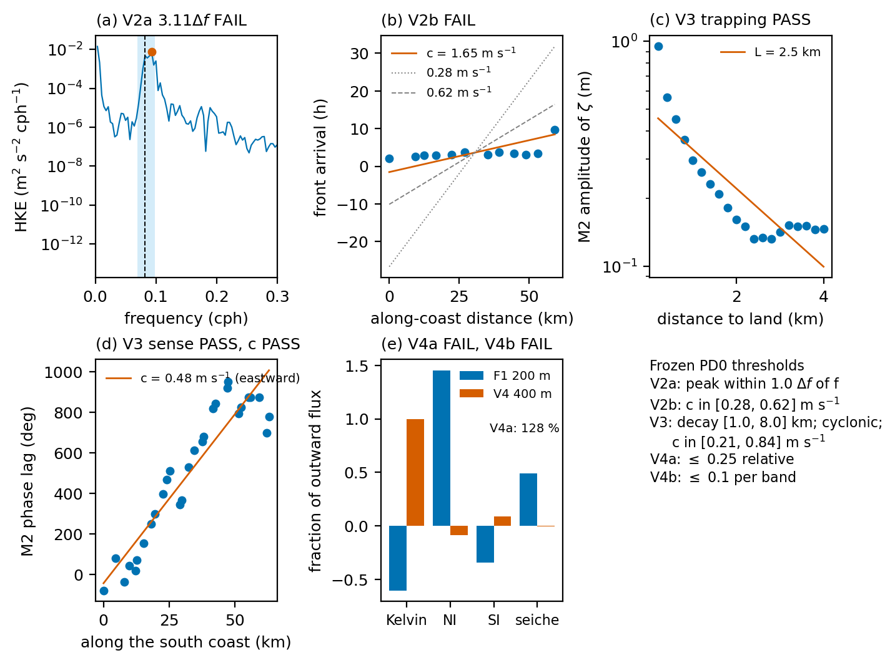

<!-- Rendered by scripts/render_readme.py: edit README.template.md, never README.md. Numbers come from figures/*.json and cases.yaml. -->
# Experiment 4 — Wind-driven internal waves in an Arctic fjord with and without landfast ice: Van Mijenfjorden (Svalbard), and a bridge from an idealised bay

**Esteban Cruz** · MITgcm, realistic fjord geometry and an idealised bay · PhD application portfolio (2027)

## Abstract

A short pulse of wind over a stratified fjord sets the water column oscillating: near-inertial currents, internal Kelvin waves that run around the basin along its coasts, and seiches. In my MSc thesis, a rectangular bay at mid latitude radiated most of that energy out through its mouth, at near-inertial frequencies. Here we ask what happens in a real Arctic fjord, Van Mijenfjorden in Svalbard (78°N), whose inner basin is closed by an island and connected to the shelf only through two straits narrower than the internal Rossby radius, and what landfast ice does to the response. We ran MITgcm on a 100 × 60 km domain at 200 m with the measured bathymetry and representative summer and late-winter stratification, forced by one wind pulse along the fjord axis, and reran the thesis bay (copied bit for bit) as a bridge, at its own latitude and at 78°N. Criteria and hypotheses were fixed before any run (`notes/pd0_preregistro.md`). The copy of the thesis reproduces it exactly (V1, maximum surface-elevation difference 0.0 m), and the model reproduces the tidally forced internal Kelvin wave of Støylen & Fer (2014) in this fjord (V3: phase speed 0.48 m s⁻¹, trapping scale 2.5 km). Three validation criteria failed and are reported as failed: the near-inertial peak on the shelf is blue-shifted to 1.136 f (V2a), the pre-registered Kelvin-front metric does not measure a propagating wave under a spatially uniform wind (V2b), and the net baroclinic energy flux through the straits changes sign between 400 m and 200 m (V4). Of the four hypotheses, the band partition of the radiated flux (H4a) is inconclusive, because the net flux through the straits is dominated by periods longer than the record resolves (0.930 of it); landfast ice reduces the internal-wave energy of the inner fjord below half that of open water (H4b(i), ratio 0.228) but the energy that remains does not enter mainly as a baroclinic flux (H4b(ii)); summer and winter open water are not distinguishable (H4c); and replacing the thesis mixing by KPP raises the radiated fraction of the wind work in the bay (H4d, ratio 3.93) but gives a negative fraction in the fjord (−6.07 %), so H4d is refuted there by the frozen arithmetic, a sign effect of the low-frequency exchange and not KPP radiating less. The bay radiates outward and mostly near-inertially at both latitudes; the fjord's net is low-frequency and inward. That contrast is descriptive, and it comes from the geometry, not from f; part of the fjord's low-frequency term is an artefact of the fixed density reference of the energy budget (a fraction 0.34 of it in a post hoc check), and none of these fluxes is resolution-converged. Every number below is read from the metrics files in `figures/` and the case registry `cases.yaml`.


*Figure 0.* The setting and the processes; no model result is drawn. (a) Van Mijenfjorden in a Sentinel-2 image of 25 March 2024, with landfast ice covering the inner fjord and open water in Bellsund, and the island Akseløya across the mouth; the inset locates it in Svalbard (MODIS). The yellow dashed frame is the model domain (100 × 60 km, open boundaries to the west, north and south, with a sponge of 10 cells, lightly shaded); the red lines are the strait sections of Akselsundet (1.07 km) and Mariasundet (two passages, the wider 0.50 km), which close the inner-fjord box of the energy budget; the late-winter runs put landfast ice on the sea cells inside the dashed blue polygon; the dots are the analysis stations (yellow: the shelf station of V2a; white: the south-coast stations of V2b). (b) A plan view, not to scale, of the processes the experiment asks about: (1) a pulse of wind along the fjord axis toward the mouth; (2) the near-inertial response, currents turning clockwise at the inertial period; (3) the internal Kelvin wave, trapped within about one Rossby radius of the coast and travelling cyclonically, with the coast on its right; (4) radiation of internal-wave energy through the straits to the shelf; (5) landfast ice, which keeps the wind from the water and puts an ice–ocean drag on its surface. Imagery: Contains modified Copernicus Sentinel data (2024), processed by ESA; inset: MODIS Terra true colour, NASA Worldview/GIBS. Drawn with VectorCraft by `figures/src/fig0_schematic.py`.

## 1. Introduction

Wind blowing over a stratified fjord moves the surface layer, tilts the pycnocline against the coasts, and leaves behind, when it stops, a field of internal waves: near-inertial oscillations, internal Kelvin waves trapped along the coasts and travelling with the coast on their right in the northern hemisphere, and Poincaré waves and seiches (Gill, 1982). How much of that energy leaves the fjord, and at which frequencies, sets how much is left to mix the fjord and how much feeds the shelf. In a Swedish sill fjord, Arneborg & Liljebladh (2001) found the net baroclinic energy flux at the mouth to be inward; in Svalbard, Støylen & Fer (2014) modelled tidally forced internal Kelvin waves in Van Mijenfjorden.

My MSc thesis (BayIW_Rectan) studied a rectangular bay (121 × 60.6 km, 164 m) forced by a wind patch at f = 6.97 × 10⁻⁵ s⁻¹: most of the baroclinic energy flux left through the mouth, at near-inertial frequencies, but only a small fraction of the wind work left the bay, and its discussion proposed that a boundary-layer closure might change that fraction. Experiment 4 takes that question to a real Arctic fjord. At 78°N the inertial period is 12.2 h instead of 25.0 h, the internal Rossby radius is only 2.5–3.6 km in summer and 0.34–1.32 km in late winter, and the inner basin of Van Mijenfjorden (527 km², 62.8 km long, 8.4 km wide, at most 119 m deep) opens to Bellsund only through Akselsundet and Mariasundet, both narrower than the Rossby radius. In winter it is covered by landfast ice.

Four hypotheses were fixed before any run (`notes/pd0_preregistro.md` §5): **H4a**, the radiated baroclinic flux is mostly near-inertial, as in the thesis bay, or, the alternative, carried by the internal Kelvin wave; **H4b**, landfast ice cuts the internal-wave energy of the inner fjord by at least half, and what remains enters through the straits; **H4c**, summer stratification radiates more than late winter in open water; **H4d**, a boundary-layer closure (KPP; Large et al., 1994) radiates a larger fraction of the wind work than the constant mixing of the thesis. A bridge of runs connects the thesis bay to the fjord (§2.3).

## 2. Methods

### 2.1 Model, domain and bathymetry

MITgcm (checkpoint69j), hydrostatic, on a Cartesian grid in UTM 33N: 100 × 60 km at 200 m, 40 levels from 1.5 m at the surface to the bottom of the grid (240 m), partial cells. The bathymetry is IBCAO v5.2 (Jakobsson et al., 2024) on the coastline of the Norwegian Polar Institute (S100), with the two straits checked against Støylen & Fer (2014) (`notes/pd1_batimetria.md`, `figures/bathy_report.json`). Akselsundet is 1.07 km wide with a sill at 22 m on the grid; Mariasundet has two passages, the wider 0.50 km, which the grid opens as 1.33 km of water, with a sill at 11 m. In the inner fjord, 48.6 % of the model cells rest on measured soundings and 50.0 % on interpolated ones. The western, northern and southern boundaries are open (Orlanski radiation) with a sponge of 10 cells.

### 2.2 Stratification and equation of state

The representative profiles are medians of the UNIS Hydrographic Database casts inside the inner fjord (842 summer casts, August–September; 36 late-winter casts, March–April, from only 5 years), on the model levels and made stable with the least change. The equation of state is linear, fitted to TEOS-10 over the range of the profiles (tα = 3.0456 × 10⁻⁵ K⁻¹, sβ = 8.4068 × 10⁻⁴; maximum error 0.017 kg m⁻³). The first-mode phase speed c₁ (flat bottom, rigid lid; `theory/modes.py`) is 0.35–0.52 m s⁻¹ in summer and 0.05–0.19 m s⁻¹ in late winter (mean to maximum depth), so R₁ = c₁/f is 2.5–3.6 km and 0.34–1.32 km and the grid resolves R₁ with 12–18 cells in summer but only 1.7–6.6 in winter. A Kelvin wave circles the inner fjord (177 km) in 95–140 h in summer. Because the fjord is narrow, the first cross-fjord Poincaré mode of the first vertical mode lies at 1.36–1.69 f (Gill, 1982, §10.3, Eq. 10.3.5), well above the near-inertial band; in the thesis bay it lies at 1.02–1.06 f, inside it.

### 2.3 Forcing and runs

Every run is forced by the same pulse of wind stress, a half Gaussian in time of peak 0.1 N m⁻², width σ = 1 h and centre at 2.5 h, spatially uniform, blowing along the fjord axis toward the mouth (from 078° grid; down-fjord winds are the strong, channelled winds of Svalbard fjords, Frank et al., 2023). The runs are forced for 60 h and then free, 280 h in all, with Δt = 120 s.

| Run | Domain | Stratification | Surface | Vertical mixing | Role |
|---|---|---|---|---|---|
| F1 | fjord, 200 m | summer | open water | KPP | reference |
| F2 | fjord | late winter | landfast ice | KPP | H4b |
| F3 | fjord | late winter | open water | KPP | H4b, H4c |
| F4 | fjord | late winter | drifting ice | KPP | descriptive |
| F5 | fjord | summer | open water, cross-axis wind | KPP | descriptive |
| F1c | fjord | summer | open water | constant, as the thesis | H4d |
| F1g | fjord | summer | open water | GGL90 | descriptive |
| V3 | fjord | summer | no wind, M2 tide at the open boundaries | KPP | V3 |
| V4 | fjord, 400 m | summer | open water | KPP | V4 |
| R1 | thesis bay, thesis f | thesis | open water, thesis wind patch | thesis | V1, H4d |
| R1k | thesis bay, thesis f | thesis | open water, thesis wind patch | KPP | H4d |
| R2 | thesis bay at 78°N | fjord summer | open water, thesis wind patch | KPP, fjord numerics | bridge |
| R3 | as R2 without the bay | fjord summer | open water | KPP, fjord numerics | bridge |

R1 is the thesis run reproduced with the thesis code and namelists; only the output format changed. R1k adds KPP and nothing else that a namelist comparison does not list (`notes/pd1_puente.md`); R1k runs 240 h and is compared with R1 over the 120 h of the thesis. R2 changes f, profile, equation of state and the fjord mixing at once; it is the thesis bay in the fjord's ocean.

### 2.4 Landfast ice

Landfast ice is MITgcm sea ice (1 m thick, concentration 1) over the inner fjord with the ice dynamics off, so the ice does not move, without thermodynamics, and the ocean under it receives the ice–ocean drag τ = ρ₀ C_w |u_ice − u| (u_ice − u) with the ice at rest and the default C_w of MITgcm, in the range measured under Arctic ice (Fer et al., 2022). MITgcm does not compute that drag when no rheology solver runs, so MITgcm files are replaced by modified copies (`config/fjord_vmf/code/`, each with the sha256 of the original and every change between marked lines): `seaice_dynsolver.F` computes the drag coefficient also without a rheology solver, so that the ocean under fixed ice feels it; `obcs_check.F` skips two stops that forbid Orlanski open boundaries and sea-ice open-boundary conditions together, which is safe here because the ice stays at least 119 cells from the open boundaries in every record of F2 and F4 (`figures/ice_ob_check.json`); `obcs_add_tides.F` ramps the tide of V3 up over one M2 cycle. The F2 and F4 restarts are bit-identical (`figures/pd1_restart.json`).

### 2.5 Mixing and numerics

KPP with MITgcm defaults and the background viscosity and diffusivity of Large et al. (1994); Smagorinsky horizontal viscosity with a small biharmonic part and quadratic bottom drag, the configuration Støylen & Fer (2014) used for this fjord; a second-order flux-limited advection of temperature and salinity, whose numerical mixing is declared (Klingbeil et al., 2014). The time step is staggered (`notes/pd1_config.md`).

### 2.6 Energy fluxes, budget and bands

The fluxes and the energy budget follow the hydrostatic decomposition of Kang & Fringer (2012, Eqs. 13–17), as the thesis does: barotropic and baroclinic kinetic energy, the exact available potential energy relative to a fixed background profile ρ_b (the initial one), the conversion C, the wind work P, and on each open face the pressure work F and the energy advection A; the residual is D. The box is the inner fjord closed by stepped sections across Akselsundet and Mariasundet, or the bay closed at its mouth. On R1, the implementation reproduces the thesis scripts with a maximum relative difference of 7.1 × 10⁻⁹ for the budget and 1.1 × 10⁻⁹ for the Nash et al. (2005) flux of the thesis (tolerance 1 %). The flux that decides the hypotheses is the baroclinic pressure work F_bc (Amendments 1–3 of the pre-registration, written before any hypothesis number was computed; advection is reported as descriptive). A flux is split into frequency bands by the exact cospectral partition of its time mean, with bands fixed before the runs: low (periods longer than 140 h, not resolved by the record), Kelvin/subinertial (14.4–140 h), near-inertial (0.85–1.20 f, 10.2–14.4 h, 8.0 frequency bins), superinertial (5.6–10.2 h) and seiche (shorter than 5.6 h).

### 2.7 Pre-registered criteria

Every model–reference difference is classified as (a) our error, (b) missing physics, (c) a numerical choice or (d) an error in the reference, and no failed criterion is redefined.

- **V1:** R1 equals the saved thesis run (surface elevation within 1.0 × 10⁻¹⁰ m).
- **V2a:** in F1, the near-inertial peak of surface kinetic energy at a shelf station lies within one frequency bin of f. **V2b:** the internal Kelvin wave speed, from the arrival of the pycnocline-displacement front at successive coastal stations, lies in 0.28–0.62 m s⁻¹.
- **V3:** with the M2 tide alone, an internal Kelvin wave trapped at the coast (decay scale 1–8 km), travelling cyclonically, at 0.21–0.84 m s⁻¹ (within a factor of two of Støylen & Fer, 2014).
- **V4:** V4 (400 m) against F1: the net outward baroclinic flux within 25 % (V4a) and the share of each resolved band within 0.10 (V4b).
- **Hypotheses:** a ratio must exceed the resolution uncertainty, so the minimum factor is 1.5 (a ratio between 1/1.5 and 1.5 is "not distinguishable"). H4a: if the low band carries more than 0.25 of the net flux, inconclusive; otherwise supported if the near-inertial share exceeds 0.5, the alternative if the Kelvin share does. H4b: (i) baroclinic energy of the inner fjord without the low band, F2/F3 ≤ 0.5; (ii) the baroclinic inflow through the straits at least as large as the barotropic one. H4c: (i) near-inertial wind work and (ii) radiated flux, F1/F3 ≥ 1.5. H4d: η = F_bc,out / P, the fraction of the wind work radiated, with KPP over the thesis closure ≥ 1.5, in the bay (R1k/R1) and in the fjord (F1/F1c).

## 3. Results

### 3.1 The bridge to the thesis (V1) and the method contrast

R1 is bit-identical to the saved thesis run: the surface elevation differs by 0.0 m in all 480 common records, and the restart files at the end of both stages are identical byte for byte (V1 **PASS**). The thesis therefore enters this experiment as it was, including two features found on the way and classified (d), errors of the reference: the thesis ran on a β-plane, not an f-plane, and its spectral scripts placed f at a value that the β-plane reaches only near the southern boundary of the domain, far from the bay (`notes/pd1_puente.md` §7).

### 3.2 Validation: three criteria fail



*Figure 1.* Validation against the frozen criteria. (a) V2a: surface kinetic energy spectrum at the shelf station of F1, the near-inertial band shaded, f dashed, the peak marked. (b) V2b: arrival of the half-maximum pycnocline displacement along the south coast, with the pre-registered speed range. (c, d) V3: decay of the M2 pycnocline amplitude away from the coast and its phase along the south coast. (e) V4: share of the outward flux in each resolved band at 200 m and 400 m.

| Criterion | Threshold | Result | Verdict | Class |
|---|---|---|---|---|
| V2a: near-inertial peak on the shelf | within one bin of f | 1.136 f, 3.11 bins | **FAIL** | (c) |
| V2b: Kelvin front speed | 0.28–0.62 m s⁻¹ | 1.65 m s⁻¹ (12 stations) | **FAIL** | (a) |
| V3: trapping, sense, speed | 1–8 km; cyclonic; 0.21–0.84 m s⁻¹ | 2.5 km; cyclonic; 0.48 m s⁻¹ | **PASS** | — |
| V4a: net outward flux, 400 m against 200 m | 25 % | −1.17 GJ against +0.32 GJ (128 %) | **FAIL** | (c) |
| V4b: band shares | 0.10 | differences 0.43–1.60 | **FAIL** | (c) |

**V2a** fails: the near-inertial peak on the shelf is at 1.136 f, 3.11 bins from f. The blue shift is domain-wide (post hoc: median 1.09 f over the wet columns, central range 1.00–1.18 f; only 5 % of the columns peak within a bin of f) and the motion is clockwise. A post hoc column test, fixed before it was run, put the F1 configuration in a doubly periodic slab: the peak came at 1.005 f (0.11 bins), which excludes an error in the Coriolis term or the time stepping and, by the rule fixed beforehand, makes the class (c). The test excludes only that: the cause of the blue shift is not identified. The candidates are the bounded geometry and its lateral modes, the open boundaries and the sponge, and background vorticity or mean flow; the 100 × 60 km domain width alone gives too small a shift (Gill, 1982, §10.3).

**V2b** fails, class (a): our metric. With a spatially uniform wind every coastal station responds locally during the pulse (11 of 12 stations reach the half-maximum before the pulse is over, 5.5 h), so the fitted 1.65 m s⁻¹ is not a phase speed (Gill, 1982, §10.10, Eq. 10.10.21; Yao, 1986). A post hoc, descriptive free-wave speed (crests of the band-passed displacement after the pulse; Hodges et al., 2000; Beletsky et al., 1997) is 0.92 ± 0.42 m s⁻¹, which does not separate a free wave from the forced response. V3 measures the model's internal Kelvin wave directly.

**V3** passes: the tidally forced internal Kelvin wave is trapped within 2.5 km of the coast, travels eastward along the south coast, and its phase speed is 0.48 m s⁻¹, as in Støylen & Fer (2014).

**V4** fails, class (c): at 400 m (R₁/Δx = 6.2–9.1) the net baroclinic flux through the straits is outward (+0.32 GJ) while at 200 m it is inward (−1.17 GJ). The gross flux falls to 0.24 of its 200 m value at Akselsundet, which carries 88 % of it, and to 0.11 at Mariasundet, which the coarse grid barely opens. By the pre-registered rule the limitation is declared. A consequence follows: the resolution bound of 25 % that justified the factor 1.5 of the hypotheses is not demonstrated.

### 3.3 Hypotheses

| Hypothesis | Result | Outcome |
|---|---|---|
| H4a: partition of the radiated flux (F1) | low band 0.930 of the net | **inconclusive with T_fin** |
| H4b(i): energy under landfast ice, F2/F3 | 0.578 / 2.541 GJ = 0.228 | **met** |
| H4b(ii): inflow through the straits (F2) | baroclinic 0.0067 GJ against barotropic 0.0206 GJ | **not met** |
| H4c: summer against winter (F1/F3) | (i) 0.83; (ii) 119.6, both fluxes inward | **not distinguishable** |
| H4d: KPP against the thesis closure, bay (R1k/R1) | η = 0.32 % against 0.082 %, ratio 3.93 | **supported** |
| H4d: KPP against the thesis closure, fjord (F1/F1c) | η = −6.07 % against 0.19 %, ratio −32.7 | **refuted** (by sign) |


*Figure 2.* The fjord against the thesis bay and the bridge. (a) Surface kinetic energy spectra: F1 (south-coast mean and shelf station), R1k (thesis bay), R2 (the bay at 78°N) and R3 (no bay), with f of each latitude. (b) Share of the surface kinetic energy in each band at those stations. (c) Signed share F_b / Σ₅|F_b| of the net outward baroclinic pressure work in each band, through the straits of the fjord runs and the mouth of the bay; positive is outward.

**H4a is inconclusive.** The net baroclinic pressure work through the straits of F1 over the record is −1.144 GJ in the low band (inward), against +0.018 (Kelvin), −0.043 (near-inertial), +0.010 (superinertial) and −0.015 GJ (seiche): the low band carries 0.930 of the total, above the 0.25 limit, so by the rule evaluated first H4a is "inconclusive with T_fin". The resolved bands sum to −0.030 GJ, an inflow, so their shares (Kelvin −0.60, near-inertial 1.45) fall outside the unit interval and mean nothing. With advection included the low share is 0.928 (descriptive).

**H4b: landfast ice removes most of the internal-wave energy, but what remains does not enter as a baroclinic flux.** (i) Without the low band, the time-mean baroclinic energy of the inner fjord is 0.578 GJ under landfast ice and 2.541 GJ in open water, a ratio of 0.228: met. Most of the F2 value is available potential energy from the drift of the background profile (§3.4); the post hoc ratio of the baroclinic kinetic energy alone is 0.0005, so the outcome holds with either number. (ii) The baroclinic pressure work entering through the straits (0.0067 GJ) is smaller than the barotropic one (0.0206 GJ): not met.


*Figure 4.* Depth-integrated, time-mean baroclinic kinetic energy in each resolved band in the inner fjord, under landfast ice (F2, top) and in open water with the same late-winter profile (F3, bottom); one logarithmic colour scale per band.

**H4c is not distinguishable.** The near-inertial wind work in summer is 6.05 GJ and in late winter 7.33 GJ, a ratio of 0.83, inside both tails. The radiated flux ratio, 119.6, is the quotient of two inward fluxes (−0.0297 and −0.00025 GJ) and is flagged; it cannot change the outcome. The winter first mode is poorly resolved at 200 m (R₁/Δx = 1.7–6.6).

**H4d is supported in the bay and refuted, by sign, in the fjord.** In the bay over the first 120 h, KPP radiates η = 0.32 % of the wind work against 0.082 % with the thesis closure (the thesis value), a ratio of 3.93: supported. Most of the change is in the denominator: with KPP the wind does 3.3 times less work (103.5 against 346.3 GJ), while the radiated flux grows only by a factor of 1.17. In the fjord, the net baroclinic pressure work through the straits in F1 is inward (−1.171 GJ), so η(F1) = −6.07 % against 0.19 % in F1c and the frozen rule gives "refuted" with a flag on the negative numerator. The refutation comes from the sign of the low-frequency net exchange, not from KPP radiating less. Post hoc, with the four resolved bands only, η is −0.154 % (F1) and 0.212 % (F1c); with the closure of the thesis the Kelvin band carries the net outward (+0.126 GJ).


*Figure 3.* (a) Baroclinic pressure work into the inner fjord through each strait in F1. (b) Through both straits in F1, F1c, F3 and F2. (c, d) Cumulative baroclinic budget of the inner fjord in F1 and F2: wind work, conversion, inflow (pressure work and advection), change of energy and the residual D; the growth of the energy in F2, without wind over the fjord, is the drift of the fixed reference (§3.4).

### 3.4 Post hoc checks

These were written after the results they examine and change no verdict.

- **Drift of the fixed reference.** The background profile of the inner fjord is smoothed during every long run (largest change 0.229 kg m⁻³ in F1c, 0.218 in F1, 0.031 in F2, 0.003–0.006 in the thesis bay). Measured against the fixed initial ρ_b that the budget prescribes, that appears as available potential energy that grows even without wind: 1.15 GJ at the end of F2 (its baroclinic kinetic energy ends at 0.014 GJ), 12.7 GJ in F1 and 149 GJ in R2. The residual D of these budgets is therefore not dissipation, class (c). The same drift enters the pressure perturbation of the strait fluxes.
- **Moving reference.** With the density reference taken as the box-mean profile at each time (method fixed before computing), the low band of F1 is still inward and dominant (−0.750 GJ instead of −1.144 GJ; low share 0.83), and η(F1) is still negative (−3.63 %). The drift explains a fraction 0.34 of the low band, not its sign. But the resolved sum of F1 changes sign (+0.047 GJ, mostly the Kelvin band, +0.092 GJ), and in F1c the low band turns outward (+0.106 GJ). The band shares of the fjord are not robust to the reference. In the bay the reference hardly matters (the H4d ratio would be 3.68).
- **Arneborg & Liljebladh band.** Band-passed as in Gullmar fjord (Arneborg & Liljebladh, 2001), the baroclinic pressure work enters the fjord in F1 (+0.038 GJ) and leaves it in F1c (−0.021 GJ) and in the bay (R1 −0.112, R2 −0.204 GJ, negative is outward). A sign comparison with another fjord, without resolution backing.
- **Narrow straits.** Mariasundet is 0.14–0.20 R₁ wide in summer and Akselsundet 0.30–0.44 R₁; Kelvin waves are transmitted poorly through straits much narrower than the Rossby radius (Johnson & Garrett, 2006, as cited by Jackson et al., 2018).

### 3.5 The bridge (descriptive)

Of the net outward baroclinic pressure work, the near-inertial band carries 0.61 and the low band 0.24 in the thesis bay (R1k), and 0.53 and 0.38 in the same bay at 78°N with the fjord's stratification and mixing (R2): the bay radiates outward and mostly near-inertially at both latitudes. In the fjord the signed low share is −0.93 (inward) and the near-inertial share −0.04. The surface kinetic energy points the same way: 0.995 near-inertial inside R2, but on the south coast of F1 0.56 in the Kelvin band and 0.08 near-inertial. Since R2 keeps the bay's near-inertial character at the fjord's f, the change from the thesis comes from the geometry (narrow basin, narrow straits), not from f, as the pre-registration predicted from the Poincaré frequencies (§2.2). The fjord's low-frequency term carries the drift caveat of §3.4, and none of these fluxes is resolution-converged (V4).

## 4. Discussion

### 4.1 What the experiment shows

In a real Arctic fjord closed by an island, a wind pulse does not radiate a clean near-inertial flux through the mouth, as the idealised bay did. The baroclinic energy flux through the narrow straits is a small net residual of a larger gross exchange, dominated over a 280 h record by periods too long to resolve, and inward in the reference run. Under landfast ice, with no wind work over the fjord, the internal-wave kinetic energy of the inner fjord nearly vanishes. In the bay, KPP raised the radiated fraction of the wind work mainly by lowering the wind work itself.

### 4.2 What we cannot claim

- That the fjord's net flux is physically inward: part of it is a reference artefact (§3.4), and it changes sign at 400 m.
- Any partition of the radiated flux by frequency in the fjord (H4a inconclusive; the shares change with the reference and the resolution).
- That KPP radiates less in the fjord: the refutation of H4d in the fjord is a sign effect.
- Anything about other fjords, other wind events or tidal conditions: one fjord, one event.

### 4.3 Limitations

- **V2a FAIL, class (c)** by the rule fixed before the column test, which excludes only an error in the inertial frequency; the cause of the blue shift (median 1.09 f) is not identified (candidates: bounded geometry, open boundaries and sponge, background vorticity).
- **V2b FAIL, class (a):** the front-arrival metric is ill-posed under a spatially uniform wind (Gill, 1982, §10.10, Eq. 10.10.21; Yao, 1986). The post hoc free-wave speed is 0.92 ± 0.42 m s⁻¹.
- **V4 FAIL, class (c): resolution.** The band partition is not robust, and the 25 % resolution bound behind the factor 1.5 of the hypotheses is not demonstrated.
- **The low band** (periods longer than 140 h, unresolved with T_fin = 280 h) dominates the net strait flux; H4a is inconclusive.
- **Fixed-reference drift:** the growth of the exact available potential energy and the residual D are not dissipation. The drift partly contaminates the low-band strait pressure work; the post hoc moving-reference check removes a fraction 0.34 of it and the sign stays. The F1 band fractions are not robust.
- **H4d in the fjord** is "refuted" literally, from a negative η (net inward low-frequency exchange); η from the resolved bands is −0.154 % against 0.212 % (post hoc).
- **Winter resolution:** the first mode is poorly resolved at 200 m (R₁/Δx = 1.7–6.6); this weighs on H4b and H4c.
- **Bathymetry:** 50.0 % of the inner-fjord cells rest on interpolated depths and 1.4 % on cells that IBCAO codes as land, so only 48.6 % rest on measured soundings (IBCAO type identifiers, `figures/bathy_report.json`).
- **Modified MITgcm files:** `obcs_check.F`, `seaice_dynsolver.F` and `obcs_add_tides.F` are modified copies (§2.4), declared as our own code.
- **Mariasundet** is 0.14–0.20 R₁ wide: reduced Kelvin transmission is expected (Johnson & Garrett, 2006, as cited by Jackson et al., 2018), and the grid opens it wider than the passages.
- **One fjord and one wind event; no tides in the study physics** (only V3 has the tide); **ice without thermodynamics.**
- **Late-winter stratification** rests on 36 casts from 5 years.

## 5. Conclusions

- The thesis bay was reproduced bit for bit, and the model reproduces the tidally forced internal Kelvin wave of Van Mijenfjorden (V3). Three validation criteria failed and are declared: a blue-shifted near-inertial peak of unidentified cause, an ill-posed Kelvin-front metric, and a strait flux that is not resolution-converged.
- In the fjord, the net baroclinic flux through the straits is dominated by unresolved low frequencies and is inward in the reference run, so the frequency partition of the radiated energy (H4a) is inconclusive.
- Landfast ice nearly removes the internal-wave energy of the inner fjord (H4b(i) met), and what remains does not enter mainly as a baroclinic flux (H4b(ii) not met). Summer and winter open water are not distinguishable (H4c).
- KPP raises the radiated fraction of the wind work in the bay, mostly by reducing the wind work (H4d supported); in the fjord the frozen rule gives "refuted" because the net flux is inward.
- The bay radiates outward and near-inertially at both latitudes; the fjord does not, and the difference comes from the geometry. To measure the fjord's radiation, the next step is higher resolution in the straits, longer records, and an energy budget with an evolving reference profile.

## Reproducing

```bash
bash exp4_arctic_bayiw/reproduce.sh --quick     # every JSON, figure and this README from existing run output
bash exp4_arctic_bayiw/reproduce.sh --dry-run   # the full plan: backup, every campaign, --quick, comparison
bash exp4_arctic_bayiw/reproduce.sh             # full: inputs, builds and every run, then --quick and the comparison
```

The quick mode reads the runs (`/Volumes/LaCie/portfolio_runs/exp4`), the saved thesis run and the external data listed in `data_external/SOURCES.md`, and recomputes every cached analysis, so it takes hours. The full mode needs MITgcm, MPI and gfortran and writes to a new run root, so the original runs are never overwritten; it backs up the committed JSONs and compares them with the regenerated ones. Both refuse to start while a model run is active. See [RUNNING.md](../RUNNING.md). Notes in Spanish, the decision record: `notes/pd0_preregistro.md` (pre-registration and its amendments), `pd1_*.md`, `pd2_validacion.md`, `pd3_hipotesis.md`.

## References

- Arneborg, L., & Liljebladh, B. (2001). The internal seiches in Gullmar Fjord. Part I: Dynamics. *J. Phys. Oceanogr.*, 31, 2549.
- Beletsky, D., O'Connor, W. P., Schwab, D. J., & Dietrich, D. E. (1997). Numerical simulation of internal Kelvin waves and coastal upwelling fronts. *J. Phys. Oceanogr.*, 27, 1197.
- Fer, I., et al. (2022). Upper-ocean turbulence structure and ocean-ice drag coefficient estimates during the MOSAiC drift. *J. Geophys. Res. Oceans*. https://doi.org/10.1029/2022JC018751
- Frank, L., Jonassen, M. O., Skogseth, R., & Vihma, T. (2023). Atmospheric climatologies over Isfjorden, Svalbard. *J. Geophys. Res. Atmos.* https://doi.org/10.1029/2022JD038011
- Gill, A. E. (1982). *Atmosphere–Ocean Dynamics*. Academic Press, International Geophysics Series 30 (read in an Academic Press reprint of the 1982 edition). ISBN 978-0-12-283522-3.
- Hodges, B. R., Imberger, J., Saggio, A., & Winters, K. B. (2000). Modeling basin-scale internal waves in a stratified lake. *Limnol. Oceanogr.*, 45, 1603–1620.
- Jackson, R. H., Lentz, S. J., & Straneo, F. (2018). The dynamics of shelf forcing in Greenlandic fjords. *J. Phys. Oceanogr.*, 48, 2799. https://doi.org/10.1175/JPO-D-18-0057.1
- Jakobsson, M., et al. (2024). The International Bathymetric Chart of the Arctic Ocean Version 5.0. *Sci. Data*. https://doi.org/10.1038/s41597-024-04278-w
- Johnson, H. L., & Garrett, C. (2006). What fraction of a Kelvin wave incident on a narrow strait is transmitted? *J. Phys. Oceanogr.*, 36, 945–954. https://doi.org/10.1175/JPO2896.1 (not read: cited as in Jackson et al., 2018)
- Kang, D., & Fringer, O. (2012). Energetics of barotropic and baroclinic tides in the Monterey Bay area. *J. Phys. Oceanogr.*, 42, 272. https://doi.org/10.1175/JPO-D-11-039.1
- Klingbeil, K., Mohammadi-Aragh, M., Gräwe, U., & Burchard, H. (2014). Quantification of spurious dissipation and mixing – discrete variance decay in a finite-volume framework. *Ocean Model.*, 81, 49–64. https://doi.org/10.1016/j.ocemod.2014.06.001
- Large, W. G., McWilliams, J. C., & Doney, S. C. (1994). Oceanic vertical mixing: a review and a model with a nonlocal boundary layer parameterization. *Rev. Geophys.*, 32, 363–403. https://doi.org/10.1029/94RG01872
- Nash, J. D., Alford, M. H., & Kunze, E. (2005). Estimating internal wave energy fluxes in the ocean. *J. Atmos. Oceanic Technol.*, 22, 1551.
- Støylen, E., & Fer, I. (2014). Tidally induced internal motion in an Arctic fjord. *Nonlin. Processes Geophys.*, 21, 87–100. https://doi.org/10.5194/npg-21-87-2014
- Yao, T. (1986). The response of currents in Trinity Bay, Newfoundland, to local wind forcing. *Atmos.–Ocean*, 24, 235–252. https://doi.org/10.1080/07055900.1986.9649249
- Data: IBCAO v5.2 (IBCAO Version 5.2 Compilation Group, 2026), https://doi.org/10.17043/ibcao-5.2; Norwegian Polar Institute, Kartdata Svalbard 1:100 000 (S100), https://doi.org/10.21334/npolar.2014.645336c7; UNIS Hydrographic Database, https://doi.org/10.21334/unis-hydrography (CC BY 4.0).
