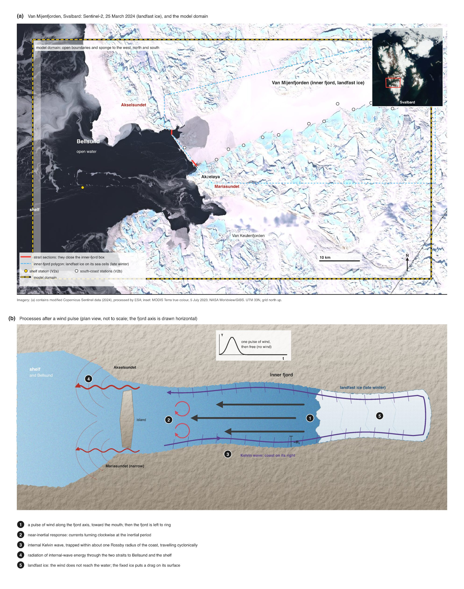
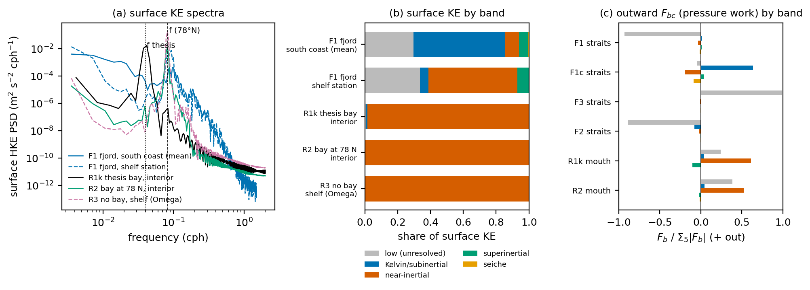
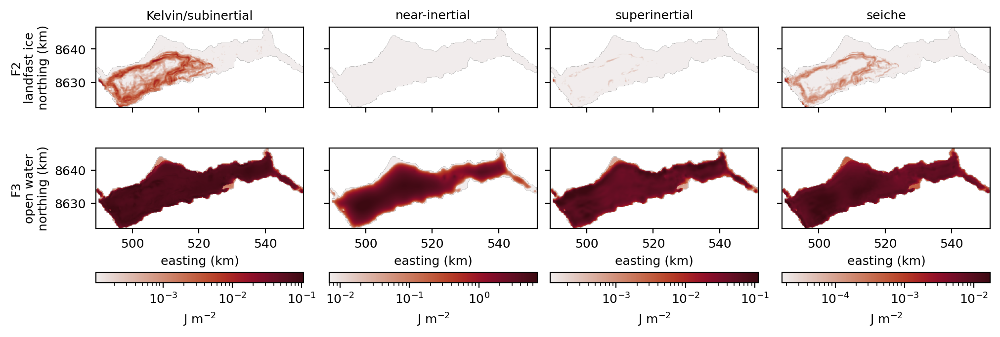
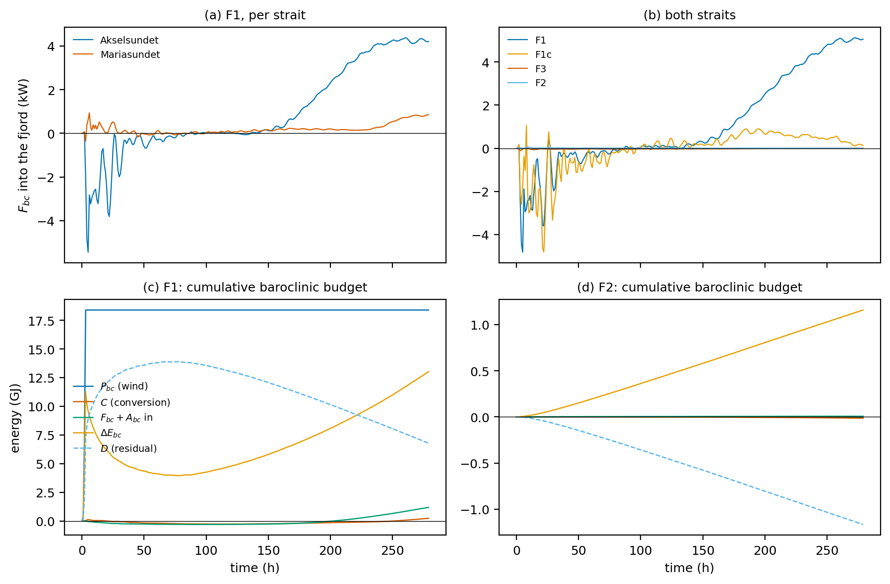
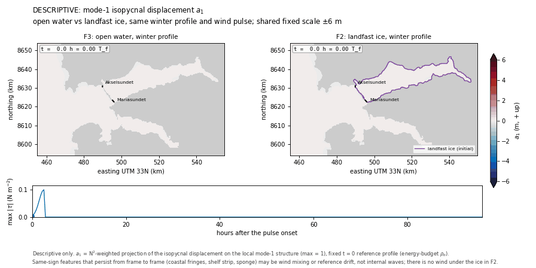
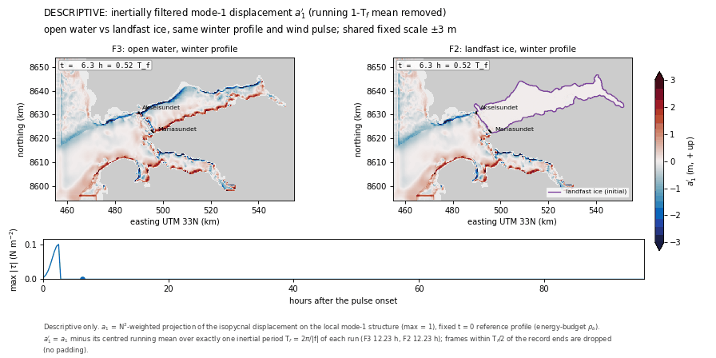
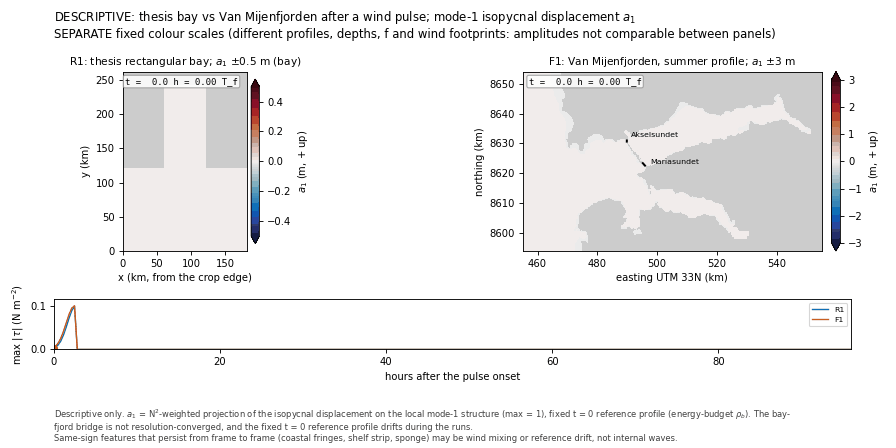
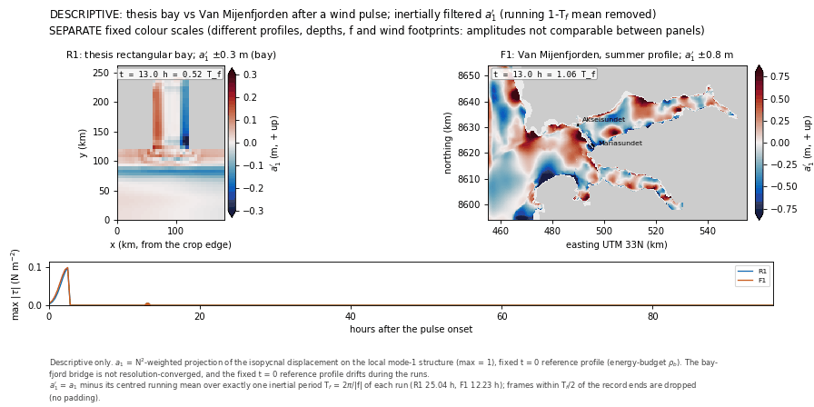
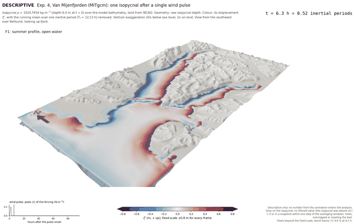
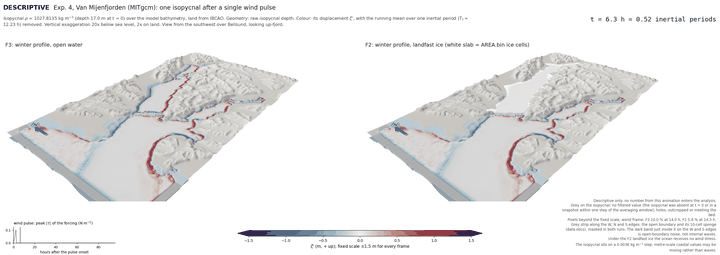

<!-- Rendered by scripts/render_readme.py: edit README.template.md, never README.md. Numbers come from figures/*.json and cases.yaml. -->
# Wind-Driven Internal Waves in an Arctic Fjord with and without Landfast Ice: Van Mijenfjorden, Svalbard

**Esteban Cruz Isidro** · PhD application portfolio (2027), Experiment 4

## Abstract

In an idealized midlatitude bay, the baroclinic energy flux from a wind pulse left mostly at near-inertial frequencies. We ask whether this holds in Van Mijenfjorden, Svalbard (78°N), whose inner basin reaches the shelf only through two straits narrower than the internal Rossby radius, and under landfast ice. We ran MITgcm at 200 m with summer and late-winter stratification and one along-axis wind pulse, with the bay, reproduced bit for bit, as a bridge. Criteria and hypotheses were fixed beforehand. The model reproduces the fjord's tidally forced internal Kelvin wave (0.48 m s⁻¹), but three validation criteria failed: a blue-shifted near-inertial peak (1.136f), an ill-posed Kelvin-front metric, and a strait flux that changes sign between 400- and 200-m grids. The net baroclinic strait flux is inward, and 0.930 of it lies at periods longer than the record resolves, so its frequency partition is inconclusive. Landfast ice reduces inner-fjord internal-wave energy to 0.228 of open water, but the remainder does not enter mainly baroclinically. Summer and winter open water are not distinguishable. KPP mixing raises the radiated fraction of wind work in the bay (ratio 3.93; the verdict depends on an amendment of the flux definition) but makes it negative in the fjord, refuting that hypothesis there by the sign of the low-frequency exchange. The bay–fjord contrast is descriptive: the runs also differ in wind pattern, grid, time step, and outer domain, part of the fjord's low-frequency flux is a fixed-reference artifact, and no flux is resolution-converged.

## Significance Statement

Wind over a fjord sets slow waves oscillating below the surface. The waves either stir the fjord or carry energy to the open sea. In a simple model bay, most of that energy left. We tested a real Arctic fjord in Svalbard, which opens to the sea through two narrow channels and freezes in winter. There, the net exchange through the channels is small, directed into the fjord, and dominated by slow motions that the simulations cannot fully resolve. Under winter ice, which shields the water from the wind, the wave energy inside the fjord falls well below that of open water. The results rest on one fjord and one wind event, and several model checks failed.

## 1. Introduction

A wind event over a stratified coastal basin puts energy into the surface mixed layer at near-inertial frequencies. Where the inertial currents meet the coast, the no-normal-flow condition pumps the base of the mixed layer and generates near-inertial internal waves that propagate away from the coast (Kelly 2019). In a closed or semi-enclosed basin the same pulse also tilts the pycnocline against the coasts. When the wind stops, the tilt relaxes into internal Kelvin waves, trapped within about one internal Rossby radius of the coast and travelling with the coast on their right in the Northern Hemisphere, and into Poincaré waves and seiches (Gill 1982). Which of these motions carries the energy, and how much of it leaves the basin, decides how much of the wind work is left to mix the basin and how much feeds the shelf.

Fjords are a demanding case for this question. Their width is often comparable to the internal Rossby radius, their mouths are constricted by sills, islands, or straits, and their stratification changes strongly with season. In Gullmar Fjord, a Swedish sill fjord, Arneborg and Liljebladh (2001) found internal seiches forced both by local wind and by coastal waves from outside, and a net baroclinic energy flux at the mouth directed into the fjord. Kelvin waves are transmitted poorly through straits much narrower than the Rossby radius (Johnson and Garrett 2006, as cited by Jackson et al. 2018), so a constricted mouth may trap the coastal part of the response. At high latitude the inertial frequency is large and the winter stratification is weak, so the inertial period and the Rossby radius both shrink. In Svalbard, Støylen and Fer (2014) modeled tidally forced internal Kelvin waves in Van Mijenfjorden, and down-fjord winds are the strong, channelled winds of Svalbard fjords (Frank et al. 2023). In winter many of these fjords are covered by landfast ice, which keeps the wind from the water and adds an ice–ocean drag at its surface, with drag coefficients measured under Arctic ice (Fer et al. 2022). We are not aware of a study of the wind-driven internal-wave response of an Arctic fjord, or of its radiation to the shelf, with and without that ice.

Our starting point is an idealized result. Cruz Isidro (2026; hereafter the thesis) forced a rectangular bay (121 × 60.6 km, 164 m deep) at f = 6.97 × 10⁻⁵ s⁻¹ with a patch of wind. Most of the baroclinic energy flux left through the mouth, at near-inertial frequencies, but only 0.082 % of the wind work left the bay. The thesis proposed that a boundary-layer mixing closure might change that fraction.

Here we take the question to Van Mijenfjorden (Fig. 0). At 78°N the inertial period is 12.2 h instead of the 25.0 h of the thesis bay. The first-mode internal Rossby radius is 2.5–3.6 km in summer and only 0.34–1.32 km in late winter. The inner basin (527 km², 62.8 km long, 8.4 km wide, at most 119 m deep) is closed by the island Akseløya and opens to Bellsund only through Akselsundet and Mariasundet, both narrower than the Rossby radius. Because the basin is narrow, its first cross-fjord Poincaré mode lies at 1.36–1.69f, above the near-inertial band; in the thesis bay it lies at 1.02–1.06f, inside it. The geometry may therefore separate near-inertial from basin-mode energy in the fjord in a way it did not in the bay.

We ask how much of the energy of one wind pulse leaves the inner fjord, at which frequencies, and how landfast ice, season, and the mixing closure change it. Four hypotheses and all validation criteria were fixed before any run. H4a states that the radiated baroclinic flux is mostly near-inertial, as in the thesis bay, or, the alternative, carried by the internal Kelvin wave. H4b states that landfast ice cuts the internal-wave energy of the inner fjord by at least half, and that what remains enters through the straits. H4c states that summer stratification radiates more than late-winter stratification in open water. H4d states that a boundary-layer closure (KPP; Large et al. 1994) radiates a larger fraction of the wind work than the constant mixing of the thesis. The flux that decides the hypotheses was amended after the first runs and before any hypothesis ratio was computed (section 2g; appendix B gives the full record). A bridge of runs, from the thesis bay reproduced bit for bit to the same bay at 78°N with the fjord's ocean, connects the idealized result to the fjord.

Section 2 describes the model, the experiments, and the energy diagnostics. Section 3 presents the open-water response and the exchange through the straits, the effect of landfast ice, the seasonal contrast, the mixing closure, and the bay–fjord contrast. Section 4 interprets these results, compares them with Gullmar Fjord and earlier work in Van Mijenfjorden, and states what they cannot show. Section 5 concludes. Appendix A reports the validation in full, including the three failed criteria.

## 2. Setting and methods



Fig. 0. Setting and processes; no model result is drawn. (a) Van Mijenfjorden in a Sentinel-2 image of 25 March 2024, with landfast ice over the inner fjord, open water in Bellsund, and the island Akseløya across the mouth; the inset locates the fjord in Svalbard (MODIS). Yellow dashed frame: model domain (100 × 60 km; open boundaries to the west, north, and south, with a 10-cell sponge, lightly shaded). Red lines: strait sections of Akselsundet (1.07 km) and Mariasundet (two passages, the wider 0.50 km), which close the inner-fjord box of the energy budget. Dashed blue polygon: sea cells that carry landfast ice in the late-winter runs. Dots: analysis stations (yellow, the shelf station of V2a; white, the south-coast stations of V2b). (b) Plan view, not to scale, of the processes studied: (1) a wind pulse along the fjord axis toward the mouth; (2) the near-inertial response, currents turning clockwise at the inertial period; (3) the internal Kelvin wave, trapped within about one Rossby radius of the coast and travelling cyclonically, coast on its right; (4) radiation of internal-wave energy through the straits to the shelf; (5) landfast ice, which keeps the wind from the water and puts an ice–ocean drag on its surface. Imagery: contains modified Copernicus Sentinel data (2024), processed by ESA; inset: MODIS Terra true color, NASA Worldview/GIBS. Drawn with VectorCraft.

### a. Model, domain, and bathymetry

We used MITgcm (checkpoint69j), hydrostatic, on a Cartesian grid in UTM 33N: 100 × 60 km at 200 m, with 40 levels from 1.5 m at the surface to the bottom of the grid (240 m) and partial cells. The bathymetry is IBCAO v5.2 (Jakobsson et al. 2024) on the coastline of the Norwegian Polar Institute (S100), with the two straits checked against Støylen and Fer (2014). Akselsundet is 1.07 km wide, with a sill at 22 m on the grid. Mariasundet has two passages, the wider 0.50 km; the grid opens them as 1.33 km of water, with a sill at 11 m. In the inner fjord, 48.6 % of the model cells rest on measured soundings and 50.0 % on interpolated ones. The western, northern, and southern boundaries are open (Orlanski radiation), with a sponge of 10 cells.

### b. Stratification and wave scales

The representative profiles are medians of the UNIS Hydrographic Database casts inside the inner fjord: 842 summer casts (August–September) and 36 late-winter casts (March–April) from only 5 years. We interpolated them to the model levels and made them stable with the least change. The equation of state is linear, fitted to TEOS-10 over the range of the profiles (tα = 3.0456 × 10⁻⁵ K⁻¹, sβ = 8.4068 × 10⁻⁴; maximum error 0.017 kg m⁻³). The first-mode phase speed c₁ (flat bottom, rigid lid) is 0.35–0.52 m s⁻¹ in summer and 0.05–0.19 m s⁻¹ in late winter, from the mean to the maximum depth. The first-mode Rossby radius R₁ = c₁/f is therefore 2.5–3.6 km in summer and 0.34–1.32 km in late winter. The grid resolves R₁ with 12–18 cells in summer but only 1.7–6.6 in winter. A Kelvin wave circles the inner fjord (177 km) in 95–140 h in summer. Because the fjord is narrow, the first cross-fjord Poincaré mode of the first vertical mode lies at 1.36–1.69f (Gill 1982, §10.3, Eq. 10.3.5), well above the near-inertial band; in the thesis bay it lies at 1.02–1.06f, inside it.

### c. Forcing and experiments

One pulse of wind stress forces the fjord runs. It is a half Gaussian in time, with peak 0.1 N m⁻², width σ = 1 h, and center at 2.5 h. It is spatially uniform and blows along the fjord axis toward the mouth (from 078° grid), the direction of the strong, channelled down-fjord winds of Svalbard fjords (Frank et al. 2023). In F5 the same pulse blows across the axis. The fjord runs are forced for 60 h and then run free, 280 h in all, with a staggered time step Δt = 120 s. V3 has no wind; the M2 tide enters at its open boundaries instead.

The bay runs keep the set-up of the thesis. The pulse has the same time shape (peak 0.1 N m⁻², σ = 1 h, center at 2.5 h) but is applied over a circular patch of radius 60 grid cells centered on the bay. They use the thesis grid (about 5.1 km in the bay, with the open sea limited to the depth of the thesis grid) and Δt = 30 s. They are forced for 60 h and run 120 h in all for R1, 240 h for R1k, and 280 h for R2 and R3. Table 1 lists all runs.

Table 1. The runs. "Descriptive" runs enter no criterion or hypothesis.

| Run | Domain | Stratification | Surface | Vertical mixing | Role |
|---|---|---|---|---|---|
| F1 | fjord, 200 m | summer | open water | KPP | reference |
| F2 | fjord | late winter | landfast ice | KPP | H4b |
| F3 | fjord | late winter | open water | KPP | H4b, H4c |
| F4 | fjord | late winter | drifting ice | KPP | descriptive |
| F5 | fjord | summer | open water, cross-axis wind | KPP | descriptive |
| F1c | fjord | summer | open water | constant, as the thesis | H4d |
| F1g | fjord | summer | open water | GGL90 | descriptive |
| V3 | fjord | summer | no wind, M2 tide at the open boundaries | KPP | V3 |
| V4 | fjord, 400 m | summer | open water | KPP | V4 |
| R1 | thesis bay, thesis f | thesis | open water, thesis wind patch | thesis | V1, H4d |
| R1k | thesis bay, thesis f | thesis | open water, thesis wind patch | KPP | H4d |
| R2 | thesis bay at 78°N | fjord summer | open water, thesis wind patch | KPP, fjord numerics | bridge |
| R3 | as R2 without the bay | fjord summer | open water | KPP, fjord numerics | bridge |

R1 is the thesis run reproduced with the thesis code and namelists; only the output format changed. R1k adds KPP and nothing else that a namelist comparison does not list. It runs 240 h and is compared with R1 over the 120 h of the thesis. R2 changes f, profile, equation of state, and mixing to those of the fjord at once: it is the thesis bay in the fjord's ocean.

### d. Landfast ice

Landfast ice is MITgcm sea ice, 1 m thick with concentration 1, over the inner fjord. Ice dynamics are off, so the ice does not move, and there is no ice thermodynamics. The ocean under the ice receives the ice–ocean drag τ = ρ₀ C_w |u_ice − u| (u_ice − u), with the ice at rest and the default C_w of MITgcm, which lies in the range measured under Arctic ice (Fer et al. 2022). MITgcm does not compute that drag when no rheology solver runs, so three MITgcm files are replaced by modified copies, declared as our own code (appendix E). One of them skips two stops that forbid Orlanski open boundaries and sea-ice open-boundary conditions together; this is safe because the ice stays at least 119 cells from the open boundaries in every record of F2 and F4. The F2 and F4 restarts are bit-identical.

### e. Mixing and numerics

Vertical mixing is KPP with MITgcm defaults and the background viscosity and diffusivity of Large et al. (1994). Horizontal viscosity is Smagorinsky with a small biharmonic part, and bottom drag is quadratic, the configuration Støylen and Fer (2014) used for this fjord. Temperature and salinity are advected by a second-order flux-limited scheme, whose numerical mixing we declare (Klingbeil et al. 2014). The time step is staggered.

### f. Energy budget, fluxes, and frequency bands

The fluxes and the energy budget follow the hydrostatic decomposition of Kang and Fringer (2012, their Eqs. 13–17), as the thesis does. Its terms are the barotropic and baroclinic kinetic energy; the exact available potential energy relative to a fixed background profile ρ_b, the initial one; the conversion C; the wind work P; and, on each open face, the pressure work F and the energy advection A. The residual is D. The box is the inner fjord closed by stepped sections across Akselsundet and Mariasundet, or the bay closed at its mouth. On R1 our implementation reproduces the thesis scripts with a maximum relative difference of 7.1 × 10⁻⁹ for the budget and 1.1 × 10⁻⁹ for the Nash et al. (2005) flux of the thesis (tolerance 1 %).

The flux that decides the hypotheses is the baroclinic pressure work F_bc; advection is reported as descriptive. We split a flux into frequency bands by the exact cospectral partition of its time mean, with bands fixed before the runs: low (periods longer than 140 h, not resolved by the record), Kelvin/subinertial (14.4–140 h), near-inertial (0.85–1.20f, 10.2–14.4 h, 8.0 frequency bins), superinertial (5.6–10.2 h), and seiche (shorter than 5.6 h).

### g. Pre-registered tests

The criteria V1–V4 and the decision rules of H4a–H4d were frozen before any run (appendix A lists the criteria). Every model–reference difference is classified as (a) our error, (b) missing physics, (c) a numerical choice, or (d) an error in the reference, and no failed criterion is redefined. A hypothesis ratio must exceed the resolution uncertainty, so the minimum factor is 1.5; a ratio between 1/1.5 and 1.5 is "not distinguishable". H4a is inconclusive if the low band carries more than 0.25 of the net flux; otherwise it is supported if the near-inertial share exceeds 0.5, and the alternative holds if the Kelvin share does. H4b requires (i) a ratio F2/F3 ≤ 0.5 of the inner-fjord baroclinic energy without the low band, and (ii) a baroclinic inflow through the straits at least as large as the barotropic one. H4c requires F1/F3 ≥ 1.5 for (i) the near-inertial wind work and (ii) the radiated flux. H4d requires the ratio, KPP over the thesis closure, of η = F_bc,out / P, the radiated fraction of the wind work, to be ≥ 1.5 in the bay (R1k/R1) and in the fjord (F1/F1c). The deciding flux was set by three amendments, written after the first runs and before any hypothesis ratio was computed, but with two flux results already known. With the numerator of Amendment 1, the bay ratio of H4d would be −0.17, which the frozen rule would read as "refuted" (post hoc). The one supported verdict of this experiment therefore depends on the amendments; appendix B gives the full record.

## 3. Results

Tables 2 and 3 summarize the verdicts. The subsections follow the physics rather than the criterion numbers.

Table 2. Validation against the frozen criteria (details in appendix A).

| Criterion | Threshold | Result | Verdict | Class |
|---|---|---|---|---|
| V1: thesis run reproduced | surface elevation within 1.0 × 10⁻¹⁰ m | 0.0 m in 480 records | **PASS** | — |
| V2a: near-inertial peak on the shelf | within one bin of f | 1.136f, 3.11 bins | **FAIL** | (c) |
| V2b: Kelvin front speed | 0.28–0.62 m s⁻¹ | 1.65 m s⁻¹ (12 stations) | **FAIL** | (a) |
| V3: trapping, sense, speed | 1–8 km; cyclonic; 0.21–0.84 m s⁻¹ | 2.5 km; cyclonic; 0.48 m s⁻¹ | **PASS** | — |
| V4a: net outward flux, 400 m against 200 m | 25 % | −1.17 GJ against +0.32 GJ (128 %) | **FAIL** | (c) |
| V4b: band shares | 0.10 | differences 0.43–1.60 | **FAIL** | (c) |

Table 3. Hypothesis outcomes by the frozen rules.

| Hypothesis | Result | Outcome |
|---|---|---|
| H4a: partition of the radiated flux (F1) | low band 0.930 of the net | **inconclusive with T_fin** |
| H4b(i): energy under landfast ice, F2/F3 | 0.578 / 2.541 GJ = 0.228 | **met** |
| H4b(ii): inflow through the straits (F2) | baroclinic 0.0067 GJ against barotropic 0.0206 GJ | **not met** |
| H4c: summer against winter (F1/F3) | (i) 0.83; (ii) 119.6, both fluxes inward | **not distinguishable** |
| H4d: KPP against the thesis closure, bay (R1k/R1) | η = 0.32 % against 0.082 %, ratio 3.93 (with F + A, post hoc and descriptive: −0.17; appendix B) | **supported** |
| H4d: KPP against the thesis closure, fjord (F1/F1c) | η = −6.07 % against 0.19 %, ratio −32.7 | **refuted** (by sign) |

### a. Model fidelity

The model reproduces the thesis exactly and the fjord's tidal Kelvin wave, but three validation criteria fail (Table 2, Fig. 1). R1 is bit-identical to the saved thesis run (V1 **PASS**), so the thesis enters this experiment as it was. With the M2 tide alone, the model's internal Kelvin wave is trapped within 2.5 km of the coast, travels eastward along the south coast, and has a phase speed of 0.48 m s⁻¹, as in Støylen and Fer (2014) (V3 **PASS**).

The three failures concern the wind-forced runs. The near-inertial peak on the shelf is blue-shifted to 1.136f (V2a, class (c)); a column test excludes an error in the inertial frequency, but the cause of the shift is not identified. The pre-registered Kelvin-front metric does not measure a propagating wave under a spatially uniform wind (V2b, class (a)). The net baroclinic flux through the straits is outward at 400 m and inward at 200 m (V4, class (c)), so the strait fluxes are not resolution-converged. A consequence follows for every hypothesis: the 25 % resolution bound that justified the factor 1.5 is not demonstrated. Appendix A gives each failure in full.


Fig. 1. Validation against the frozen criteria. (a) V2a: surface kinetic energy spectrum at the shelf station of F1; near-inertial band shaded, f dashed, peak marked. (b) V2b: arrival of the half-maximum pycnocline displacement along the south coast, with the pre-registered speed range. (c),(d) V3: decay of the M2 pycnocline amplitude away from the coast and its phase along the south coast. (e) V4: share of the outward flux in each resolved band at 200 and 400 m.

### b. The open-water response and the exchange through the straits

In open water the net baroclinic exchange through the straits is inward and dominated by the unresolved low band (Fig. 2c). Over the record, the net baroclinic pressure work through the straits of F1 is −1.144 GJ in the low band, against +0.018 (Kelvin), −0.043 (near-inertial), +0.010 (superinertial), and −0.015 GJ (seiche); negative is inward. The low band carries 0.930 of the total, above the 0.25 limit, so by the rule evaluated first H4a is "inconclusive with T_fin". The resolved bands sum to −0.030 GJ, an inflow. Their shares (Kelvin −0.60, near-inertial 1.45) therefore fall outside the unit interval and mean nothing. With advection included, the low share is 0.928 (descriptive).

The net, −1.171 GJ, is small against the wind work over the box (19.3 GJ) and is the residual of a larger gross exchange, most of it through Akselsundet, which carries 88 % of the gross flux (Fig. 3a). Mariasundet is only 0.14–0.20 R₁ wide in summer, and Akselsundet 0.30–0.44 R₁, and Kelvin waves are transmitted poorly through straits much narrower than the Rossby radius (section 4b).

Part of the low band is an artifact of the fixed reference density. The background profile of the inner fjord is smoothed during every long run, and against the fixed ρ_b this appears as available potential energy that grows even without wind. The residual D of the budgets is therefore not dissipation (class (c)). With a moving reference (post hoc, appendix C), the F1 low band is still inward and dominant (−0.750 GJ; low share 0.83): the drift explains a fraction 0.34 of it, not its sign. The resolved sum of F1, however, changes sign with that reference, so the band shares of the fjord are not robust. We state this caveat here once; later sections refer to it.



Fig. 2. The fjord against the thesis bay and the bridge. (a) Surface kinetic energy spectra: F1 (south-coast mean and shelf station), R1k (thesis bay), R2 (the bay at 78°N), and R3 (no bay), with f of each latitude. (b) Share of the surface kinetic energy in each band at those stations. (c) Signed share F_b / Σ₅|F_b| of the net outward baroclinic pressure work in each band, through the straits of the fjord runs and the mouth of the bay; positive is outward.

### c. Landfast ice

Landfast ice removes most of the internal-wave energy of the inner fjord, but what remains does not enter mainly as a baroclinic flux (Fig. 4). Without the low band, the time-mean baroclinic energy of the inner fjord is 0.578 GJ under landfast ice (F2) and 2.541 GJ in open water with the same late-winter profile (F3). The ratio, 0.228, meets H4b(i). Most of the F2 value is available potential energy from the drift of the background profile (section 3b); the post hoc ratio of the baroclinic kinetic energy alone is 0.0005, so the outcome holds with either number. The baroclinic pressure work entering through the straits in F2 (0.0067 GJ) is smaller than the barotropic one (0.0206 GJ), so H4b(ii) is not met. In the cumulative budget of F2 (Fig. 3d), the energy grows without wind over the fjord; that growth is the drift of the fixed reference. The drifting-ice run F4 is descriptive and enters no hypothesis. The winter first mode is poorly resolved at 200 m (R₁/Δx = 1.7–6.6), which weighs on this result and on the next.



Fig. 4. Depth-integrated, time-mean baroclinic kinetic energy in each resolved band in the inner fjord, under landfast ice (F2, top) and in open water with the same late-winter profile (F3, bottom); one logarithmic color scale per band.

### d. Season

Summer and late-winter open water are not distinguishable by the frozen rule. The near-inertial wind work is 6.05 GJ in summer (F1) and 7.33 GJ in late winter (F3), a ratio of 0.83, in neither tail. The radiated-flux ratio, 119.6, is the quotient of two inward fluxes (−0.0297 and −0.00025 GJ) and is flagged; it cannot change the outcome. H4c is therefore "not distinguishable".

### e. The mixing closure and the radiated fraction

KPP raises the radiated fraction of the wind work in the bay, mostly by lowering the wind work, and gives a negative fraction in the fjord. In the bay over the first 120 h, KPP radiates η = 0.32 % of the wind work, against 0.082 % with the thesis closure (the thesis value). The ratio, 3.93, supports H4d in the bay. Most of the change is in the denominator: with KPP the wind does 3.3 times less work (103.5 against 346.3 GJ), while the radiated flux grows only by a factor of 1.17. This verdict depends on the amendments of the deciding flux (section 2g, appendix B).

In the fjord the net baroclinic pressure work through the straits of F1 is inward (−1.171 GJ; Fig. 3b). Hence η(F1) = −6.07 %, against 0.19 % in F1c, and the frozen rule gives "refuted", with a flag on the negative numerator. The refutation comes from the sign of the low-frequency net exchange, not from KPP radiating less. With the four resolved bands only (post hoc), η is −0.154 % in F1 and 0.212 % in F1c; with the thesis closure the Kelvin band carries the net outward (+0.126 GJ).



Fig. 3. Strait fluxes and the inner-fjord budget. (a) Baroclinic pressure work into the inner fjord through each strait in F1. (b) The same through both straits in F1, F1c, F3, and F2. (c),(d) Cumulative baroclinic budget of the inner fjord in F1 and F2: wind work, conversion, inflow (pressure work and advection), change of energy, and the residual D. The growth of the energy in F2, without wind over the fjord, is the drift of the fixed reference (section 3b).

### f. The bay–fjord contrast

The bay radiates outward and mostly near-inertially at both latitudes, and the fjord does not (Fig. 2; descriptive). Of the net outward baroclinic pressure work, the near-inertial band carries 0.61 and the low band 0.24 in the thesis bay (R1k). In the same bay at 78°N with the fjord's stratification and mixing (R2), the shares are 0.53 and 0.38. In the fjord the signed low share is −0.93 (inward) and the near-inertial share −0.04. The surface kinetic energy points the same way: it is 0.995 near-inertial inside R2, but 0.56 Kelvin-band and 0.08 near-inertial on the south coast of F1.

Because R2 keeps the bay's near-inertial character at the fjord's f, f alone does not explain the change. The change is consistent with the geometry (narrow basin, narrow straits), as the pre-registration predicted from the Poincaré frequencies (section 2b). But R2 and F1 also differ in the spatial pattern of the wind: a local patch over the open bay against a uniform pulse along the narrow fjord, which projects differently onto near-inertial motion. They differ as well in the horizontal grid (about 5.1 km in the bay against 200 m), the time step (30 s against 120 s), and the outer domain (section 2c). The bridge therefore cannot attribute the change to the geometry alone. The fjord's low-frequency term carries the drift caveat of section 3b, and none of these fluxes is resolution-converged (section 3a).

## 4. Discussion

### a. A fjord that exchanges rather than radiates

In a real Arctic fjord closed by an island, a wind pulse does not radiate a clean near-inertial flux through the mouth, as the idealized bay did. The net baroclinic energy flux through the narrow straits is small against the wind work and is the residual of a larger gross exchange. Over a 280 h record it is dominated by periods too long to resolve, and it is inward in the reference run. Two features of the geometry may contribute. The narrow basin lifts its first cross-fjord Poincaré mode well above the near-inertial band (section 2b), and both straits are narrower than R₁. Under landfast ice, with no wind work over the fjord, the internal-wave kinetic energy of the inner fjord nearly vanishes. In the bay, KPP raised the radiated fraction of the wind work mainly by lowering the wind work itself.

### b. Comparison with other fjords

In Gullmar Fjord, Arneborg and Liljebladh (2001) found the net baroclinic energy flux at the mouth to be inward. Band-passed as they did (post hoc, appendix C), the baroclinic pressure work enters our fjord in F1 and leaves it in F1c and in the bay. That is a sign comparison with another fjord, without resolution backing. Our tidal Kelvin wave meets V3, whose speed range lies within a factor of two of Støylen and Fer (2014) (section 3a). The weak transmission of Kelvin waves through straits much narrower than the Rossby radius (Johnson and Garrett 2006, as cited by Jackson et al. 2018) applies most to Mariasundet, where reduced transmission is expected and which the grid also opens wider than its passages.

### c. What the experiment cannot claim, and its limitations

We cannot claim:
- that the fjord's net flux is physically inward: part of it is a reference artifact (section 3b), and it changes sign at 400 m (section 3a);
- any partition of the radiated flux by frequency in the fjord (H4a inconclusive; the shares change with the reference and the resolution);
- that KPP radiates less in the fjord: the refutation of H4d in the fjord is a sign effect (section 3e);
- anything about other fjords, other wind events, or tidal conditions: one fjord, one event.

The limitations, each stated in full where indicated:
- V2a FAIL, class (c): the cause of the blue shift (median 1.09f) is not identified (appendix A).
- V2b FAIL, class (a): the front-arrival metric is ill-posed under a spatially uniform wind (appendix A).
- V4 FAIL, class (c): the band partition is not robust, and the 25 % resolution bound behind the factor 1.5 is not demonstrated (section 3a, appendix A).
- The low band (periods longer than 140 h, unresolved with T_fin = 280 h) dominates the net strait flux, so H4a is inconclusive (section 3b).
- Fixed-reference drift: the growth of the available potential energy and the residual D are not dissipation, and the F1 band fractions are not robust (section 3b, appendix C).
- H4d in the fjord is "refuted" literally, from a negative η (section 3e).
- The bay verdict of H4d depends on the amendments of the deciding flux (appendix B).
- Winter resolution: R₁/Δx = 1.7–6.6 at 200 m, which weighs on H4b and H4c (section 3c).
- Bathymetry: 50.0 % of the inner-fjord cells rest on interpolated depths and 1.4 % on cells that IBCAO codes as land, so only 48.6 % rest on measured soundings (section 2a).
- Three MITgcm files are modified copies, declared as our own code (section 2d, appendix E).
- Mariasundet is 0.14–0.20 R₁ wide, and the grid opens it wider than its passages (sections 2a and 4b).
- One fjord and one wind event; no tides in the study physics (only V3 has the tide); ice without thermodynamics.
- The late-winter stratification rests on 36 casts from 5 years (section 2b).
- Two analysis details affect descriptive numbers only (appendix C).

## 5. Conclusions

1. The thesis bay was reproduced bit for bit, and the model reproduces the tidally forced internal Kelvin wave of Van Mijenfjorden. Three validation criteria failed and are declared: a blue-shifted near-inertial peak of unidentified cause, an ill-posed Kelvin-front metric, and a strait flux that is not resolution-converged.
2. In the fjord, the net baroclinic flux through the straits is dominated by unresolved low frequencies and is inward in the reference run, so the frequency partition of the radiated energy (H4a) is inconclusive.
3. Landfast ice nearly removes the internal-wave energy of the inner fjord (H4b(i) met), and what remains does not enter mainly as a baroclinic flux (H4b(ii) not met). Summer and winter open water are not distinguishable (H4c).
4. KPP raises the radiated fraction of the wind work in the bay, mostly by reducing the wind work (H4d supported, a verdict that depends on the flux amendments); in the fjord the frozen rule gives "refuted" because the net flux is inward.
5. The bay radiates outward and near-inertially at both latitudes; the fjord does not. Descriptively this is consistent with the geometry rather than f, but the bridge runs also differ in the wind pattern, the grid, the time step, and the outer domain, and the fjord's flux carries the drift caveat. Measuring the fjord's radiation needs higher resolution in the straits, longer records, and an energy budget with an evolving reference profile.

## Appendix A: Validation

The frozen criteria were as follows.
- V1: R1 equals the saved thesis run (surface elevation within 1.0 × 10⁻¹⁰ m).
- V2a: in F1, the near-inertial peak of surface kinetic energy at a shelf station lies within one frequency bin of f.
- V2b: the internal Kelvin wave speed, from the arrival of the pycnocline-displacement front at successive coastal stations, lies in 0.28–0.62 m s⁻¹.
- V3: with the M2 tide alone, an internal Kelvin wave is trapped at the coast (decay scale 1–8 km), travels cyclonically, and has a speed of 0.21–0.84 m s⁻¹ (within a factor of two of Støylen and Fer 2014).
- V4: V4 (400 m) against F1: the net outward baroclinic flux within 25 % (V4a) and the share of each resolved band within 0.10 (V4b).

V1 passes. R1 is bit-identical to the saved thesis run: the surface elevation differs by 0.0 m in all 480 common records, and the restart files at the end of both stages are identical byte for byte. The thesis therefore enters this experiment as it was, including two features found on the way and classified (d), errors of the reference. The thesis ran on a β-plane, not an f-plane, and its spectral scripts placed f at a value that the β-plane reaches only near the southern boundary of the domain, far from the bay (`notes/pd1_puente.md` §7).

V2a fails, class (c). The near-inertial peak on the shelf is at 1.136f, 3.11 bins from f. The blue shift is domain-wide (post hoc: median 1.09f over the wet columns, central range 1.00–1.18f; only 5 % of the columns peak within a bin of f), and the motion is clockwise. A post hoc column test, fixed before it was run, put the F1 configuration in a doubly periodic slab: the peak came at 1.005f (0.11 bins). This excludes an error in the Coriolis term or the time stepping and, by the rule fixed beforehand, makes the class (c). The test excludes only that: the cause of the blue shift is not identified. The candidates are the bounded geometry and its lateral modes, the open boundaries and the sponge, and background vorticity or mean flow; the 100 × 60 km domain width alone gives too small a shift (Gill 1982, §10.3).

V2b fails, class (a): our metric. With a spatially uniform wind every coastal station responds locally during the pulse: 11 of 12 stations reach the half-maximum before the pulse is over (5.5 h). The fitted 1.65 m s⁻¹ is therefore not a phase speed (Gill 1982, §10.10, Eq. 10.10.21; Yao 1986). A post hoc, descriptive free-wave speed, from the crests of the band-passed displacement after the pulse (Hodges et al. 2000; Beletsky et al. 1997), is 0.92 ± 0.42 m s⁻¹, which does not separate a free wave from the forced response. V3 measures the model's internal Kelvin wave directly.

V3 passes. The tidally forced internal Kelvin wave is trapped within 2.5 km of the coast, travels eastward along the south coast, and its phase speed is 0.48 m s⁻¹, as in Støylen and Fer (2014).

V4 fails, class (c). At 400 m (R₁/Δx = 6.2–9.1) the net baroclinic flux through the straits is outward (+0.32 GJ), while at 200 m it is inward (−1.17 GJ). The gross flux falls to 0.24 of its 200 m value at Akselsundet, which carries 88 % of it, and to 0.11 at Mariasundet, which the coarse grid barely opens. By the pre-registered rule the limitation is declared. A consequence follows: the resolution bound of 25 % that justified the factor 1.5 of the hypotheses is not demonstrated.

## Appendix B: Pre-registration and amendments

The criteria, hypotheses, thresholds, and tolerances were fixed in `notes/pd0_preregistro.md` before any MITgcm output of this experiment existed; any change requires a dated amendment at the end of that note. The flux that decides the hypotheses is the baroclinic pressure work F_bc (Amendments 1–3). No hypothesis ratio had been computed when the amendments were written, but two flux results were already known, as the pre-registration records.

Amendment 1 put the advection into the H4d numerator (F_bc + A_bc). Amendment 2 took it out again, knowing that on R1 the pressure work carries 0.28 GJ out of the bay and the advection 5.68 GJ into it. Amendment 3 made the pressure work decide H4a, H4b(ii), and H4c(ii), at a time when the band split of the F1 pressure work through each strait, the H4a input, was already in the V4 diagnostics (`figures/pd2_v4_diagnostics.json`).

With the Amendment 1 numerator, the bay ratio of H4d would be −0.17 (η = 0.26 % against −1.56 %), which the frozen rule would read as "refuted". The one supported verdict of this experiment depends on that amendment (post hoc, descriptive).

## Appendix C: Post hoc checks

These checks were written after the results they examine, and they change no verdict.

- Drift of the fixed reference. The background profile of the inner fjord is smoothed during every long run (largest change 0.229 kg m⁻³ in F1c, 0.218 in F1, 0.031 in F2, and 0.003–0.006 in the thesis bay). Measured against the fixed initial ρ_b that the budget prescribes, this appears as available potential energy that grows even without wind: 1.15 GJ at the end of F2 (whose baroclinic kinetic energy ends at 0.014 GJ), 12.7 GJ in F1, and 149 GJ in R2. The residual D of these budgets is therefore not dissipation, class (c). The same drift enters the pressure perturbation of the strait fluxes.
- Moving reference. With the density reference taken as the box-mean profile at each time (method fixed before computing), the low band of F1 is still inward and dominant (−0.750 GJ instead of −1.144 GJ; low share 0.83), and η(F1) is still negative (−3.63 %). The drift explains a fraction 0.34 of the low band, not its sign. But the resolved sum of F1 changes sign (+0.047 GJ, mostly the Kelvin band, +0.092 GJ), and in F1c the low band turns outward (+0.106 GJ). The band shares of the fjord are not robust to the reference. In the bay the reference hardly matters (the H4d ratio would be 3.68).
- Arneborg and Liljebladh band. Band-passed as in Gullmar Fjord (Arneborg and Liljebladh 2001), the baroclinic pressure work enters the fjord in F1 (+0.038 GJ) and leaves it in F1c (−0.021 GJ) and in the bay (R1 −0.112, R2 −0.204 GJ; negative is outward). This is a sign comparison with another fjord, without resolution backing.
- Narrow straits. Mariasundet is 0.14–0.20 R₁ wide in summer and Akselsundet 0.30–0.44 R₁; Kelvin waves are transmitted poorly through straits much narrower than the Rossby radius (Johnson and Garrett 2006, as cited by Jackson et al. 2018).
- Two analysis details that affect descriptive numbers only. The bay records hold one sample more than T/Δt, so their low band takes three frequency bins instead of two (the bridge shares and the R1/R1k post hoc numbers). The near-inertial wind work of H4c(i) is band-passed with an unwindowed circular FFT, so its absolute values carry wrap-around from the end of the record (F1 and F3 are treated alike).

## Appendix D: Animations

Six animations show the response to the wind pulse. They are descriptive: no number in this README comes from them, and no criterion or hypothesis uses them (`analysis/animate.py`, `analysis/blender_export.py`, `analysis/blender_render.py`).

Animations 1–4 show the first four days in plan view. The field a₁ is the first-mode isopycnal displacement: the isopycnal displacement relative to the fixed initial reference profile of the energy budget, projected with the N² weight on the local first vertical mode (scaled to one at its maximum), positive upward. The filtered field a₁′ is a₁ minus its centered running mean over exactly one inertial period of each run (12.2 h in the fjord, 25.0 h in the thesis bay). Frames within half a period of the ends of the record have no full window and are left out. Each animation has its own fixed color scale.



Animation 1. a₁ in late winter, open water (F3, left) and landfast ice (F2, right), with the same profile and wind pulse and one shared scale. Purple line: initial ice edge; black lines: strait sections. Features that keep the same sign from frame to frame (coastal fringes, a strip on the shelf, the open-boundary sponges) may be wind mixing or the drift of the reference profile rather than internal waves. Under the ice of F2 there is no wind stress, so the two panels differ in mixing as well as in waves.



Animation 2. The same runs, a₁′. In open water the inner fjord shows bands of opposite sign along its two coasts that change from frame to frame. Under the ice, a₁′ of the inner fjord stays close to zero on this scale (no wind stress under the ice in F2), while outside the ice the two runs look alike. The running-mean filter attenuates subinertial signal (Kelvin waves, slow seiches) and has ripple above f, so a₁′ shows mainly near- and superinertial oscillations.



Animation 3. a₁ in the thesis bay (R1, left, cropped to the bay and the shelf in front of it, scale set by the bay) and in Van Mijenfjorden in summer (F1, right). The scales are separate: the two runs differ in profile, depth, f, and the spatial pattern of the wind, so the amplitudes are not comparable. The caveat of Animation 1 on same-sign features applies, and the bridge is not resolution-converged (section 3f).



Animation 4. The same runs, a₁′, each filtered with its own inertial period. In the bay the two side walls carry displacements of opposite sign; in the fjord the signal is spread over the basin and the shelf. As in Animation 2, the filter attenuates subinertial signal (Kelvin waves, slow seiches) and has ripple above f: a₁′ shows mainly near- and superinertial oscillations.

Animations 5 and 6 draw one isopycnal in three dimensions over the model bathymetry, with the land from IBCAO, seen from the southwest over Bellsund looking up the fjord (rendered with Blender). They are descriptive in the same sense. The surface is the depth of the isopycnal in each density snapshot. Its color is the displacement of the isopycnal from its initial depth, positive upward, minus its centered running mean over one inertial period; frames that lack a full window are left out. The running-mean filter attenuates subinertial signal (Kelvin waves, slow seiches), so the colors show mainly near- and superinertial oscillations, not the Kelvin waves of the fjord. The vertical exaggeration is 20× below sea level and 2× on land, and each animation has one fixed color scale.

[](figures/blender_shotA_F1.mp4)

Animation 5. Summer, open water (F1): the isopycnal 1024.795 kg m⁻³, at 6 m at the start, the level of strongest stratification below the surface mixed layer; scale ±0.8 m. In the worst frame 9.6 % of the pixels lie beyond the scale (at 6.3 h). Click for the MP4.

[](figures/blender_shotB_F3F2.mp4)

Animation 6. Late winter, open water (F3, left) and landfast ice (F2, right; the white slab marks the ice cells), with the same profile and wind pulse and one shared scale of ±1.5 m. The winter profile is a staircase whose surface step the pulse mixes away within hours. The isopycnal is therefore 1027.813 kg m⁻³, at 17 m: the shallowest step above the sill of Akselsundet whose isopycnal stays in at least 98 % of its initial water columns throughout the record in both runs. It sits on a density step of only 0.0036 kg m⁻³, so meter-scale values along the coasts may be mixing rather than internal waves. Under the ice of F2 there is no wind stress, so the two panels differ in forcing and mixing as well as in waves. The open boundaries and their ten-cell sponges are masked in gray; the dark band just inside the gray strip on the western and southern edges is open-boundary noise, not internal waves. In the worst frame 10.0 % of the pixels of F3 (at 14.0 h) and 5.8 % of those of F2 (at 14.3 h) lie beyond the scale. Click for the MP4.

## Appendix E: Data availability and reproducibility

Every number in this README is read from the metrics files in `figures/` and from the case registry `cases.yaml`, from which every run's inputs are generated; `scripts/render_readme.py` renders the README from `README.template.md` and refuses to render if a fixed word no longer matches the metrics.

```bash
bash exp4_arctic_bayiw/reproduce.sh --quick     # every JSON, figure and this README from existing run output
bash exp4_arctic_bayiw/reproduce.sh --dry-run   # the full plan: backup, every campaign, --quick, comparison
bash exp4_arctic_bayiw/reproduce.sh --quick --animations   # also redraws Animations 1-4 of appendix D (about 2 h more)
bash exp4_arctic_bayiw/reproduce.sh             # full: inputs, builds and every run, then --quick and the comparison
```

The quick mode reads the runs (`/Volumes/LaCie/portfolio_runs/exp4`), the saved thesis run, and the external data listed in `data_external/SOURCES.md`, and recomputes every cached analysis, so it takes hours. The full mode needs MITgcm, MPI, and gfortran and writes to a new run root, so the original runs are never overwritten; it backs up the committed JSONs and compares them with the regenerated ones. Both refuse to start while a model run is active. See [RUNNING.md](../RUNNING.md).

Sources of the methods: the bathymetry and strait checks are in `notes/pd1_batimetria.md` and `figures/bathy_report.json` (IBCAO type identifiers); the modal calculation is `theory/modes.py`; the bridge and its namelist comparison are in `notes/pd1_puente.md`; the configuration and the staggered time step are in `notes/pd1_config.md`. The ice-to-boundary distance is in `figures/ice_ob_check.json`, and the F2 and F4 restart test in `figures/pd1_restart.json`. Fig. 0 is drawn by `figures/src/fig0_schematic.py`.

Modified MITgcm files: in `config/<cfg>/code/` of every fjord configuration (`fjord_vmf`, `fjord_vmf_100`, `fjord_vmf_100s`, `fjord_vmf_400`, `fjord_vmf_column`), each with the sha256 of the original and every change between marked lines. `seaice_dynsolver.F` computes the drag coefficient also without a rheology solver, so that the ocean under fixed ice feels it; `obcs_check.F` skips the two stops that forbid Orlanski open boundaries and sea-ice open-boundary conditions together; `obcs_add_tides.F` ramps the V3 tide up over one M2 cycle.

Notes in Spanish, the decision record: `notes/pd0_preregistro.md` (pre-registration and its amendments), `pd1_*.md`, `pd2_validacion.md`, `pd3_hipotesis.md`.

## References

- Arneborg, L., and B. Liljebladh, 2001: The internal seiches in Gullmar Fjord. Part I: Dynamics. *J. Phys. Oceanogr.*, **31**, 2549–2566.
- Beletsky, D., W. P. O'Connor, D. J. Schwab, and D. E. Dietrich, 1997: Numerical simulation of internal Kelvin waves and coastal upwelling fronts. *J. Phys. Oceanogr.*, **27**, 1197.
- Cruz Isidro, E., 2026: Estudio numérico de ondas internas generadas por un seiche en una bahía. M.S. thesis, Posgrado en Ciencias de la Tierra, Universidad Nacional Autónoma de México, in preparation.
- Fer, I., and Coauthors, 2022: Upper-ocean turbulence structure and ocean-ice drag coefficient estimates during the MOSAiC drift. *J. Geophys. Res. Oceans*, https://doi.org/10.1029/2022JC018751.
- Frank, L., M. O. Jonassen, R. Skogseth, and T. Vihma, 2023: Atmospheric climatologies over Isfjorden, Svalbard. *J. Geophys. Res. Atmos.*, https://doi.org/10.1029/2022JD038011.
- Gill, A. E., 1982: *Atmosphere–Ocean Dynamics*. International Geophysics Series, Vol. 30, Academic Press (read in an Academic Press reprint of the 1982 edition), ISBN 978-0-12-283522-3.
- Hodges, B. R., J. Imberger, A. Saggio, and K. B. Winters, 2000: Modeling basin-scale internal waves in a stratified lake. *Limnol. Oceanogr.*, **45**, 1603–1620.
- Jackson, R. H., S. J. Lentz, and F. Straneo, 2018: The dynamics of shelf forcing in Greenlandic fjords. *J. Phys. Oceanogr.*, **48**, 2799, https://doi.org/10.1175/JPO-D-18-0057.1.
- Jakobsson, M., and Coauthors, 2024: The International Bathymetric Chart of the Arctic Ocean Version 5.0. *Sci. Data*, https://doi.org/10.1038/s41597-024-04278-w.
- Johnson, H. L., and C. Garrett, 2006: What fraction of a Kelvin wave incident on a narrow strait is transmitted? *J. Phys. Oceanogr.*, **36**, 945–954, https://doi.org/10.1175/JPO2896.1 (not read: cited as in Jackson et al. 2018).
- Kang, D., and O. Fringer, 2012: Energetics of barotropic and baroclinic tides in the Monterey Bay area. *J. Phys. Oceanogr.*, **42**, 272, https://doi.org/10.1175/JPO-D-11-039.1.
- Kelly, S. M., 2019: Coastally generated near-inertial waves. *J. Phys. Oceanogr.*, **49**, 2979–2995, https://doi.org/10.1175/JPO-D-18-0148.1.
- Klingbeil, K., M. Mohammadi-Aragh, U. Gräwe, and H. Burchard, 2014: Quantification of spurious dissipation and mixing – discrete variance decay in a finite-volume framework. *Ocean Modell.*, **81**, 49–64, https://doi.org/10.1016/j.ocemod.2014.06.001.
- Large, W. G., J. C. McWilliams, and S. C. Doney, 1994: Oceanic vertical mixing: A review and a model with a nonlocal boundary layer parameterization. *Rev. Geophys.*, **32**, 363–403, https://doi.org/10.1029/94RG01872.
- Nash, J. D., M. H. Alford, and E. Kunze, 2005: Estimating internal wave energy fluxes in the ocean. *J. Atmos. Oceanic Technol.*, **22**, 1551.
- Støylen, E., and I. Fer, 2014: Tidally induced internal motion in an Arctic fjord. *Nonlinear Processes Geophys.*, **21**, 87–100, https://doi.org/10.5194/npg-21-87-2014.
- Yao, T., 1986: The response of currents in Trinity Bay, Newfoundland, to local wind forcing. *Atmos.–Ocean*, **24**, 235–252, https://doi.org/10.1080/07055900.1986.9649249.
- Data: IBCAO v5.2 (IBCAO Version 5.2 Compilation Group, 2026), https://doi.org/10.17043/ibcao-5.2; Norwegian Polar Institute, Kartdata Svalbard 1:100 000 (S100), https://doi.org/10.21334/npolar.2014.645336c7; UNIS Hydrographic Database, https://doi.org/10.21334/unis-hydrography (CC BY 4.0).
