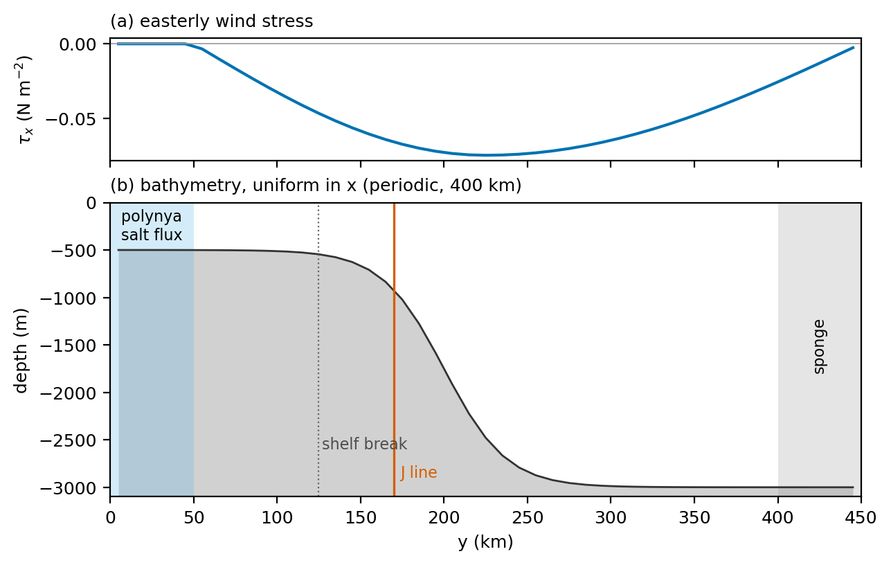
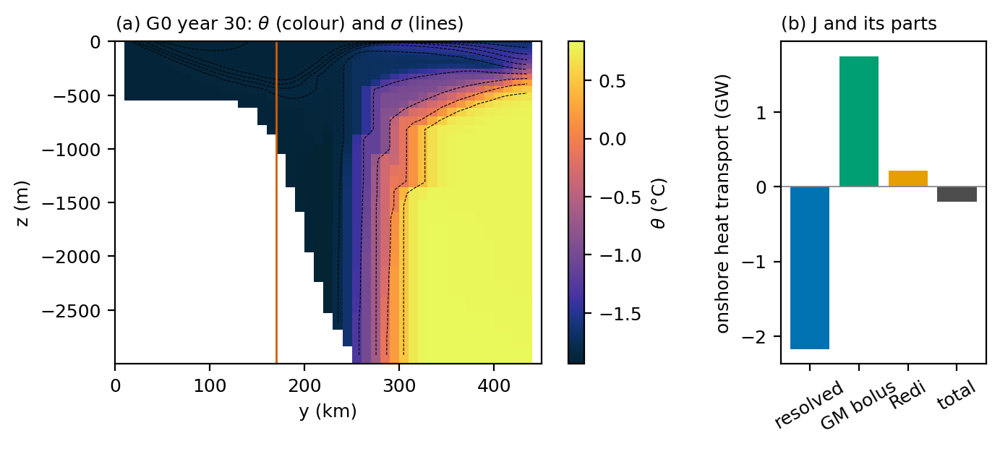
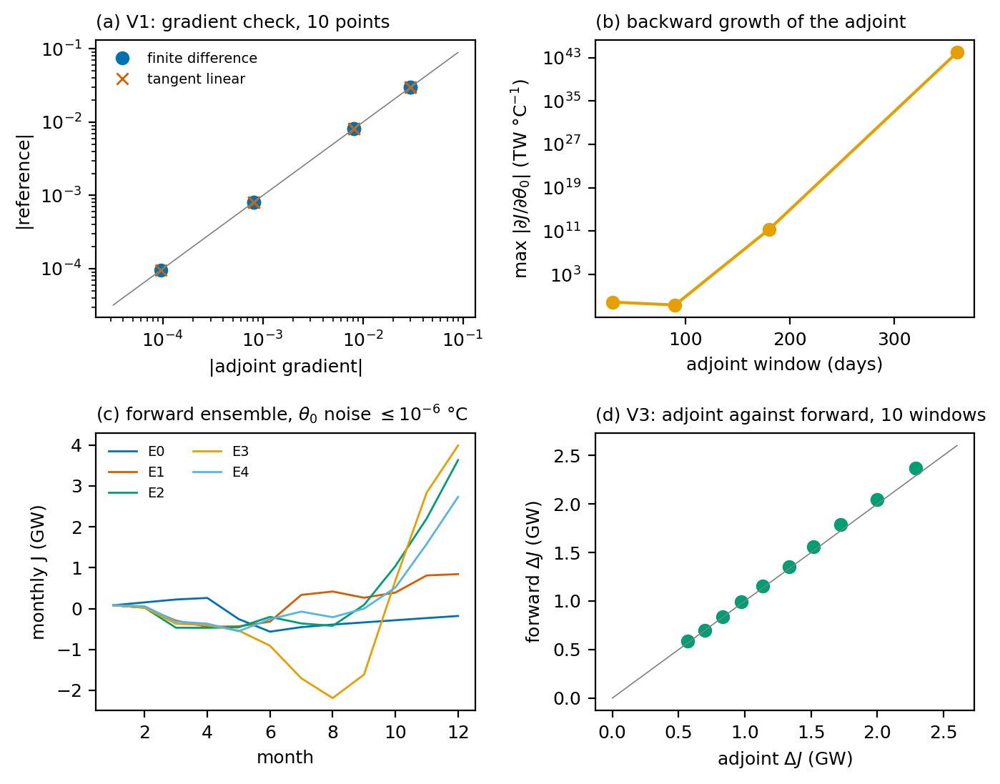
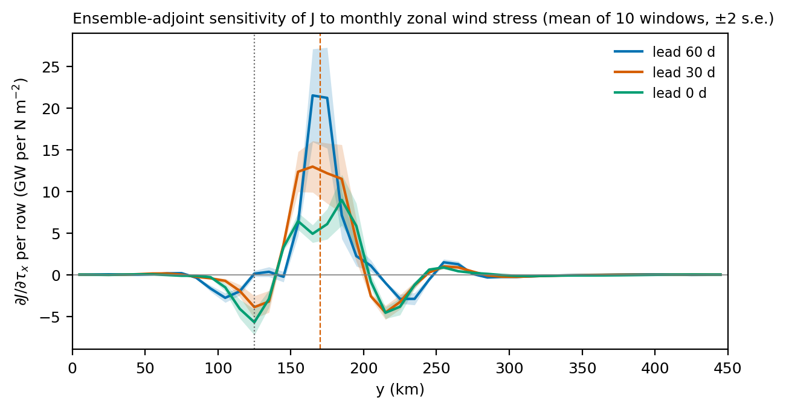
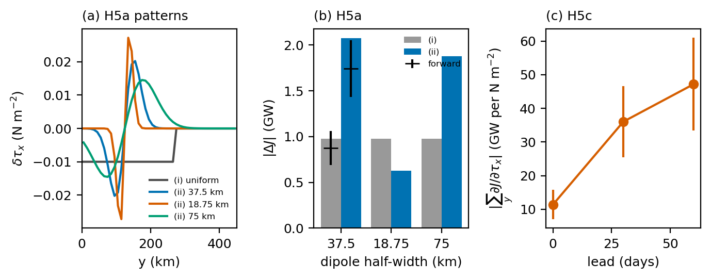
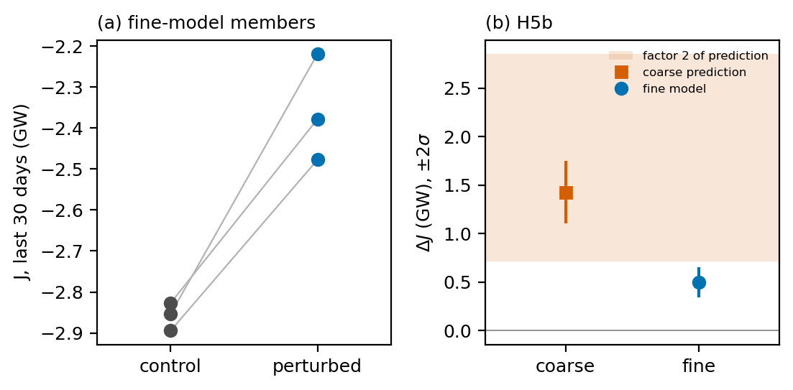
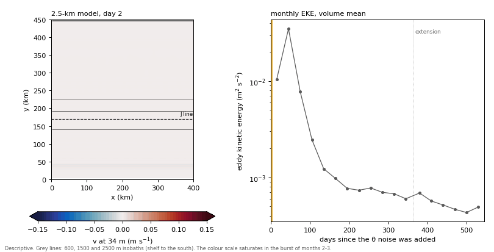

# Experiment 5 — Adjoint sensitivity of onshore heat transport across an Antarctic continental slope

<!-- Rendered by scripts/render_readme.py: every number below comes from figures/*.json or
cases.yaml. Edit README.template.md, never README.md. -->

## Abstract

What sets the onshore flux of heat across an Antarctic continental slope, and how far ahead does it remember the wind? We pose the question with the adjoint of MITgcm, generated with Tapenade, in the idealized dense-shelf channel of Dettling et al. (2024): a 10-km model with a slope-aware Gent–McWilliams closure. The cost function J is the onshore heat transport across the 170-km line over the last month of a window. The adjoint passes a gradient check at 10 control points (worst relative error 2.1 × 10⁻⁶ against finite differences, 2.7 × 10⁻¹¹ against the tangent linear model). The deterministic adjoint over 180 and 360 days, however, grows without bound backward in time. The cause is our own error: the coarse spin-up stayed exactly zonally symmetric, an unstable state in which tiny non-symmetric perturbations grow within days. The coarse results are therefore those of a zonally symmetric (2-D) model with parameterized eddies. We therefore replaced it, in a declared post hoc amendment, by an ensemble adjoint (Lea et al. 2000) of 10 windows of 90 days. Its prediction of the response to a wind perturbation agrees with paired forward runs within 2.4%. The sensitivity is concentrated at the J line and at the shelf break. A dipole of wind stress curl at the break moves J more than a uniform change of the same norm (H5a), but not at every width (not robust). Within the 90-day windows the sensitivity grows with lead time, so its decay scale (H5c) cannot be measured. In a 2.5-km eddy-resolving model the response to the most sensitive wind pattern is detectable and has the predicted sign, but it is 0.35 times the coarse prediction, outside the registered factor of two (H5b fails). The eddies of that model are weak, carry little of J, and had not reached equilibrium, so the test compares the coarse model with an eddy field that was still decaying.

## 1. Question and design

On Antarctic continental slopes, the onshore transport of warm deep water is mostly carried by mesoscale eddies (Stewart & Thompson 2014; Thompson et al. 2018). Its sensitivity to the wind is the question an adjoint answers in one run: ∂J/∂τ for every place and month at once (Marotzke et al. 1999; Mazloff 2012). Three hypotheses were registered before any adjoint was run (`notes/pd0_preregistro.md`):

- **H5a.** A change of the wind stress curl at the shelf break (a dipole) moves J more than a uniform change of the easterlies with the same RMS norm over the shelf and slope, because the curl sets the Ekman pumping over the slope (`notes/pd1b_config_dettling.md`).
- **H5b.** The coarse model predicts the sign, and the magnitude within a factor of two, of the response of an eddying model to the pattern of largest sensitivity.
- **H5c.** The wind sensitivity of J halves at a lead time between one and six months (Mazloff 2012).

Validation is part of the result, not a formality: V1 (gradient check), V2 (linearity of ±Δu) and V3 (adjoint prediction against a forward run) have thresholds fixed in advance, and a failure is reported as a failure.

## 2. Configuration

The channel follows Table 1 of Dettling et al. (2024) (Fig. 0): 400 km periodic in x, 450 km closed in y, 3000 m deep, with a shelf, a tanh slope and a sponge to the north. Easterly winds blow over the slope, and a polynya salt flux over the inner shelf makes the shelf water dense. The coarse model (10 km, 35 levels) uses the slope-aware GM coefficient of Dettling et al. (2024), in advective form. The fine model (2.5 km) resolves eddies and has no GM. Its first year of spin-up stayed zonally symmetric, like the coarse model (§3), and had no eddies; noise in θ then let them form, over a further year and a registered extension (`notes/pd0_preregistro.md`). The eddy kinetic energy peaks at 3.5 × 10⁻² m² s⁻² in the second month and then decays without levelling off. The registered equilibrium test, which compares the mean of the last three months with the three before, fails by 13 % after a year and by 22 % after the extension of half a year, at 4.6 × 10⁻⁴ m² s⁻². As registered, the fine ensemble starts from there anyway. Declared differences from Dettling et al. (2024): a linear equation of state, a surface relaxation in place of the sea-ice boundary condition, and idealized initial profiles (`notes/pd1b_config_dettling.md`).

**Fig. 0.** Geometry and forcing. (a) Zonal wind stress. (b) Depth, the polynya and the sponge; the vertical line is the J line.

After a spin-up of 30 years (G0), the shelf is at −1.90 °C, close to freezing. Across the J line, the resolved flow carries heat offshore (−2.17 GW) and the GM bolus flow carries it onshore (+1.75 GW), with a small Redi part (+0.22 GW); the total is −0.21 GW (Fig. 1). This is the balance Dettling et al. (2024) describe for the dense-shelf regime. The registered expectation for V4, a fresh-shelf front with J > 0, does not hold by construction of this regime; it is reported as such (`notes/v4_revision_posthoc.md`).

**Fig. 1.** Mean state of the coarse model in the last spin-up year. (a) Zonal-mean θ and density. (b) J and its parts.

## 3. Method

**Cost function.** J = −ρ₀ c_p ∫∫ v (θ − θ_f) dx dz, averaged over the last month of the window, with the bolus velocity and the Redi flux included in the coarse model, in units of GW (positive onshore). The adjoint is generated by Tapenade (Gaikwad et al. 2024), with binomial checkpointing in a copy of `the_main_loop.F`; the MITgcm source is not modified. Controls are the monthly zonal and meridional wind stress, the initial θ and S and the vertical diffusivity κᵥ.

**What did not work, and why (post hoc).** The adjoint over 180 and 360 days grows exponentially backward in time: the largest |∂J/∂θ₀| is 8.2 × 10⁻³ after 30 days and 2.4 × 10⁻³ after 90 days, but 2.1 × 10¹¹ after 180 and 8.9 × 10⁴³ after 360 days (Fig. 3b). The forward model explains it. Five forward runs that differ only by θ₀ noise of at most 1 × 10⁻⁶ °C agree in the first month (spread 3.7 × 10⁻⁵ GW) but differ by 0.06 and 0.27 GW in the second and third months, as much as J itself (Fig. 3c). A perturbation of a single deep cell by either sign moves J from +0.22 to −0.44 and −0.45 GW. The cause, found by the final review of this experiment, is a symmetry that was never broken: geometry, forcing and initial state are uniform in x, nothing perturbed them, and the spin-up G0 and every coarse state used below are zonally symmetric to round-off. At this resolution the symmetric state is unstable. The θ₀ noise, and round-off in the adjoint, seed non-symmetric disturbances that grow within days; a deep perturbation of either sign moving J the same way is the signature of that symmetry breaking. Symmetric intermittent events also occur (the unperturbed run E0 has an abrupt reversal of J in its fourth and fifth months) and may add to the growth. This is our error (class (a)), declared in `notes/pd0_preregistro.md`, in a dated correction. We keep the symmetric coarse model and say what it is: a 2-D model with parameterized eddies, whose adjoint is the adjoint of the closure. Perturbations that are uniform in x keep it symmetric, which is why the ensemble tests below are linear.

**Ensemble adjoint (post hoc, PD2).** Following Lea et al. (2000), the sensitivity is the mean of 10 adjoints over windows of 90 days (stable in every window), started from the end of each of the last 10 spin-up years. Paired forward runs with ±Δu from the same states test it (V2e, V3e). The deterministic tests V1–V3 are made on a window of 30 days, where the forward ensemble is still linear. The amendment was written and committed before any of these runs were seen. The windows are not exchangeable samples: the wind sensitivity and the forward responses fall steadily from the first to the last of these years, because G0 still drifts, so the standard errors below describe the spread over these years rather than sampling noise.

**A correction.** While these tests were run, the first forward run with a wind perturbation blew up. Without periodic forcing, MITgcm reads the wind once, and the control package adds the wind control to it at every step; the control accumulated. Every earlier wind sensitivity referred to that accumulating control. With the forcing reloaded every step, all wind-stress results were recomputed; the θ and κᵥ results and the diagnosis above did not depend on it.

## 4. Results

### 4.1 Validation

| Test | Window | Result | Threshold | Verdict |
|---|---|---|---|---|
| V1 adjoint vs finite differences, 10 points | 30 d | worst 2.1 × 10⁻⁶ | < 1 % | passes |
| V1 adjoint vs tangent linear | 30 d | worst 2.7 × 10⁻¹¹ | < 1 % | passes |
| V2 linearity, τx | 30 d | 0.18 | < 0.1 | fails |
| V2 linearity, θ₀ | 30 d | 0.25 | < 0.1 | fails |
| V2 linearity, κᵥ | 30 d | 2.8 × 10⁻³ | < 0.1 | passes |
| V3 adjoint vs forward, τx | 30 d | 17.6 % | < 30 % | passes |
| V3 adjoint vs forward, θ₀ | 30 d | 20.8 % | < 30 % | passes |
| V3 adjoint vs forward, κᵥ | 30 d | 1.5 × 10⁻³ % | < 30 % | passes |
| V2e linearity, ensemble | 90 d | 0.038 | < 0.1 | passes |
| V3e ensemble adjoint vs forward | 90 d | 2.4 % | < 30 % | passes |
| V5 eddy fraction of J, fine model | 180 d | −10 to −9 % | > 50 % | fails |

The adjoint is exact to the precision of the finite differences (Fig. 3a). Because the state is zonally symmetric, points that differ only in x have the same gradient, so the 10 points test four distinct gradients. The deterministic linearity test fails for τx and θ₀ at the registered amplitudes: for τx, +Δu gives +0.61 GW, as predicted (0.61 GW), but −Δu gives −0.87 GW. The amplitudes were not changed afterwards. Over the ensemble, the adjoint predicts 1.31 GW and the forward runs give 1.34 ± 0.19 GW; the agreement holds member by member (Fig. 3d).

**Fig. 3.** (a) V1. (b) Largest |∂J/∂θ₀| against the window. (c) Monthly J of five forward runs that differ by θ₀ noise. (d) V3e: adjoint and forward ΔJ in each window.

### 4.2 Where the wind matters

The ensemble-adjoint sensitivity to the zonal wind stress is concentrated within a few tens of kilometres of the J line and changes sign over the shelf break and the lower slope (Fig. 2). Weaker easterlies at the J line raise the onshore heat transport. Integrated over y, the sensitivity is 11, 36 and 47 GW per N m⁻² at lead times of zero, one and two months. These leads are approximate: the monthly records are periodic over the window, so part of the first record (nominal lead two months) acts inside the J month, and part of the third acts in the first half-month. Sums over records, which H5a and the FP pattern use, are exact.

**Fig. 2.** Ensemble-adjoint sensitivity of J to the monthly zonal wind stress, by lead time (mean of 10 windows, ±2 standard errors).

### 4.3 Hypotheses

**H5a — not robust.** With patterns of equal RMS norm over y < 275 km, the dipole centred at the break (125 km) moves J by 2.07 GW and the uniform pattern by 0.97 GW: H5a holds at the registered half-width of 37.5 km, and the paired difference (1.10 ± 0.10 GW) is significant. It holds at 75 km (1.88 against 0.97 GW) but does not hold at 18.75 km (0.63 against 0.97 GW), so it is not robust. Forward runs confirm the ordering (1.74 against 0.87 GW), with the adjoint low by 18 % for the dipole and 33 % for the uniform pattern, whose response is not linear (V2e = 0.23).

**H5c — not testable beyond 60 days.** Within the windows the sensitivity grows with lead time (Fig. 4c). Its half-decay lies beyond the longest lead the ensemble adjoint can reach.

**H5b — fails.** The coarse model predicts ΔJ = 1.43 ± 0.16 GW for the pattern of Fig. 2 (amplitude 0.01 N m⁻², constant for 180 days), positive in 10 of 10 paired forward runs. In the 2.5-km model, three control and three perturbed members of 180 days, started from the end of the eddy spin-up, give ΔJ = 0.50 GW (Fig. 5). The control members span −2.89 to −2.83 GW and the perturbed ones −2.48 to −2.22 GW, so the response is well above the registered detection threshold (2σ_Δ = 0.16 GW) and has the predicted sign. It is, however, 0.35 times the prediction, outside the factor of two: H5b fails on magnitude. The coarse model gets the direction of the eddy-resolving model's response right and overestimates its size. In the same runs, eddies carry −10 to −9 % of J (V5 fails): the mean flow carries the heat offshore, and the eddies return only a small part of it onshore, whereas in the coarse model the GM bolus flow returns most of the resolved offshore transport (§2). The fine model is therefore not the eddy-dominated reference that H5b assumed: its eddies are weak and were still decaying when the ensemble started. These runs cannot separate the two possible causes of the overestimate, the GM closure and the unequilibrated fine model. We classify the failure as a numerical choice (c): a fine spin-up long enough for the eddies to reach equilibrium did not fit the compute budget of this experiment.

**Fig. 4.** (a) H5a patterns. (b) |ΔJ| predicted by the ensemble adjoint for each pattern, with forward runs (±2 s.e.). (c) H5c: integrated sensitivity against lead time.

**Fig. 5.** H5b. (a) J over the last 30 days of each 2.5-km member; lines join members started from the same state. (b) ΔJ predicted by the coarse model (±2 s.e.) and in the fine model (±2σ_Δ); the band is the factor of two around the prediction.

## 5. Limitations

- The coarse model is zonally symmetric with parameterized eddies; its adjoint is the adjoint of a closure in a 2-D state, not of eddies, and the instability of that state to non-symmetric perturbations limits the deterministic adjoint.
- The ensemble members come from a spin-up that still drifts; their spread is not a sampling error.
- The bathymetry is uniform along the slope; there are no canyons or troughs (Morrison et al. 2020).
- There is no sea ice; a surface relaxation stands in for it, and the equation of state is linear.
- The ensemble adjoint reaches two months of lead, so H5c is not tested beyond them.
- The fine model had not reached eddy equilibrium: its eddy energy was still decaying when the ensemble started, and its eddies carry little of J. H5b compares the coarse model with that state, with three members per arm.
- Everything after the failure of the long adjoint is post hoc and labelled as such; the thresholds are those registered before any run.

## 6. Reproducibility

`reproduce.sh --check` lists every step in order: building the forward and Tapenade binaries, the spin-up, the adjoint and forward runs, the evaluation (`analysis/pd2_eval.py`, `analysis/hypotheses.py`), the figure data and figures, and the README. The configuration of every run is in `cases.yaml`.

## Appendix: Animation

The animation is descriptive: no number in this README comes from it, and no criterion or hypothesis uses it (`analysis/animate.py`).

**Animation.** Eddy spin-up of the 2.5-km model, from the moment noise in θ breaks the zonal symmetry to the end of the registered extension. Left: five-day mean meridional velocity near the surface; the shelf is to the south, grey lines are isobaths and the dashed line is the J line. Right: the monthly eddy kinetic energy of the same runs (§2), with the current frame marked. The burst of the second month, in which the colour scale saturates, gives way to weaker eddies; over the deep basin they keep decaying, and on the shelf they decay much more slowly.

## References

Dettling, N., M. Losch, F. Pollmann and T. Kanzow, 2024: Toward parameterizing eddy-mediated transport of warm deep water across the Weddell Sea continental slope. *J. Phys. Oceanogr.*, https://doi.org/10.1175/JPO-D-23-0215.1

Gaikwad, S. S., et al., 2024: MITgcm-AD v2: open-source tangent linear and adjoint modeling framework for the oceans and atmosphere enabled by the automatic differentiation tool Tapenade. *Future Gener. Comput. Syst.*, https://doi.org/10.1016/j.future.2024.107512

Lea, D. J., M. R. Allen and T. W. N. Haine, 2000: Sensitivity analysis of the climate of a chaotic system. *Tellus A*, https://doi.org/10.3402/tellusa.v52i5.12283

Marotzke, J., et al., 1999: Construction of the adjoint MIT ocean general circulation model and application to Atlantic heat transport sensitivity. *J. Geophys. Res.*, https://doi.org/10.1029/1999JC900236

Mazloff, M. R., 2012: On the sensitivity of the Drake Passage transport to air–sea momentum flux. *J. Climate*, https://doi.org/10.1175/JCLI-D-11-00030.1

Morrison, A. K., et al., 2020: Warm Circumpolar Deep Water transport toward Antarctica driven by local dense water export in canyons. *Sci. Adv.*, https://doi.org/10.1126/sciadv.aav2516

Stewart, A. L., and A. F. Thompson, 2014: Eddy-mediated transport of warm Circumpolar Deep Water across the Antarctic shelf break. *Geophys. Res. Lett.*, https://doi.org/10.1002/2014GL062281

Thompson, A. F., A. L. Stewart, P. Spence and K. J. Heywood, 2018: The Antarctic Slope Current in a changing climate. *Rev. Geophys.*, https://doi.org/10.1029/2018RG000624
