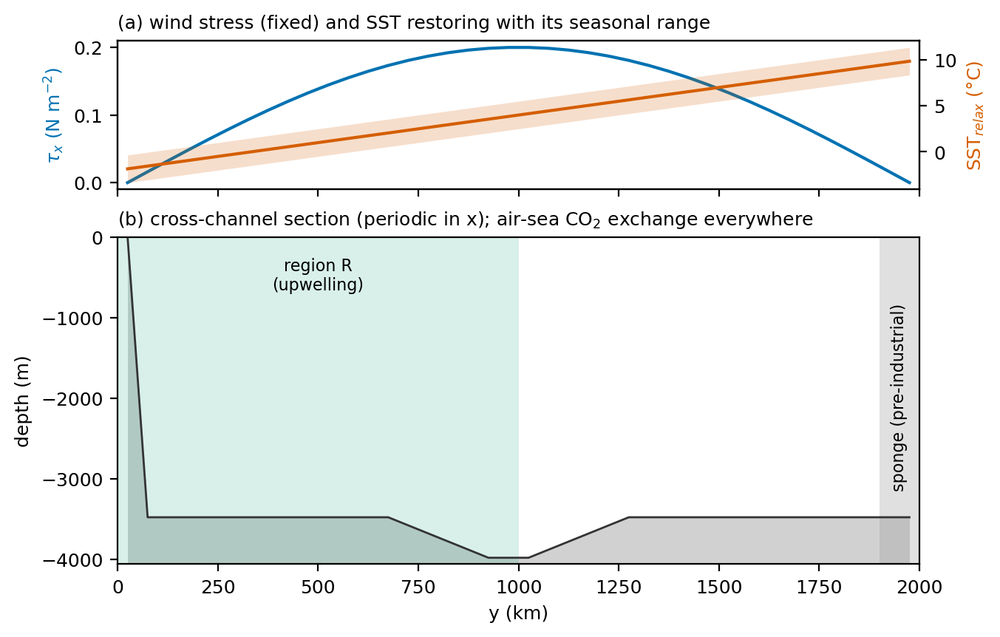
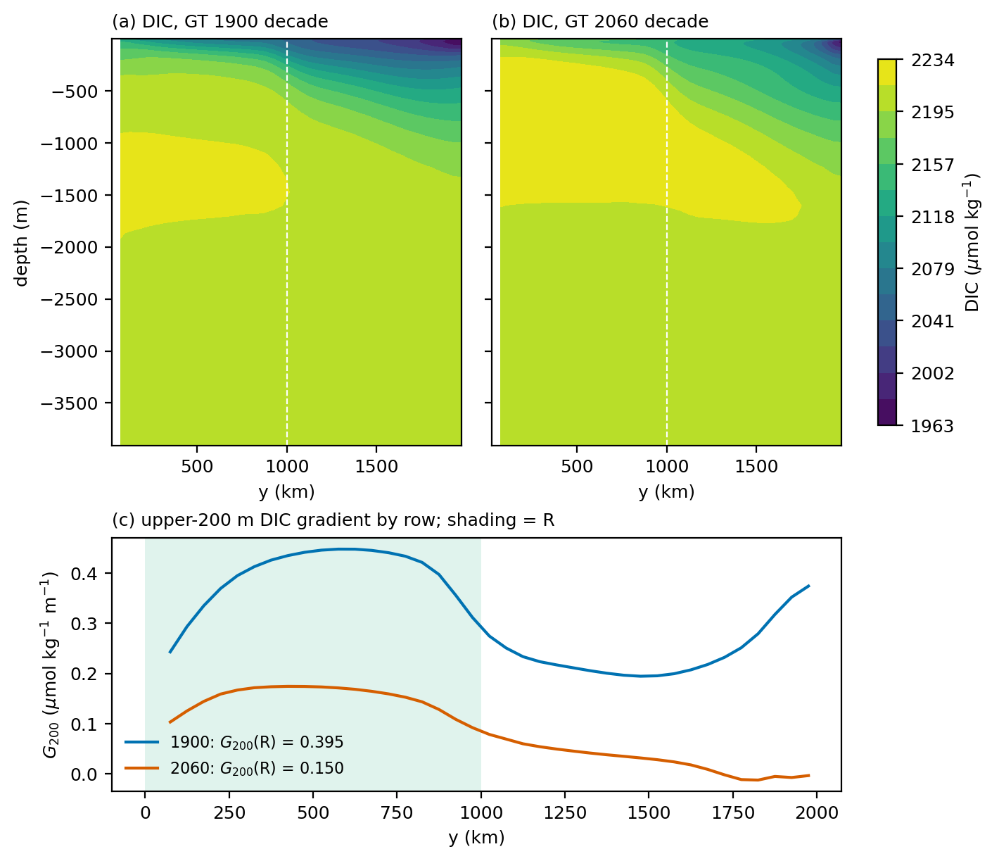
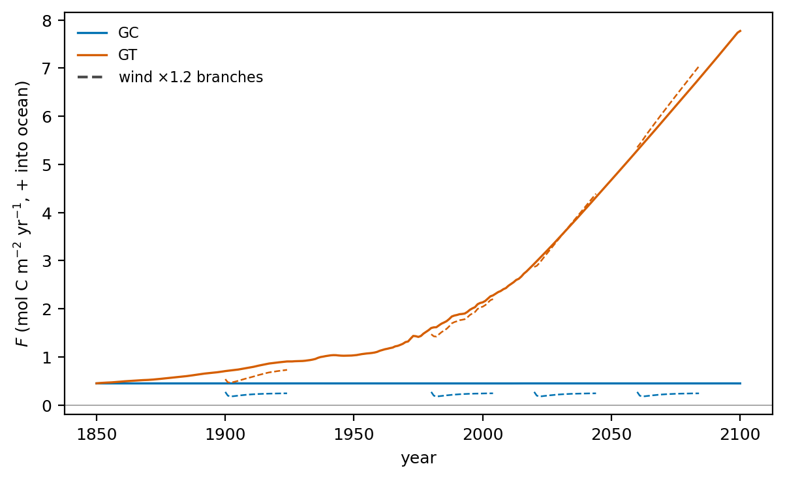
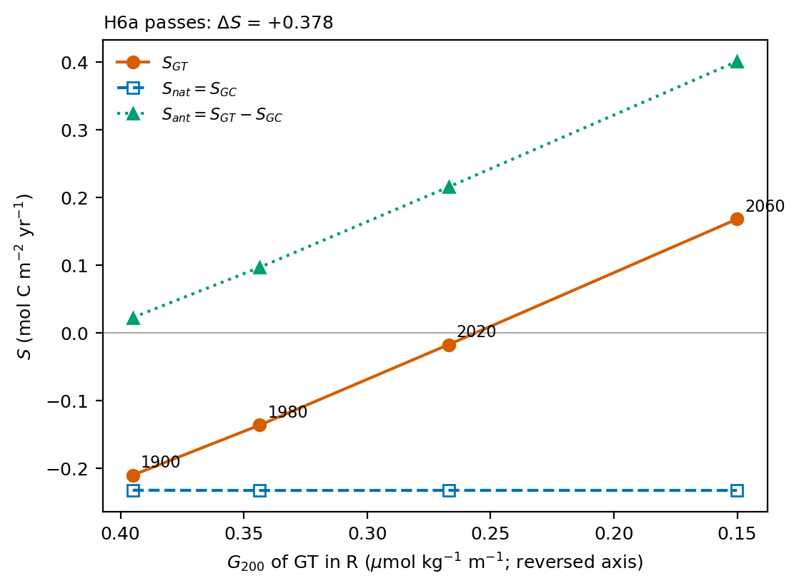
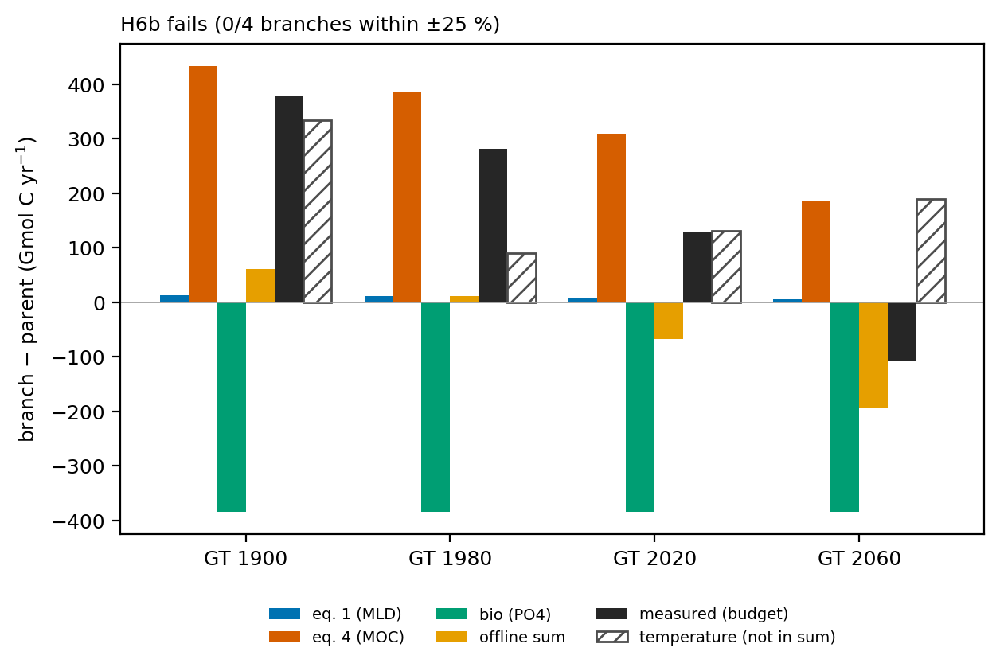

# Experiment 6 — Does anthropogenic carbon weaken the wind sensitivity of the Southern Ocean CO₂ sink? An online test in an idealized channel

<!-- Rendered by scripts/render_readme.py: every number below comes from figures/*.json, cases.yaml
or the analysis constants. Edit README.template.md, never README.md. -->

## Abstract

Stronger westerlies over the Southern Ocean bring more carbon-rich deep water to the surface and, in the pre-industrial ocean, release CO₂. Jarníková et al. (2025) infer, from an offline decomposition of surface DIC in an Earth system model (UKESM1), that this wind response weakens as anthropogenic carbon accumulates near the surface and erodes the vertical gradient of dissolved inorganic carbon (DIC). We test that inference online, in the idealized re-entrant channel of the MITgcm tutorial (50 km, Gent–McWilliams eddies) coupled to `pkg/dic`. A control run at the 1850 atmospheric CO₂ (GC) and a transient run under historical and SSP3-7.0 CO₂ (GT) share a spin-up of 1000 tracer years. From both, the zonal wind stress is stepped up by a factor of 1.2 in 1900, 1980, 2020 and 2060, and the sensitivity S is the change of the air–sea flux over branch years 6–15. Between the 1900 and 2060 branches the upper-200 m DIC gradient in the upwelling region falls by 62 %. The wind sensitivity of the transient run changes by ΔS = +0.378 mol C m⁻² yr⁻¹, against a control drift of 3.0 × 10⁻⁴, so the registered hypothesis H6a passes. The offline decomposition of Jarníková et al. (eqs. 1 and 4, with a phosphate-based biological term) reproduces the measured change of the mixed-layer carbon budget within ±25 % in zero of the four branches (H6b fails). In a 10-km eddy-permitting version, H6c [pending].

## 1. Question and design

The Southern Ocean takes up a large share of the anthropogenic CO₂ that enters the ocean, and its sink varies with the westerly winds (Le Quéré et al. 2007; Lovenduski et al. 2008; Gruber et al. 2019). Stronger westerlies drive more upwelling of old, DIC-rich deep water, from which natural carbon outgasses (Lovenduski et al. 2008). The upwelled water, which holds little anthropogenic carbon, also takes up more anthropogenic CO₂; in ACCESS-OM2 this extra uptake offsets about a third of the extra outgassing (Menviel & Spence 2024).

Jarníková et al. (2025) decompose the response of surface DIC in UKESM1 into mixed-layer entrainment (their eq. 1), upwelling by the overturning circulation (eq. 4) and the supply of iron and the biological response (eqs. 2, 3 and 5). They identify three compensating factors: the erosion of the vertical DIC gradient by anthropogenic carbon, which shrinks the outgassing term; a shoaling mixed layer that offsets a stronger overturning; and the recovery of stratospheric ozone, which reverses part of the wind trend. Their inference is offline: the gradients of one state are combined with the circulation change of another.

We isolate the first factor and ask whether it holds when circulation and carbon evolve together, online. The wind change is imposed as a step, and there is no ozone forcing. Three hypotheses were registered before the transient run started (`notes/pd0_preregistro.md`):

- **H6a.** The wind sensitivity of the transient run moves toward uptake between the 1900 and 2060 branches, ΔS = S_GT(2060) − S_GT(1900) > 0, and by more than twice the drift of the control, |S_GC(2060) − S_GC(1900)|.
- **H6b.** In each of the four transient branches, the offline sum (eq. 1 + eq. 4 + a biological term with phosphate in place of iron) is within ±25 % of the measured change of advection, mixing and biology in the mixed-layer DIC budget of the upwelling region.
- **H6c.** In the eddy-permitting model, the same ΔS is detectable (|ΔS| > 2σ over the members), has the sign of the coarse ΔS, and is within a factor [0.5, 2] of it.

Validation tests V6a–V6d have thresholds fixed in the same document; a failure is reported as a failure, and failures are classified as (a) our error, (b) missing physics, (c) a numerical choice or (d) an error in the reference.

## 2. Configuration

The channel is the re-entrant channel of Abernathey et al. (2011) as distributed in the MITgcm tutorial `tutorial_reentrant_channel` (Fig. 0): 1000 km periodic in x, 2000 km closed in y, 49 levels, with the tutorial's zonal wind stress, its sloping southern boundary and its restoring of surface temperature. We add a seasonal cycle to the restoring temperature (Fig. 0a) and to the light, so that the winter mixed layer deepens and the entrainment term of Jarníková et al. has something to act on. Carbon is carried by `pkg/dic` with six tracers (DIC, alkalinity, phosphate, dissolved organic phosphorus, oxygen and preformed phosphate); there is no iron, no explicit ecosystem and no sea ice. Gas exchange uses a fixed wind speed, so a change of the wind stress acts on the carbon only through the circulation. The northern rows are a sponge that restores the tracers to pre-industrial profiles. The analysis region R is the southern 19 rows (y < 1000 km), where the upper overturning cell upwells.

**Fig. 0.** Geometry and forcing. (a) Zonal wind stress and the restoring temperature with its seasonal range. (b) Depth, the region R and the pre-industrial sponge.

The coarse model (50 km, time step 1000 s) parameterizes eddies with Gent–McWilliams and Redi. Its spin-up (G0) accelerates the tracers by a factor of 4 against the momentum (Bryan 1984) for 1000 tracer years, followed by 48 synchronous years (G0s), about the length Wang (2001) found sufficient after an asynchronous equilibrium. The drift in the last century of G0 is 2.4 × 10⁻⁵ mol C m⁻² yr⁻¹ in the channel-mean flux and 1.3 × 10⁻⁴ µmol kg⁻¹ in the DIC below the thermocline, so V6a passes; over G0s it is 2.1 × 10⁻⁴ and 2.2 × 10⁻³. At equilibrium the upper cell carries 0.38 Sv out of R (100 % of its maximum, reached at the edge of R), the winter mixed layer in R reaches 752 m in September, and the channel takes up 0.45 mol C m⁻² yr⁻¹ at the pre-industrial CO₂. The share of the cell's growth that lies inside R is 81 %; the rest is noise on the plateau north of R, not upwelling.

GC holds the atmospheric CO₂ at its 1850 value for 251 years; GT follows the CMIP6 historical concentrations (Meinshausen et al. 2017) and then SSP3-7.0 (Meinshausen et al. 2020) to 2100. Each branch starts from the parent's state on 1 January of its year, multiplies the wind stress by 1.2 and runs 25 years. The budget of the annual channel DIC closes to 3.7 × 10⁻⁶ of the surface flux (V6b passes).

## 3. Method

**Sensitivity.** F is the channel-mean `DICCFLX` in mol C m⁻² yr⁻¹, positive into the ocean, and S(t_b) is the mean of F_branch − F_parent over branch years 6–15. Following Lovenduski et al. (2008), S_nat = S_GC and S_ant = S_GT − S_GC.

**Gradients.** G₂₀₀ = [DIC(200 m) − DIC(surface)]/200 m and ΔDIC₁₀₀₀ = DIC(1000 m) − DIC(surface), over R, in the decade of the parent centred on the branch year (Jarníková et al. 2025, eqs. 1 and 4).

**Offline decomposition.** With the parent's gradients and the branch-minus-parent changes of the winter mixed-layer depth δMLD and of the upwelling δMOC (residual overturning in temperature layers, including the GM bolus), the terms in mol C yr⁻¹ are δMLD × G₂₀₀ × ρ₀ × A_R (eq. 1), δMOC × ΔDIC₁₀₀₀ × ρ₀ (eq. 4), and −R_CP × e × (the extra phosphate supply by the same two routes), with R_CP = 117 and e the export fraction of the supplied phosphate in the parent. The measured counterpart is the branch-minus-parent change of advection + mixing + biology in the DIC budget of the mixed layer of R, from the model's own tendency diagnostics. A temperature term, the change of the flux from the branch-minus-parent surface temperature alone (carbonate chemistry of `pkg/dic`), acts through gas exchange rather than circulation; it is reported but not added to the sum.

## 4. Results

### 4.1 The gradient erodes

**Fig. 1.** DIC in GT, zonal mean, in the decades centred on (a) 1900 and (b) 2060; (c) G₂₀₀ by row, with R shaded.

Anthropogenic carbon enters at the surface and raises the DIC of the upper ocean, while the deep water that upwells in R changes little over the run, so the vertical contrast shrinks (Fig. 1). Over R, G₂₀₀ falls from 0.395 to 0.150 µmol kg⁻¹ m⁻¹ between the 1900 and 2060 decades.

**Fig. 2.** Channel-mean air–sea flux of GC, GT and the wind branches (dashed).

### 4.2 H6a: the wind sensitivity

**Fig. 3.** Wind sensitivity of each branch against the parent's G₂₀₀ in R: S_GT, S_nat = S_GC and S_ant = S_GT − S_GC.

| Branch | G₂₀₀ | S_GT | S_nat | S_ant |
|---|---|---|---|---|
| 1900 | 0.395 | −0.210 | −0.233 | +0.022 |
| 1980 | 0.344 | −0.137 | −0.233 | +0.097 |
| 2020 | 0.267 | −0.018 | −0.233 | +0.215 |
| 2060 | 0.150 | +0.168 | −0.233 | +0.401 |

**Table 1.** G₂₀₀ in µmol kg⁻¹ m⁻¹; S in mol C m⁻² yr⁻¹, positive = more uptake under the stronger wind.

ΔS = +0.378 mol C m⁻² yr⁻¹ (180 % of |S_GT(1900)|), against a control drift of 3.0 × 10⁻⁴: H6a passes. S_GT changes sign in the 2060 branch.

The whole change is in S_ant. S_nat, the response of the control, is the same in every branch, as it should be: the control has the same circulation and the same atmospheric CO₂ in every branch year. Under the stronger wind the transient channel loses less carbon than the control from the first branch on, and in the last branch it takes up more than it did before the wind step. The change has the direction that Jarníková et al. (2025) infer for UKESM1, but in this channel it is large enough to reverse the sign of the response.

### 4.3 H6b: the offline decomposition

**Fig. 4.** Offline terms against the measured change of the mixed-layer budget of R, per transient branch. The temperature term (hatched) is not part of the sum.

| Branch | eq. 1 (MLD) | eq. 4 (MOC) | bio (PO₄) | measured | offline / measured | temperature |
|---|---|---|---|---|---|---|
| 1900 | +12.4 | +433.0 | −384.6 | +377.1 | 0.16 | +334.1 |
| 1980 | +10.8 | +384.4 | −384.6 | +281.2 | 0.04 | +89.5 |
| 2020 | +8.4 | +309.0 | −384.6 | +128.5 | −0.52 | +131.1 |
| 2060 | +4.7 | +185.1 | −384.6 | −109.1 | 1.79 | +189.5 |

**Table 2.** Branch − parent, Gmol C yr⁻¹, positive = DIC added to the mixed layer of R.

The offline sum is within ±25 % of the measured change in zero of the four branches: H6b fails.

**Post hoc (not registered).** Compared term by term (Table 3), the physical and the biological parts fail in different ways.

| Branch | offline physics (eq. 1 + eq. 4) | measured advection + mixing | offline / measured | measured mixing | measured bio |
|---|---|---|---|---|---|
| 1900 | +445.4 | +689.1 | 0.65 | +161.8 | −312.0 |
| 1980 | +395.1 | +593.1 | 0.67 | +141.6 | −311.9 |
| 2020 | +317.4 | +440.5 | 0.72 | +95.9 | −312.0 |
| 2060 | +189.7 | +202.9 | 0.94 | −1.2 | −311.9 |

**Table 3.** As Table 2, with the measured change split into its physical and biological parts (post hoc).

- **Biology.** The phosphate-based term is the same in every branch, and so is the measured biological change: neither the circulation nor phosphate depends on CO₂. The offline term overestimates it in every branch.
- **Physics.** The offline sum of eqs. 1 and 4 declines as G₂₀₀ erodes, as does the measured supply, which is the mechanism proposed by Jarníková et al. (2025). However, it recovers only part of the measured supply in the early branches, and only part of its decline. Most of the gap is mixing: in the budget it falls from +161.8 to −1.2 Gmol C yr⁻¹ between the 1900 and 2060 branches, while eq. 1, which sees only the change of mixed-layer depth, gives +12.4 and +4.7.
- **The sum.** The physical and biological changes have opposite signs and similar sizes, so modest errors in each become large errors in their sum.

The decomposition gets the direction of the change right but not its size. We classify the failure tentatively as (d), a process the offline decomposition does not represent (the change of diapycnal and eddy mixing under the stronger wind). An error of class (a) in our implementation of eq. 1 is not excluded.

### 4.4 H6c: eddies

**Fig. 5.** Wind sensitivity of the 10-km members and of the coarse model in the 1900 and 2060 branches.

The 10-km model, without GM, starts from the coarse state of GT in 1900 and 2060 and runs three control/wind pairs of 15 years each. Its ΔS is [pending] mol C m⁻² yr⁻¹ against a detection threshold of [pending], and [pending] times the coarse ΔS: H6c [pending].

## 5. Limitations

- **Missing physics.** There is no iron, which limits Southern Ocean productivity, no explicit ecosystem (the biology of `pkg/dic` is a nutrient-restoring export, a null hypothesis for the biological term), no sea ice and no ozone forcing. The biological term of H6b therefore uses phosphate where Jarníková et al. use iron.
- **The sponge.** The northern sponge restores to pre-industrial profiles, so anthropogenic carbon enters the channel only through the surface; the lateral supply of anthropogenic carbon from the north is missing. A sensitivity run with an anthropogenic sponge was cut from the scope for time.
- **Resolution.** At 10 km the eddies are only partly resolved, and the fine branches are short; H6c tests the sign and the order of magnitude, not the eddy compensation itself.
- **The temperature term.** The temperature term uses an empirical conductance: the parent's air–sea flux over R divided by its mean air–sea pCO₂ difference. In the first branch that difference is small, so the conductance, and with it the temperature term, is poorly conditioned. The term is reported but not used in any verdict.
- **Idealization.** One channel, one wind profile and a fixed gas-exchange wind; the step in wind stress is a sensitivity experiment, not a scenario.

## 6. Reproducibility

`reproduce.sh --check` lists every step; `reproduce.sh --quick` regenerates the evaluation, figures and this README from existing runs. Configuration: `cases.yaml`; inputs: `gendata/`; pre-registration and decisions: `notes/` (in Spanish).

## References

Abernathey, R., J. Marshall, and D. Ferreira, 2011: The dependence of Southern Ocean meridional overturning on wind stress. *J. Phys. Oceanogr.*, **41**, 2261–2278, https://doi.org/10.1175/JPO-D-11-023.1

Bryan, K., 1984: Accelerating the convergence to equilibrium of ocean-climate models. *J. Phys. Oceanogr.*, **14**, 666–673, https://doi.org/10.1175/1520-0485(1984)014%3C0666:ATCTEO%3E2.0.CO;2

Gruber, N., P. Landschützer, and N. S. Lovenduski, 2019: The variable Southern Ocean carbon sink. *Annu. Rev. Mar. Sci.*, **11**, 159–186, https://doi.org/10.1146/annurev-marine-121916-063407

Jarníková, T., et al., 2025: Decreasing importance of carbon-climate feedbacks in the Southern Ocean in a warming climate. *Sci. Adv.*, **11**, eadr3589, https://doi.org/10.1126/sciadv.adr3589

Le Quéré, C., et al., 2007: Saturation of the Southern Ocean CO₂ sink due to recent climate change. *Science*, **316**, 1735–1738, https://doi.org/10.1126/science.1136188

Lovenduski, N. S., N. Gruber, and S. C. Doney, 2008: Toward a mechanistic understanding of the decadal trends in the Southern Ocean carbon sink. *Global Biogeochem. Cycles*, **22**, https://doi.org/10.1029/2007GB003139

Meinshausen, M., et al., 2017: Historical greenhouse gas concentrations for climate modelling (CMIP6). *Geosci. Model Dev.*, **10**, 2057–2116, https://doi.org/10.5194/gmd-10-2057-2017

Meinshausen, M., et al., 2020: The shared socio-economic pathway (SSP) greenhouse gas concentrations and their extensions to 2500. *Geosci. Model Dev.*, **13**, 3571–3605, https://doi.org/10.5194/gmd-13-3571-2020

Menviel, L., and P. Spence, 2024: Southern Ocean circulation's impact on atmospheric CO₂ concentration. *Front. Mar. Sci.*, **10**, 1328534, https://doi.org/10.3389/fmars.2023.1328534

Wang, D., 2001: A note on using the accelerated convergence method in climate models. *Tellus A*, **53**, 27–34, https://doi.org/10.3402/tellusa.v53i1.12179
